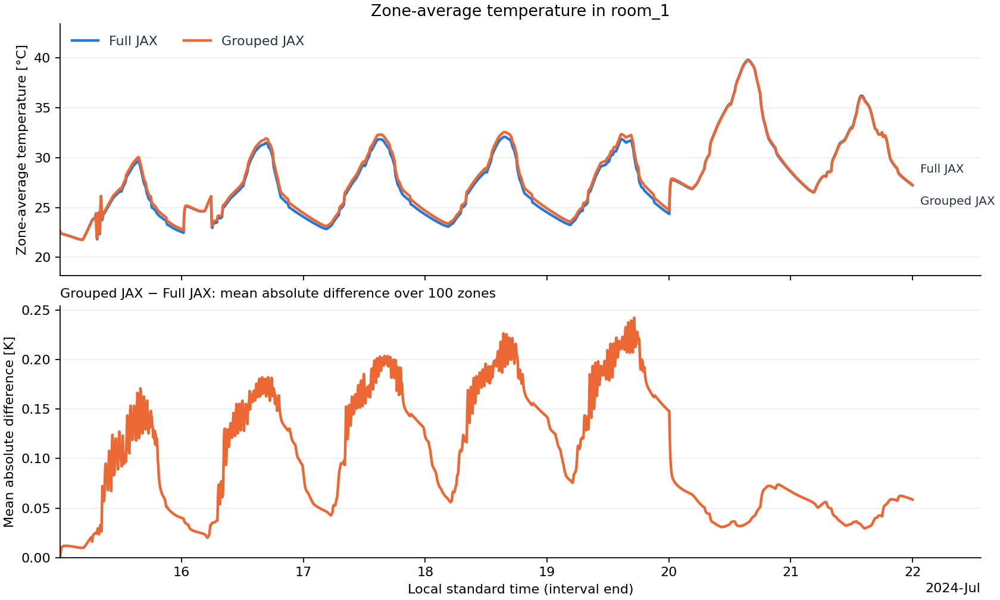
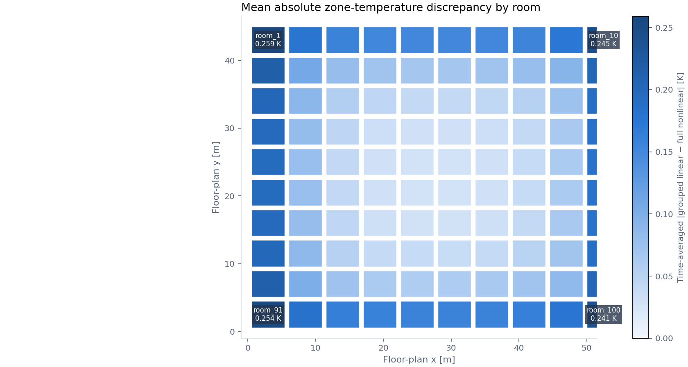
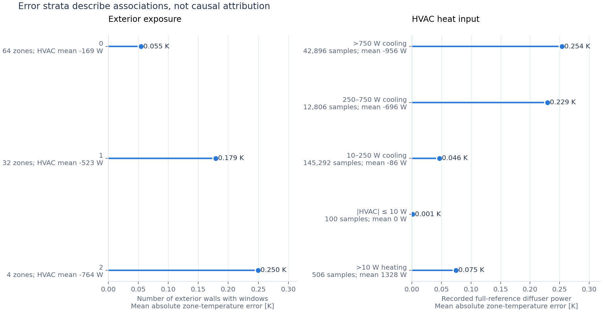
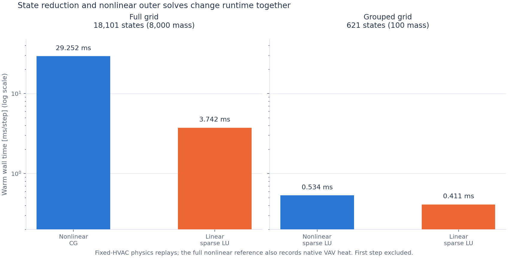

# Detailed Full JAX versus Grouped JAX Analysis

**English** | [한국어](GROUPED_FULL_ANALYSIS_ko.md)

## 1. Answer in one page

For the saved 100-zone, seven-day Chicago case, the **0.102 K overall MAE is
mainly associated with model reduction, not with the fourth-power longwave
approximation**. The evidence is:

1. On the full grid, linear versus nonlinear longwave treatment gives a
    **0.000124760 K MAE**.
2. On the same grouped grid, restoring the nonlinear outer iteration gives a
    grouped-nonlinear versus grouped-linear **0.000131440 K MAE**. Grouped
    nonlinear versus full nonlinear still has **0.102188210 K MAE**.
3. Thus, making the grouped longwave solve nonlinear does **not** remove the
    approximately 0.102 K group-versus-full discrepancy.

The large afternoon cooling peaks are not a preprocessing averaging error. Every
temperature compared below is the **zone-average temperature produced by its own
model**. Grouped JAX solves reduced unknowns; it does not solve the full
18,101-state trajectory and merely average it afterward.

The tail is spatial and temporal:

| Quantity                           | Grouped linear − full nonlinear |
| ---------------------------------- | ------------------------------: |
| Samples, `2,016 times × 100 zones` |                         201,600 |
| Signed mean                        |                     +0.099815 K |
| MAE                                |                      0.102185 K |
| RMSE                               |                      0.150530 K |
| Median absolute error              |                      0.059092 K |
| 90th percentile absolute error     |                      0.303030 K |
| 95th percentile absolute error     |                      0.350005 K |
| 99th percentile absolute error     |                      0.434144 K |
| Maximum absolute error             |                      0.559672 K |
| Negative signed errors             |                          4.036% |
| Absolute error > 0.2 K             |                         17.889% |
| Absolute error > 0.4 K             |                          1.868% |

The mostly positive signed error explains why the bias, +0.099815 K, is close to
the MAE, 0.102185 K. It does not imply that every grouped-zone temperature is
too warm.

**Scope:** This is one saved summer week with one floor plan, seed, control
schedule, weather file, and solver configuration. It is not a general bound for
other weather, buildings, control sequences, or grouping settings.

## 2. What is actually being compared

The primary artifacts are the immutable inputs
[`results/restructure_cpu/physics.npz`](results/restructure_cpu/physics.npz) and
[`results/restructure_cpu/summary.json`](results/restructure_cpu/summary.json).
The source run starts on **2024-07-15**, lasts seven days, uses five-minute
steps on logical CPU 8, JAX 0.4.34, and the Chicago O'Hare TMY3 EPW. The final
sample at 2024-07-22 00:00 local time is the endpoint of the 2,016th interval.

The reference full-JAX run natively updates the VAVs, records its diffuser heat,
and advances nonlinear heat balances. Full linear and grouped linear replay
**the same recorded heat, zone order, weather, material configuration, and
initial state**, rather than recomputing the controller.

| Path                         | Grid and total states | Solver / radiation    | Control                   |         Warm ms/step and linear solves         |
| ---------------------------- | :-------------------: | --------------------- | ------------------------- | :--------------------------------------------: |
| Full nonlinear reference     |        18,101         | CG / nonlinear        | Native VAV, heat recorded | 29.252; 2 solves × 478 steps, 3 solves × 1,538 |
| Full linear                  |        18,101         | Sparse LU / linear    | Identical recorded heat   |             3.742; 1 solve × 2,016             |
| Grouped linear               |          621          | Sparse LU / linear    | Identical recorded heat   |             0.411; 1 solve × 2,016             |
| Grouped nonlinear supplement |          621          | Sparse LU / nonlinear | Same recorded heat again  |    0.534; 2 solves × 532, 3 solves × 1,484     |

Warm means exclude the first step. The full nonlinear reference includes native
VAV evaluation and heat recording; the other three rows are heat replays.
Absolute runtimes must therefore be interpreted with their measurement scope.
The supplementary NPZ records `prepared_nonlinear=True`, sparse LU, the two
state counts, timestamps, zone order, and hashes of both source artifacts.

### States include their mass nodes

A reported `thermal_nodes` count already includes the mass portion of the
storage vector. It must not be added to `mass_nodes` again. At 100 zones:

- Full: **18,101 = 10,101 air/envelope states + 8,000 mass states**.
- Grouped: **621 = 521 air/envelope states + 100 mass states**.

The actual group map, not just the room count, determines those totals. The
default air grouping generally creates one connected-air unknown per zone.
Envelope grouping uses material, adjacency signature, wall depth, and connected
run information. Interior mass is represented by one effective unknown per air
group, with capacity and air coupling aggregated over the contributing cells.
Mass and envelope are not simply discarded. What changes is the allowed spatial
temperature variation within each group.

For group matrix $P$, the projected heat balance contains

$$P^\mathsf{T}A_{\rm cv}P,\qquad P^\mathsf{T}b,\qquad \theta=P\phi$$

The full-grid solution is not constrained to $P\phi$. Imposing that subspace
changes the effective heat-capacity, conduction, radiation, and mass response at
different spatial scales. This is the central model-reduction hypothesis;
section 7 explains what still must be isolated experimentally.

The derivative-based linearization is a separate change. At every solve

$$(T^{n+1})^4\approx sT^{n+1}+c^n,\qquad s=4T_{\ast}^3,\qquad c^n=(T^n)^4-sT^n$$

where $T_{\ast}=295.65$ K (22.5 °C) and $T^n$ is the previous temperature. With
the nonlinear option enabled, updated fourth-power terms are iterated. The
grouped supplement selects this option **before matrix preparation**, so it
really uses 2–3 sparse-LU solves per step rather than being a renamed linear
trajectory. See [the heat-balance guide](HEAT_BALANCE_EQUATIONS.md) for the
equation-level implementation.

### Why conserving heat transfer does not reproduce the temperatures

**It is a reduction of spatial state resolution, not a wrong heat-capacity
sum.** The distinction is between preserving aggregate coefficients and
reconstructing the full trajectory. The implementation really does retain
substantial physics:

| Full-grid quantity                                | Grouped counterpart                          | What is not recovered                                                                        |
| ------------------------------------------------- | -------------------------------------------- | -------------------------------------------------------------------------------------------- |
| Cell capacities $C_i$                             | $\sum_{i\in g}C_i$                           | Different thermal histories within $g$                                                       |
| Cell-to-cell conduction matrix                    | $P^\mathsf{T}A_{\rm cv}P$                    | Temperature-dependent flux distribution inside and between cells of one group                |
| Boundary conductance and cell heat inputs         | Group-wise sums                              | Where inside the group the inputs act, and their interaction with unequal local temperatures |
| Interior mass capacity and air conductance        | One effective mass per air group             | The distribution and time histories of individual mass temperatures                          |
| Per-face emissive area and room radiation factors | Aggregated group faces and gray-area factors | Radiation feedback from the discarded within-group temperature variation                     |

For a group $g$, the model imposes $\theta_i=\phi_g$ for all $i\in g$. If
$\theta=P\phi$, the sum of the reduced balances correctly includes the original
conductances and heat inputs. But that sum is evaluated at the common
temperature $\phi_g$. At a later full-grid step,

$$P^\mathsf{T}A_{\rm cv}\theta=(P^\mathsf{T}A_{\rm cv}P)\phi+P^\mathsf{T}A_{\rm cv}(\theta-P\phi)$$

The second term is generally nonzero when the full temperatures inside a group
have become unequal. Conservation of the first term cannot make that term
vanish. Exterior weather, window exposure, local diffuser heat, and unequal wall
or mass temperatures generate exactly such variations. They then feed back into
the zone's later average state.

The following mental picture is useful: lumping **100 identical surfaces**
exposed to exactly the same air, boundary temperature, and radiation gives no
additional error merely because they share a temperature. The surfaces in this
model do not all have those identical histories and boundary conditions. The
grouping rule may preserve material and adjacency type without guaranteeing an
identical time-varying forcing at each member cell. Nor should one assume that
all thermal gradients are large: the point is that the reduced model cannot
represent them at all.

Radiation makes the distribution issue particularly clear:

$$\frac{1}{n}\sum_i T_i^4\neq\left(\frac{1}{n}\sum_iT_i\right)^4.$$

For equal-capacity cells with temperatures $T_i=\bar T+\delta_i$ and zero-mean
$\delta_i$,

$$\frac{1}{n}\sum_iT_i^4
=\bar T^4+6\bar T^2\operatorname{mean}(\delta_i^2)
+4\bar T\operatorname{mean}(\delta_i^3)
+\operatorname{mean}(\delta_i^4)$$

The zero-mean assumption does not make $\operatorname{mean}(\delta_i^3)$ vanish
in general. For symmetric deviations that third moment is zero, but the
coefficient of $\operatorname{mean}(\delta_i^4)$ is still one, not three.

Equal total wall area and emissivity do not recover the full fourth-power
exchange when $\delta_i\neq0$. This argument concerns the nonlinear radiation
operator; it does **not** contradict the separate measured result that using a
linearized fourth-power approximation on a *fixed grid* is very accurate here.

Similarly, summing all mass capacities and their air-exchange coefficients
preserves an effective first-order heat store, not the full set of coupled
cell-specific modes. If the full solution stayed group-uniform for every time,
the reduction could be exact. Otherwise, representing the aggregate does not
make its dynamics identical. The difference remains visible in a zone-average
output because the discarded spatial variation alters subsequent heat exchange;
it is not merely a problem of losing small-scale visualization detail.

## 3. Linearization versus grouping: measured results

Let $F_N$, $F_L$, $G_L$, and $G_N$ denote full nonlinear, full linear, grouped
linear, and grouped nonlinear zone-average temperatures, respectively.

| Difference |  Bias [K] |     MAE [K] | p95 absolute [K] | Maximum absolute [K] |
| ---------- | --------: | ----------: | ---------------: | -------------------: |
| $F_L-F_N$  | +0.000013 | 0.000124760 |         0.000569 |             0.002152 |
| $G_L-F_L$  | +0.099802 | 0.102188925 |         0.349709 |             0.558641 |
| $G_L-F_N$  | +0.099815 | 0.102185340 |         0.350005 |             0.559672 |
| $G_N-G_L$  | −0.000014 | 0.000131440 |         0.000603 |             0.002222 |
| $G_N-F_N$  | +0.099801 | 0.102188210 |         0.349698 |             0.558606 |

The signed decomposition used in the source report is

$$G_L-F_N=(F_L-F_N)+(G_L-F_L),$$

and its maximum absolute sample-wise identity error is **0.0** for these saved
arrays. With the new supplement one can also write

$$G_N-F_N=(G_L-F_L)+(F_L-F_N)+(G_N-G_L).$$

These are **sample-wise signed identities**, not additive decompositions of MAE,
p95, or maximum absolute error. Different sample errors can cancel. Do not turn
the MAEs into percentages that sum to 100%. In particular, subtracting 0.000125
from 0.102185 does not yield a valid causal attribution between geometry,
radiation, and mass.

What is established here is narrower and strong: in this case, the measured
full-grid and within-grouped-grid radiation-linearization discrepancies are both
around $10^{-4}$ K MAE, while the group-versus-full discrepancy is around
$10^{-1}$ K. That does not measure the separate air, envelope, compact
radiation, and mass-aggregation contributions.

## 4. Direct Full/Grouped zone-average temperature time series

The upper panel directly overlays Full JAX and Grouped JAX in `room_1`, chosen
because it has the largest time-averaged absolute discrepancy. Both curves are
zone-average temperatures in °C, not individual finite-volume cell temperatures.
The lower panel is the mean absolute Full/Grouped difference over all 100 zones
at each time in K:

$$e_{t,z}=|G_{L,t,z}-F_{N,t,z}|,\qquad \mathrm{MAE}(t)=\frac{1}{100}\sum_z e_{t,z}.$$

No percentile curve is included in this plot. The scalar tail statistics above
remain available as numerical summaries, but they do not define either plotted
temperature.



[Exact values used for the plot](results/temperature_comparison_cpu/zone_average_timeseries.csv)
include the interval end, selected zone, both temperatures, its absolute
difference, and the all-zone mean absolute difference. The CSV has 2,016 rows,
one per five-minute interval.

The detailed breakdown shows how concentrated that tail is:

| Slice              |  MAE [K] | Scalar p95 within slice [K] | Mean recorded HVAC [W/zone] |
| ------------------ | -------: | --------------------------: | --------------------------: |
| Monday, July 15    | 0.069410 |                    0.271250 |                     −284.61 |
| Tuesday, July 16   | 0.105183 |                    0.334609 |                     −363.04 |
| Wednesday, July 17 | 0.129444 |                    0.364432 |                     −402.97 |
| Thursday, July 18  | 0.146390 |                    0.381161 |                     −429.99 |
| Friday, July 19    | 0.161550 |                    0.390739 |                     −445.14 |
| Saturday, July 20  | 0.054600 |                    0.114697 |                     −108.38 |
| Sunday, July 21    | 0.048758 |                    0.096588 |                     −111.30 |

The daily CSV also includes the final midnight endpoint as a separate 100-sample
date; it is not a full eighth day. Negative W indicates cooling.

Across all weekdays and weekend days, the same hour-of-day pattern is visible:
04:00 MAE is 0.048163 K, 12:00 is 0.123172 K, 17:00 reaches the hourly maximum
of 0.146986 K, and 18:00 has the largest hourly p95 of 0.428755 K. Mean cooling
falls after 17:00 (17:00 −451.65 W; 18:00 −317.77 W), while error remains high.
That is compatible with stored thermal state and grouped interior response, not
just instantaneous HVAC. The hourly series still cannot prove causation.

The worst mean interval is **2024-07-19 17:10**, with across-zone MAE 0.242126
K, cross-zone p95 0.475649 K, and maximum 0.555900 K. The largest individual
sample is **room_1 at 2024-07-19 18:10**: full 27.621513 °C, grouped 28.181185
°C, difference +0.559672 K, recorded HVAC −1248.851 W. This is a tail event, not
a description of all 201,600 samples. See
[daily](results/grouped_full_analysis/daily_errors.csv),
[hourly](results/grouped_full_analysis/hourly_errors.csv), and
[worst-interval](results/grouped_full_analysis/worst_intervals.csv) tables.

## 5. Where the discrepancy is largest



The four largest room MAEs are the four corners: room_1 0.258950 K, room_91
0.253871 K, room_10 0.245148 K, and room_100 0.240637 K. Actual manifest wall
geometry, rather than room-number arithmetic, gives these exterior groups:

| Number of exterior walls with windows | Zones |  MAE [K] | Scalar p95 [K] | Mean recorded HVAC [W/zone] |
| ------------------------------------: | ----: | -------: | -------------: | --------------------------: |
|                                     0 |    64 | 0.054509 |       0.138130 |                     −169.22 |
|                                     1 |    32 | 0.179104 |       0.378342 |                     −523.50 |
|                                     2 |     4 | 0.249652 |       0.486976 |                     −764.38 |

Exterior exposure and HVAC cooling change together. It would be incorrect to
attribute the whole exterior-category increase to grouping walls. Nor does this
show that windows themselves are the only cause. HVAC magnitude, solar and
outdoor boundary conditions, wall conduction, shared indoor radiation, thermal
mass, and prior temperature states are confounded.

The recorded same-model forcing gives a second view of the association:

| Recorded full-reference diffuser power | Time × zone samples | Grouped − full MAE [K] |
| -------------------------------------- | ------------------: | ---------------------: |
| Cooling > 750 W                        |              42,896 |               0.253628 |
| Cooling 250–750 W                      |              12,806 |               0.229328 |
| Cooling 10–250 W                       |             145,292 |               0.046433 |
| $                                      |                HVAC |             \\leq10$ W |
| Heating > 10 W                         |                 506 |               0.074688 |

The correlation between absolute error and absolute recorded HVAC power is
**0.837658**. The five bins are mutually exclusive and cover all samples. These
are associations, not regression-controlled causal effects. Cooling is
concentrated in exposed zones and occupied hours; the model discrepancy also
depends on its preceding trajectory.
[Zone statistics](results/grouped_full_analysis/zone_errors.csv),
[exterior groups](results/grouped_full_analysis/exterior_wall_errors.csv), and
[HVAC bins](results/grouped_full_analysis/hvac_load_errors.csv) retain signed
error, p95, maximum, and mean forcing for further checks.



A physically plausible diagnosis is that strong summer cooling creates larger
air–envelope–mass temperature gradients precisely where the reduced model
restricts spatial variation. This is a hypothesis consistent with the
measurements. It has not yet been split into independent air, envelope,
radiation, and mass mechanisms.

## 6. Why the speedup is not one factor

The headline 16.07× timing comparison changes several things at once: full-grid
nonlinear CG, 27.905707 ms/step, versus grouped-grid linear dense, 1.736138
ms/step, in native closed-loop rollouts. State count, repeated radiation solves,
solver implementation, preparation, and host/device transfer all differ. A state
reduction of 29.15× does not itself imply a 16.07× wall speedup.



| Zones | Full total (mass) | Grouped total (mass) | State reduction | Full nonlinear CG [ms/step] | Grouped linear dense [ms/step] | Combined speedup |
| ----: | ----------------: | -------------------: | --------------: | --------------------------: | -----------------------------: | ---------------: |
|    16 |     2,945 (1,280) |             129 (16) |          22.83× |                       5.240 |                          0.797 |            6.58× |
|    36 |     6,565 (2,880) |             253 (36) |          25.95× |                      10.365 |                          1.008 |           10.29× |
|   100 |    18,101 (8,000) |            621 (100) |          29.15× |                      27.906 |                          1.736 |           16.07× |

The controlled fixed-HVAC physics rows offer a cleaner, but still scoped,
comparison:

- Full and grouped **linear sparse LU** both use one direct solve per step.
    Their 3.741974 / 0.410678 warm-time ratio is **9.11×**. For this study's
    constant exterior convection coefficient, the LU factor is prepared and
    cached. This ratio covers repeated cached-factor solves, state reduction,
    and replay bookkeeping, not a new factorization at every step. It is not a
    universal $N^3$ scaling law.
- Within the grouped sparse-LU path, nonlinear radiation iteration changes warm
    time from 0.410678 to **0.534487 ms/step**, about 1.30×. It replaces one
    solve with 2–3 solves. Both measurements exclude the first step and include
    zone-average extraction. Unlike the original grouped-linear timer, the
    nonlinear supplement excludes timestamp assignment and recorded-diffuser
    heat injection; this is a scoped warm-time comparison rather than an exact
    same-boundary timing measurement. The measured temperature difference
    remains only 0.000131 K MAE.
- Full nonlinear CG also has 2–3 outer solves, but its **CG inner iterations**
    are distinct from those outer solves. The saved artifacts do not justify a
    CG-iteration-by-CG-iteration runtime decomposition.

## 7. Separate the physics replay from feedback divergence

The independent `timing` runs each execute their own native VAV controller. The
grouped run is linear dense; the full run is nonlinear CG. Their difference is
**not** another fixed-HVAC approximation measurement:

| Independent grouped timing rollout − full timing rollout |      Value |
| -------------------------------------------------------- | ---------: |
| MAE                                                      | 0.190891 K |
| p95 absolute error                                       | 1.252756 K |
| Maximum absolute error                                   | 7.975712 K |

The large closed-loop tail must not be labeled an 8 K model bias. Grouped minus
full bias is only +0.0000117 K in these independently controlled runs, because
trajectories diverge in both directions. Temperature-dependent control can
change the next heating/cooling path. Nonlinear thermal update or solver
configuration is not interchangeable between this comparison and the grouped
fixed-HVAC replay either.

The measurement that separates the two effects is direct: compare each timing
rollout to its own model's `physics` trajectory.

| Timing rollout − same-model physics trajectory |     MAE [K] | Maximum absolute [K] |
| ---------------------------------------------- | ----------: | -------------------: |
| Full nonlinear CG                              | 0.000000492 |          0.000001907 |
| Grouped linear dense                           |    0.217107 |             7.832302 |

Full timing and full physics replay almost coincide. Grouped timing and grouped
physics do not, because their HVAC inputs diverge after feedback. This
establishes the importance of feedback **path divergence**, but it does not
identify mode switching as the sole cause. The timing rollouts do not store
per-zone VAV mode, supply temperature, and corresponding HVAC heat, so that
mechanism still needs instrumentation. The daily differences and these paired
metrics are recorded in
[`closed_loop_daily_errors.csv`](results/grouped_full_analysis/closed_loop_daily_errors.csv)
and
[`closed_loop_vs_physics.csv`](results/grouped_full_analysis/closed_loop_vs_physics.csv).

## 8. What is measured, and what needs another experiment

| Question                                                                                    | Status supported by this analysis                                                    |
| ------------------------------------------------------------------------------------------- | ------------------------------------------------------------------------------------ |
| Is the 0.102 K MAE caused mainly by simply turning $T^4$ into a line?                       | **No in this case**, from both full-grid and within-grouped nonlinear/linear checks. |
| Are exterior exposure and strong cooling associated with larger errors?                     | **Yes**, strongly in these data, but with confounding.                               |
| Is zone-average behavior responsible for the tail?                                          | Yes: the tail remains after using each model's own zone-average temperature.         |
| Is the exact air-grouping contribution known?                                               | **No.** More reduction experiments are required.                                     |
| Are envelope grouping, compact group radiation, and mass aggregation separately quantified? | **No.** They are mechanisms to isolate, not assigned percentages.                    |
| Is closed-loop mode switching proven to explain the 7.98 K maximum?                         | **No.** Feedback path divergence is measured; its detailed mechanism is not.         |
| Will another building or weather week have the same MAE or speedup?                         | Unknown; these measured values describe this setup only.                             |

The following experiments would complete the attribution, each using a new
output directory and the same recorded reference heat:

1. **Air/mass resolution:** repeat grouped sparse-LU replay using
    `air_block_cells=1`, with other options unchanged. Because grouped mass
    follows its air group, document and separate the coupled mass refinement
    before treating this as a pure air-only experiment.
2. **Envelope-only reduction:** compare full sparse-LU and grouped
    `air_block_cells=1` where air and mass have matching cell resolution. Add
    an explicit envelope-grouping disabling/refinement option if the
    implemented signatures still combine envelope states.
3. **Mass aggregation:** at fixed air and envelope grouping, preserve individual
    mass states in one variant and lump them in another. Do not infer the
    aggregation effect from turning all mass on/off.
4. **Radiation aggregation:** separately retain full-grid indoor radiation and
    its compact projected form under identical spatial states, to distinguish
    spatial reduction from radiation-coupling approximation.
5. **Feedback mechanism:** record setpoints, zone temperature, VAV mode, supply
    flow/temperature, and heat for every model. Mark the first divergent action
    and replay paired heat counterfactually before assigning the large tail to
    mode switching.

These are proposals, not results claimed by the present analysis.

## 9. Reproduce the derived artifacts

Source inputs are read only. The replay refuses an existing output file and the
analysis refuses an existing output directory. Choose new names if these already
exist; do not overwrite the original `restructure_cpu` results. Run from the
repository root and change the pinned logical CPU to one allowed on your host.
External EnergyPlus is not launched by either command.

```bash
SOURCE=benchmarks/grouped_jax_study/results/restructure_cpu
REPLAY=benchmarks/grouped_jax_study/results/grouped_full_nonlinear_replay_repeat.npz
ANALYSIS=benchmarks/grouped_jax_study/results/grouped_full_analysis_repeat
EPW="$HOME/.local/share/sbsim/energyplus-24.2/WeatherData/USA_IL_Chicago-OHare.Intl.AP.725300_TMY3.epw"
test -r "$EPW" && test ! -e "$REPLAY" && test ! -e "$ANALYSIS"
OPENBLAS_NUM_THREADS=1 OMP_NUM_THREADS=1 taskset -c 8 \
  .venv/bin/python -m benchmarks.grouped_jax_study.replay_grouped_nonlinear \
  --source "$SOURCE" --epw "$EPW" --output "$REPLAY"
.venv/bin/python -m benchmarks.grouped_jax_study.analyze_grouped_full \
  --source "$SOURCE" --grouped-nonlinear "$REPLAY" --output "$ANALYSIS"
.venv/bin/python -m pytest -q \
  benchmarks/grouped_jax_study/test_analyze_grouped_full.py \
  benchmarks/grouped_jax_study/test_replay_grouped_nonlinear.py \
  benchmarks/grouped_jax_study/test_analysis_plots.py
```

The reproduction verifies EPW and source SHA-256 hashes, matched timestamps,
diffuser positions, zone order, total and mass state counts, prepared nonlinear
sparse LU, finite temperatures/timing, and multiple outer solves. The provided
artifact is
[`grouped_full_nonlinear_replay.npz`](results/grouped_full_nonlinear_replay.npz).
Its exact source physics SHA-256 starts with `6a7a4965b87d37f6`, stored in full
in `analysis_summary.json`. The analysis also hashes the summary and floor plan
and validates annotations against room names rather than room-number order.

All numbers and figure inputs are reproducible from
[`analyze_grouped_full.py`](analyze_grouped_full.py),
[`replay_grouped_nonlinear.py`](replay_grouped_nonlinear.py), and
[`analysis_plots.py`](analysis_plots.py). The complete statistics are in
[`results/grouped_full_analysis/analysis_summary.json`](results/grouped_full_analysis/analysis_summary.json);
the CSVs are readable alternatives to every plotted quantity. No new full
seven-day benchmark or independent optimizer experiment was run for this
supplement.
