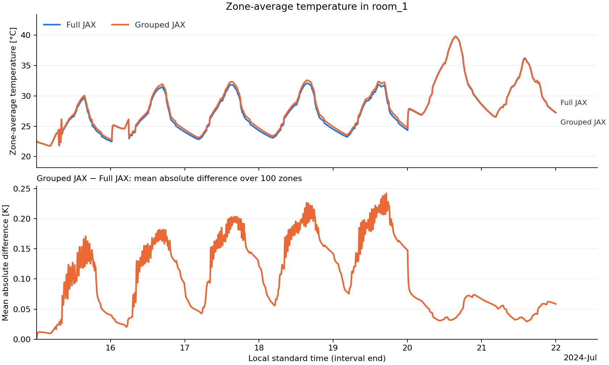
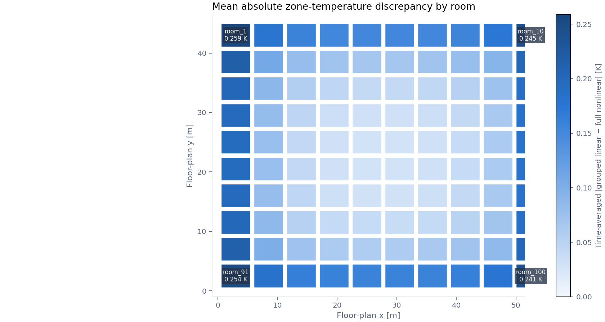
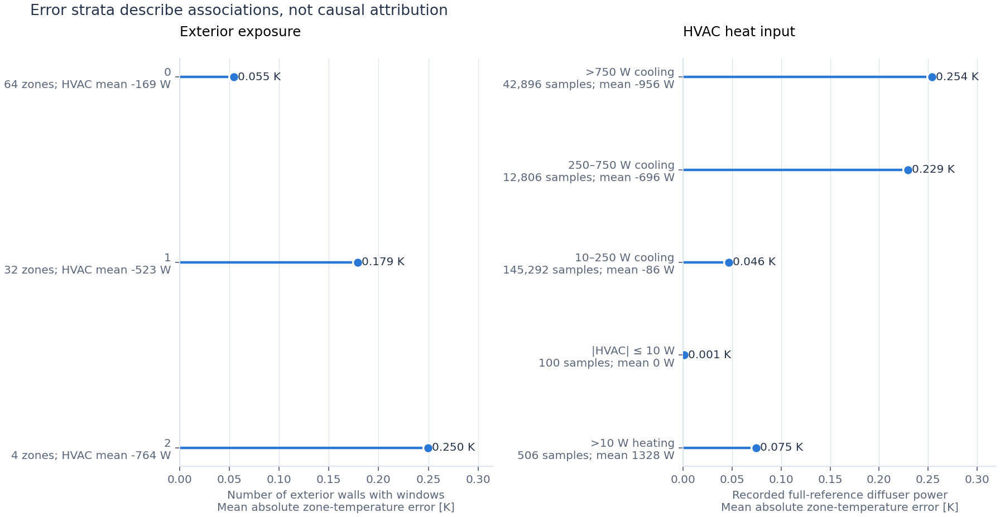
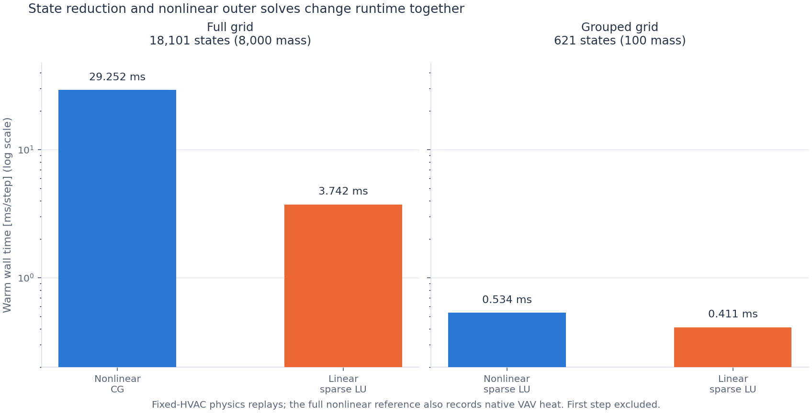

# Full JAX와 Grouped JAX 차이의 상세 분석

**한국어** | [English](GROUPED_FULL_ANALYSIS.md)

## 1. 결론부터

저장된 100존·7일 Chicago 사례에서 **전체 MAE 0.102 K는 주로 공간 모델 축소와 관련되며, 장파 네제곱 근사가 주원인은
아니다.** 실제 측정 근거는 다음과 같다.

1. 같은 full grid에서 장파 선형과 비선형의 MAE는 **0.000124760 K**다.
2. 같은 grouped grid에서 비선형 외부 반복을 되살린 결과, grouped nonlinear와 grouped linear의 MAE는
    **0.000131440 K**다. Grouped nonlinear와 full nonlinear의 MAE는 여전히
    **0.102188210 K**다.
3. 따라서 grouped의 장파 풀이를 비선형으로 바꿔도 약 **0.102 K**의 grouped–full 차이는 사라지지 않는다.

오후 냉방 시간대의 큰 차이는 전처리 평균 오류가 아니다. 아래 비교에 쓰는 온도는 모두 **각 모델이 자기 계산 결과로 만든 존
평균온도**다. Grouped JAX는 full의 18,101개 상태 궤적을 먼저 구하고 나중에 평균하는 것이 아니라, 축소된 미지수를 직접
푼다.

오차는 시간과 공간에 집중되어 있다.

| 항목                           | Grouped linear − full nonlinear |
| ------------------------------ | ------------------------------: |
| 샘플 수, `2,016 시각 × 100 존` |                         201,600 |
| 부호가 있는 평균               |                     +0.099815 K |
| MAE                            |                      0.102185 K |
| RMSE                           |                      0.150530 K |
| 절대오차 중앙값                |                      0.059092 K |
| 절대오차 90백분위수            |                      0.303030 K |
| 절대오차 95백분위수            |                      0.350005 K |
| 절대오차 99백분위수            |                      0.434144 K |
| 최대 절대오차                  |                      0.559672 K |
| 부호가 있는 오차가 음수인 비율 |                          4.036% |
| 절대오차 > 0.2 K               |                         17.889% |
| 절대오차 > 0.4 K               |                          1.868% |

부호가 있는 오차가 대부분 양수이므로 bias +0.099815 K와 MAE 0.102185 K가 비슷하다. 하지만 모든 grouped 존이
항상 덥다는 뜻은 아니다.

**적용 범위:** 이것은 저장된 여름 한 주, 하나의 평면·시드·제어 일정·기상 파일·솔버 구성에 대한 결과다. 다른 날씨, 건물, 제어
시퀀스와 그룹 설정에도 같은 오차나 속도 향상이 일반화된다는 뜻이 아니다.

## 2. 실제로 무엇을 비교했나

원본 입력인
[`results/restructure_cpu/physics.npz`](results/restructure_cpu/physics.npz)와
[`results/restructure_cpu/summary.json`](results/restructure_cpu/summary.json)은
읽기만 했다. 원본 실행은 **2024-07-15**부터 7일, 5분 간격, 논리 CPU 8과 JAX 0.4.34, Chicago O'Hare
TMY3 EPW를 사용한다. 마지막 샘플인 2024-07-22 00:00(현지시각)은 2,016번째 구간의 종료 시각이다.

기준 full-JAX 실행은 자체 VAV를 갱신하고 디퓨저별 열량을 기록하면서 비선형 열수지를 진행한다. Full linear와 grouped
linear는 컨트롤러를 다시 계산하는 대신 **기록된 같은 열량, 존 순서, 기상, 재료 구성, 초기 상태를 재생**한다.

| 경로                        | 격자와 전체 상태 수 | 솔버 / 복사        | 제어                       |           Warm ms/step 및 선형 풀이            |
| --------------------------- | :-----------------: | ------------------ | -------------------------- | :--------------------------------------------: |
| Full nonlinear 기준         |       18,101        | CG / 비선형        | Native VAV, 열량 기록      | 29.252; 2 solves × 478 steps, 3 solves × 1,538 |
| Full linear                 |       18,101        | Sparse LU / 선형   | 기록된 같은 열량           |             3.742; 1 solve × 2,016             |
| Grouped linear              |         621         | Sparse LU / 선형   | 기록된 같은 열량           |             0.411; 1 solve × 2,016             |
| Grouped nonlinear 보조 실험 |         621         | Sparse LU / 비선형 | 같은 기록 열량을 다시 재생 |    0.534; 2 solves × 532, 3 solves × 1,484     |

Warm 평균은 첫 스텝을 제외한다. Full nonlinear 기준은 native VAV 평가와 열량 기록을 포함하고 나머지 셋은 열량
재생이다. 따라서 절대 실행 시간도 각 측정 범위와 함께 해석해야 한다. 보조 NPZ에는 `prepared_nonlinear=True`,
sparse LU, 두 상태 수, 시각, 존 순서와 두 원본의 SHA-256이 기록되어 있다.

### 상태 수에는 이미 질량 노드가 포함된다

`thermal_nodes`는 저장 벡터 전체 크기이며 질량 상태를 이미 포함한다. 여기에 `mass_nodes`를 다시 더하면 안 된다.
100존에서는 다음과 같다.

- Full: **18,101 = 공기·외피 10,101 + 질량 8,000**.
- Grouped: **621 = 공기·외피 521 + 질량 100**.

존 수만이 아니라 실제 그룹 지도가 이 크기를 정한다. 기본 공기 그룹은 일반적으로 존 하나의 연결 공기에 미지수 하나를 둔다. 외피는 재료,
인접 존 signature, 벽 깊이와 연결 구간 정보를 이용해 묶는다. 내부질량은 공기 그룹마다 하나의 유효 미지수로 나타내며, 각 셀의
열용량과 공기 결합을 합산한다. 질량이나 외피를 없앤 것이 아니라, 그룹 안에서 표현할 수 있는 공간 온도 변화를 줄인 것이다.

그룹 행렬을 $P$라 하면 투영 열수지에는 다음이 들어간다.

$$P^\mathsf{T}A_{\rm cv}P,\qquad P^\mathsf{T}b,\qquad \theta=P\phi$$

Full-grid 해에는 $\theta=P\phi$라는 제약이 없다. 이 부분공간을 강제하면 서로 다른 공간 스케일의 유효
열용량·전도·복사·질량 응답이 달라진다. 이것이 공간 축소 가설이며, 아직 개별 기여를 분리하지 못한 부분은 7절에서 구분한다.

장파의 미분 기반 선형화는 별개 변경이다. 매 풀이에서

$$(T^{n+1})^4\approx sT^{n+1}+c^n,\qquad s=4T_{\ast}^3,\qquad c^n=(T^n)^4-sT^n$$

을 쓴다. 여기서 $T_{\ast}=295.65$ K(22.5 °C), $T^n$은 직전 온도다. 비선형 옵션이면 갱신된 네제곱 항으로 외부
반복을 한다. Grouped 보조 실험은 이 옵션을 **행렬 preparation 전에** 지정하며, 실제로 이름만 바꾼 선형 궤적이 아니라
스텝마다 2–3회 sparse-LU 풀이를 했다. 식 수준의 구현은 [열수지 유도 문서](HEAT_BALANCE_EQUATIONS_ko.md)에
있다.

### 왜 열전달을 합산·복원했는데도 온도 오차가 생기나

**공간 상태 해상도를 줄인 것이며, 열용량 합계를 틀린 것이 아니다.** 총 계수와 열원을 보존하는 것과 full 온도 궤적을 복원하는 것은
서로 다른 문제다. 실제 구현이 유지하는 물리량과 잃는 정보를 구분하면 다음과 같다.

| Full-grid 항목                  | Grouped 대응 항목              | 복원하지 못하는 정보                                         |
| ------------------------------- | ------------------------------ | ------------------------------------------------------------ |
| 셀 열용량 $C_i$                 | $\sum_{i\in g}C_i$             | $g$ 안에서 서로 다른 열 이력                                 |
| 셀 사이 전도 행렬               | $P^\mathsf{T}A_{\rm cv}P$      | 같은 그룹 셀 사이 및 주변 셀과의 온도 의존 열류 분포         |
| 경계 컨덕턴스와 셀별 열원       | 그룹별 합                      | 그룹 내부에서 입력되는 위치와 서로 다른 국소 온도의 상호작용 |
| 내부질량 열용량과 공기 컨덕턴스 | 공기 그룹당 유효 질량 하나     | 개별 질량 온도의 분포와 시간 이력                            |
| 면별 방사 면적과 존 복사 인자   | 그룹 면 및 gray-area 인자 합산 | 제거한 그룹 내부 온도 변화가 복사에 되먹이는 영향            |

그룹 $g$에 대해 $\theta_i=\phi_g$를 모든 $i\in g$에 강제한다. 만약 $\theta=P\phi$이면 축소 열수지의 합에
원래 전도와 열원이 올바르게 들어간다. 하지만 그 합은 공통 온도 $\phi_g$에서 평가한다. 후속 full-grid 상태에서는

$$P^\mathsf{T}A_{\rm cv}\theta=(P^\mathsf{T}A_{\rm cv}P)\phi+P^\mathsf{T}A_{\rm cv}(\theta-P\phi)$$

다. 그룹 안의 full 온도가 서로 달라지면 두 번째 항은 일반적으로 0이 아니다. 첫 항의 총량을 보존한다고 이 항까지 없어지는 것은
아니다. 외기, 창의 외피 노출, 국소 디퓨저 열원, 서로 다른 벽·질량 온도가 이런 내부 변화를 만들고, 그 변화가 다음 존 평균 상태에도
영향을 준다.

직관적으로 **동일한 면 100개**가 공기, 경계 온도, 복사 조건과 이력까지 모두 같으면 하나의 온도로 묶어도 새 오차가 생기지 않는다. 이
모델의 면들은 그렇게 모든 이력과 경계 조건이 같지 않다. 재료와 인접 signature를 보존하는 규칙이 셀별 시간변화 강제 입력까지 같다는
뜻은 아니다. 모든 내부 온도 구배가 크다고 단정하는 것도 아니다. 축소 모델이 그것을 표현할 수조차 없다는 것이 핵심이다.

복사에서는 온도 분포 문제가 특히 명확하다.

$$\frac{1}{n}\sum_i T_i^4\neq\left(\frac{1}{n}\sum_iT_i\right)^4.$$

열용량이 같은 셀에서 $T_i=\bar T+\delta_i$, $\operatorname{mean}(\delta_i)=0$이면

$$\frac{1}{n}\sum_iT_i^4
=\bar T^4+6\bar T^2\operatorname{mean}(\delta_i^2)
+4\bar T\operatorname{mean}(\delta_i^3)
+\operatorname{mean}(\delta_i^4)$$

$\operatorname{mean}(\delta_i)$가 0이어도 일반적인 분포에서는
$\operatorname{mean}(\delta_i^3)$까지 0이 되지 않는다. 편차가 대칭이면 이 3차 모멘트는 0이지만,
$\operatorname{mean}(\delta_i^4)$의 계수는 여전히 3이 아니라 1이다.

총 벽 면적과 방사율이 같아도 $\delta_i\neq0$인 full의 네제곱 복사 열교환을 동일하게 복원하지 않는다. 이것은 비선형 복사
연산자에 관한 설명이다. **고정된 격자에서** 네제곱을 선형화한 오차가 이 사례에서 아주 작다는 별도의 측정 결과와 모순되지 않는다.

내부질량의 총 열용량과 공기 열교환 계수를 합쳐도 유효한 1차 열저장소는 보존하지만 개별 셀의 결합 모드 전부를 복원하지는 않는다. Full
해가 모든 시각에 그룹 내부에서 균일하면 축소도 정확할 수 있다. 그렇지 않으면 총량을 대표하더라도 그 동역학이 같다는 보장은 없다. 존
평균온도에서도 차이가 남는 이유는, 제거한 공간 변화가 후속 열교환을 바꾸기 때문이다. 단순히 미세한 시각화 정보만 잃는 문제가 아니다.

## 3. 선형화와 그룹화: 측정으로 분리

Full nonlinear, full linear, grouped linear, grouped nonlinear의 존 평균온도를 각각
$F_N$, $F_L$, $G_L$, $G_N$으로 쓴다.

| 차이      |  Bias [K] |     MAE [K] | p95 절대오차 [K] | 최대 절대오차 [K] |
| --------- | --------: | ----------: | ---------------: | ----------------: |
| $F_L-F_N$ | +0.000013 | 0.000124760 |         0.000569 |          0.002152 |
| $G_L-F_L$ | +0.099802 | 0.102188925 |         0.349709 |          0.558641 |
| $G_L-F_N$ | +0.099815 | 0.102185340 |         0.350005 |          0.559672 |
| $G_N-G_L$ | −0.000014 | 0.000131440 |         0.000603 |          0.002222 |
| $G_N-F_N$ | +0.099801 | 0.102188210 |         0.349698 |          0.558606 |

원본 보고서에 사용한 부호가 있는 분해식은

$$G_L-F_N=(F_L-F_N)+(G_L-F_L)$$

이고, 저장 배열을 샘플별로 검산한 최대 절대 항등식 오차는 **0.0**이다. 새 보조 실험을 포함해 다음도 쓸 수 있다.

$$G_N-F_N=(G_L-F_L)+(F_L-F_N)+(G_N-G_L).$$

이것은 **샘플별 부호가 있는 항등식**이지 MAE·p95·최대 절대오차의 가산 분해가 아니다. 서로 다른 샘플 오차는 상쇄될 수 있다.
MAE를 합이 100%인 백분율로 바꾸면 안 된다. 0.000125를 0.102185에서 뺀다고 형상·복사·질량에 대한 유효한 인과 기여율이
생기지도 않는다.

이 사례에서 입증된 것은 더 좁고 분명하다. Full-grid와 grouped-grid 내부의 복사 선형화 차이는 각각 약 $10^{-4}$ K
MAE인데, grouped–full 차이는 약 $10^{-1}$ K다. 이 결과만으로 공기, 외피, 압축 복사, 질량 집계의 개별 기여율을
측정한 것은 아니다.

## 4. Full JAX와 Grouped JAX의 존 평균온도 시계열

위 패널은 시간평균 절대차이가 가장 큰 `room_1`에서 Full JAX와 Grouped JAX의 곡선을 직접 겹쳐 보여준다. 두 곡선 모두
개별 유한체적 셀이 아니라 각 모델이 계산한 존 평균온도 [°C]다. 아래 패널은 각 시각 100개 존의 평균 절대온도차 [K]다.

$$e_{t,z}=|G_{L,t,z}-F_{N,t,z}|,\qquad \mathrm{MAE}(t)=\frac{1}{100}\sum_z e_{t,z}.$$

이 그림에는 백분위수 곡선이 없다. 위 표의 꼬리 통계는 별도 수치 요약으로 남겨두며, 그림의 온도 곡선 두 개는 그 통계로 계산한 것이
아니다.



[그림에 사용한 실제 값 CSV](results/temperature_comparison_cpu/zone_average_timeseries.csv)에는
5분 구간별 2,016개 행의 종료 시각, 선택 존, 두 모델의 온도, 그 존의 절대차이, 전체 존 평균 절대차이가 들어 있다.

요일별 분해에서 꼬리가 집중된 시간을 확인할 수 있다.

| 구간            |  MAE [K] | 구간 내 scalar p95 [K] | 기록 HVAC 평균 [W/zone] |
| --------------- | -------: | ---------------------: | ----------------------: |
| 7월 15일 월요일 | 0.069410 |               0.271250 |                 −284.61 |
| 7월 16일 화요일 | 0.105183 |               0.334609 |                 −363.04 |
| 7월 17일 수요일 | 0.129444 |               0.364432 |                 −402.97 |
| 7월 18일 목요일 | 0.146390 |               0.381161 |                 −429.99 |
| 7월 19일 금요일 | 0.161550 |               0.390739 |                 −445.14 |
| 7월 20일 토요일 | 0.054600 |               0.114697 |                 −108.38 |
| 7월 21일 일요일 | 0.048758 |               0.096588 |                 −111.30 |

Daily CSV에는 마지막 자정 endpoint가 100개 샘플의 별도 날짜로 들어간다. 완전한 여덟 번째 날이 아니다. 음수 W는 냉방이다.

모든 요일의 시간대별 결과를 보면 04:00 MAE는 0.048163 K, 12:00은 0.123172 K, 17:00이 최고 0.146986
K, 18:00의 p95가 최고 0.428755 K다. 평균 냉방은 17:00 −451.65 W, 18:00 −317.77 W로 줄지만 오차는
크게 남는다. 순간 HVAC뿐 아니라 축적된 열 상태와 grouped 내부 응답도 관련된다는 패턴과 일치하지만, 이 시간 계열만으로 인과를
입증할 수 없다.

평균 오차가 가장 큰 시각은 **2024-07-19 17:10**이며 존 전체 MAE 0.242126 K, cross-zone p95
0.475649 K, 최대 0.555900 K다. 개별 최대 샘플은 **2024-07-19 18:10의 room_1**으로 Full
27.621513 °C, Grouped 28.181185 °C, 차이 +0.559672 K, 기록 HVAC −1248.851 W다. 이것은 꼬리
사건이지 201,600개 전체를 대표하지 않는다. 자세한 값은
[daily](results/grouped_full_analysis/daily_errors.csv),
[hourly](results/grouped_full_analysis/hourly_errors.csv),
[worst-interval](results/grouped_full_analysis/worst_intervals.csv)에 있다.

## 5. 차이가 큰 위치와 조건



존 MAE가 가장 큰 네 곳은 네 모서리인 room_1 0.258950 K, room_91 0.253871 K, room_10 0.245148
K, room_100 0.240637 K다. 방 번호 연산이 아니라 실제 manifest의 벽 geometry를 사용한 분류는 다음과 같다.

| 창이 있는 외벽 수 | 존 수 |  MAE [K] | Scalar p95 [K] | 기록 HVAC 평균 [W/zone] |
| ----------------: | ----: | -------: | -------------: | ----------------------: |
|                 0 |    64 | 0.054509 |       0.138130 |                 −169.22 |
|                 1 |    32 | 0.179104 |       0.378342 |                 −523.50 |
|                 2 |     4 | 0.249652 |       0.486976 |                 −764.38 |

외피 노출과 냉방 부하가 함께 변하므로 외벽 분류의 오차 증가 전부를 벽 그룹화에 돌리면 안 된다. 창 자체가 유일한 원인이라는 뜻도 아니다.
HVAC 크기, 일사와 외기 경계 조건, 벽 전도, 실내 복사, 열질량과 직전 온도 상태가 함께 얽혀 있다.

같은 모델에 기록한 강제 입력으로 나눈 결과도 관련성을 보여준다.

| Full 기준 실행의 기록된 디퓨저 출력 | Time × zone 샘플 | Grouped − full MAE [K] |
| ----------------------------------- | ---------------: | ---------------------: |
| 냉방 > 750 W                        |           42,896 |               0.253628 |
| 냉방 250–750 W                      |           12,806 |               0.229328 |
| 냉방 10–250 W                       |          145,292 |               0.046433 |
| $                                   |             HVAC |             \\leq10$ W |
| 난방 > 10 W                         |              506 |               0.074688 |

절대오차와 기록된 HVAC 절대출력의 Pearson 상관계수는 **0.837658**다. 다섯 bin은 겹치지 않고 전체 샘플을 포함한다.
이것은 교란변수를 통제한 인과 효과가 아니라 관련성이다. 냉방은 외피 노출 존과 재실 시간에 집중되며, 모델 오차도 이전 상태에 의존한다.
[존별 통계](results/grouped_full_analysis/zone_errors.csv),
[외벽 그룹](results/grouped_full_analysis/exterior_wall_errors.csv),
[HVAC bin](results/grouped_full_analysis/hvac_load_errors.csv)에는 부호가 있는 오차, p95,
최대와 평균 강제 입력도 보존했다.



강한 여름 냉방으로 공기–외피–질량의 온도 구배가 커지는 바로 그 조건에서 축소 모델이 공간 변화를 제한한다는 것은 이 측정과 일치하는 물리적
가설이다. 그러나 이를 공기·외피·복사·질량의 독립 메커니즘으로 분해한 것은 아니다.

## 6. 속도 향상을 하나의 요인으로 볼 수 없는 이유

Headline 16.07× 비교는 full-grid nonlinear CG의 27.905707 ms/step과 grouped-grid
linear dense의 1.736138 ms/step을 native closed-loop에서 측정한다. 상태 수, 반복 복사 풀이, 솔버
구현, preparation과 host/device 전송을 함께 바꾼다. 상태 수가 29.15× 준다는 사실이 곧 16.07×의 wall
time을 뜻하지 않는다.



| 존 수 | Full 전체(질량) | Grouped 전체(질량) | 상태 감소 | Full nonlinear CG [ms/step] | Grouped linear dense [ms/step] | 결합 속도 향상 |
| ----: | --------------: | -----------------: | --------: | --------------------------: | -----------------------------: | -------------: |
|    16 |   2,945 (1,280) |           129 (16) |    22.83× |                       5.240 |                          0.797 |          6.58× |
|    36 |   6,565 (2,880) |           253 (36) |    25.95× |                      10.365 |                          1.008 |         10.29× |
|   100 |  18,101 (8,000) |          621 (100) |    29.15× |                      27.906 |                          1.736 |         16.07× |

고정 HVAC physics에서는 더 통제했지만 여전히 범위가 정해진 비교가 가능하다.

- Full과 grouped **linear sparse LU**는 모두 스텝마다 직접 풀이 한 번이다. 3.741974 / 0.410678
    warm 시간 비율은 \*\*9.11×\*\*다. 이 연구의 외기 대류계수는 일정하므로 LU factor를 준비한 뒤 캐시한다. 따라서
    이 비율은 매 스텝 새로 factorization하는 것이 아니라 캐시된 factor를 이용한 반복 풀이, 상태 감소와 replay
    bookkeeping을 측정한 것이며 보편적인 $N^3$ scaling 법칙이 아니다.
- Grouped sparse-LU 안에서 비선형 복사 반복을 켜면 warm 시간이 0.410678에서 **0.534487 ms/step**으로
    약 1.30×가 된다. 한 번 대신 2–3회 푼다. 둘 다 첫 스텝은 제외하고 존 평균 추출은 포함한다. 다만 nonlinear 보조
    재생 타이머는 원래 grouped linear 타이머에 포함된 timestamp 할당과 recorded diffuser 열 주입을
    포함하지 않는다. 따라서 이는 범위를 한정한 warm 시간 비교이며, 완전히 같은 측정 경계의 비교는 아니다. 온도 차이는 여전히 MAE
    0.000131 K다.
- Full nonlinear CG도 외부 반복이 2–3회지만 그 **CG 내부 반복**은 별개다. 저장 결과만으로 CG 반복 하나하나의
    시간까지 분해할 수 없다.

## 7. Physics replay와 폐루프 divergence를 구분

독립적인 `timing` 실행은 각 자신의 native VAV를 실행한다. Grouped는 linear dense, Full은 nonlinear
CG다. 이 둘의 차이를 **고정 HVAC 물리 근사 오차로 또 쓰면 안 된다.**

| 독립 grouped timing rollout − full timing rollout |         값 |
| ------------------------------------------------- | ---------: |
| MAE                                               | 0.190891 K |
| p95 절대오차                                      | 1.252756 K |
| 최대 절대오차                                     | 7.975712 K |

큰 폐루프 꼬리를 8 K의 모델 bias로 부르면 안 된다. 독립 제어 실행의 grouped−full bias는 +0.0000117 K에
불과하며, 궤적이 양 방향으로 달라져 상쇄된다. 온도에 반응하는 제어가 다음 냉난방 경로를 바꾸기 때문이다. 이 비교의 nonlinear 설정과
solver도 grouped 고정 HVAC replay와 서로 바꿔 사용할 수 없다.

효과를 구분하기 위해 각 timing rollout을 자기 모델의 `physics` 궤적과 직접 비교했다.

| Timing rollout − 같은 모델의 physics 궤적 |     MAE [K] | 최대 절대오차 [K] |
| ----------------------------------------- | ----------: | ----------------: |
| Full nonlinear CG                         | 0.000000492 |       0.000001907 |
| Grouped linear dense                      |    0.217107 |          7.832302 |

Full timing과 full physics 재생은 거의 일치한다. Grouped는 HVAC 입력이 피드백을 통해 달라지므로 두 경로가
일치하지 않는다. **피드백 경로 divergence**의 중요성은 측정되었지만 mode switching만이 원인이라고 확인한 것은 아니다.
Timing rollout은 존별 VAV 모드, 공급 온도와 대응 HVAC 열량을 저장하지 않으므로 상세 메커니즘은 계측을 추가해야 한다.
날짜별 차이와 짝 비교는
[`closed_loop_daily_errors.csv`](results/grouped_full_analysis/closed_loop_daily_errors.csv)와
[`closed_loop_vs_physics.csv`](results/grouped_full_analysis/closed_loop_vs_physics.csv)에
기록했다.

## 8. 측정된 사실과 추가 실험이 필요한 가설

| 질문                                                      | 이 분석이 지지하는 상태                                                                |
| --------------------------------------------------------- | -------------------------------------------------------------------------------------- |
| MAE 0.102 K는 단순히 $T^4$를 직선으로 바꿨기 때문인가?    | **이 사례에서는 아니다.** Full-grid와 grouped-grid 내부의 비선형/선형 비교로 확인했다. |
| 외피 노출과 강한 냉방은 큰 오차와 관련되는가?             | **그렇다.** 이 데이터에서 강한 관련성이 있지만 confounding이 있다.                     |
| 존 평균온도를 비교했는데도 꼬리가 남는가?                 | 그렇다. 개별 셀 오차가 아니라 각 모델 자신의 존 평균에서 남는다.                       |
| 공기 그룹화만의 정확한 기여를 알았는가?                   | **아니다.** 추가 축소 실험이 필요하다.                                                 |
| 외피 그룹화, compact 복사, 질량 집계를 각각 정량화했는가? | **아니다.** 분리할 메커니즘이지 배정된 백분율은 없다.                                  |
| 최대 7.98 K의 원인이 mode switching으로 입증됐는가?       | **아니다.** 피드백 경로 divergence는 측정했으나 상세 원인은 미확정이다.                |
| 다른 건물이나 기상 주에도 같은 MAE와 속도 향상인가?       | 알 수 없다. 이 수치들은 이 설정의 측정치다.                                            |

다음은 새 출력 디렉터리에서 같은 기록 기준 열량을 재사용해 기여를 분리하는 실험 제안이며, 현재 보고서가 주장한 결과가 아니다.

1. **공기/질량 해상도:** 다른 설정은 유지하고 `air_block_cells=1`로 grouped sparse-LU replay를
    반복한다. Grouped 질량이 공기 그룹을 따라가므로, pure air-only 실험으로 해석하기 전에 함께 세분화되는 질량도
    구분해야 한다.
2. **외피만 축소:** 공기와 질량이 같은 셀 해상도가 되는 full sparse-LU와 grouped `air_block_cells=1`을
    비교한다. 구현된 signature도 여러 외피 상태를 합치면 외피 그룹화를 끄거나 세분화하는 명시적 옵션을 추가한다.
3. **질량 집계:** 공기·외피 그룹은 고정한 채 개별 질량 상태 유지와 하나로 합산을 비교한다. 질량 전체를 켜고 끈 차이로 집계 효과를
    추정하지 않는다.
4. **복사 집계:** 동일한 공간 상태에서 full-grid 실내 복사와 compact 투영 복사를 따로 유지해 공간 축소와 복사 결합
    근사를 분리한다.
5. **피드백 메커니즘:** 모든 모델의 설정온도, 존 온도, VAV 모드, 공급 유량·온도, 열량을 기록한다. 처음으로 달라진 행동을
    표시하고 기록 열량을 paired counterfactual로 재생한 뒤 mode switching에 큰 꼬리를 돌리는지 판단한다.

## 9. 파생 산출물 재현

원본은 읽기만 한다. Replay는 기존 출력 파일, analysis는 기존 출력 디렉터리를 거부한다. 아래 경로가 존재하면 새 이름을 지정하고
원본 `restructure_cpu` 결과는 덮어쓰지 않는다. 저장소 루트에서 실행하며 논리 CPU 번호는 현재 호스트에서 허용되는 것으로
바꾼다. 두 명령 모두 외부 EnergyPlus를 실행하지 않는다.

```bash
SOURCE=benchmarks/grouped_jax_study/results/restructure_cpu
REPLAY=benchmarks/grouped_jax_study/results/grouped_full_nonlinear_replay_repeat.npz
ANALYSIS=benchmarks/grouped_jax_study/results/grouped_full_analysis_repeat
EPW="$HOME/.local/share/sbsim/energyplus-24.2/WeatherData/USA_IL_Chicago-OHare.Intl.AP.725300_TMY3.epw"
test -r "$EPW" && test ! -e "$REPLAY" && test ! -e "$ANALYSIS"
OPENBLAS_NUM_THREADS=1 OMP_NUM_THREADS=1 taskset -c 8 \
  .venv/bin/python -m benchmarks.grouped_jax_study.replay_grouped_nonlinear \
  --source "$SOURCE" --epw "$EPW" --output "$REPLAY"
.venv/bin/python -m benchmarks.grouped_jax_study.analyze_grouped_full \
  --source "$SOURCE" --grouped-nonlinear "$REPLAY" --output "$ANALYSIS"
.venv/bin/python -m pytest -q \
  benchmarks/grouped_jax_study/test_analyze_grouped_full.py \
  benchmarks/grouped_jax_study/test_replay_grouped_nonlinear.py \
  benchmarks/grouped_jax_study/test_analysis_plots.py
```

재현 과정에서 EPW와 원본 SHA-256, 시각, 디퓨저 위치, 존 순서, 전체·질량 상태 수, prepared nonlinear sparse
LU, 유한한 온도·시간과 여러 외부 반복을 검증한다. 제공 산출물은
[`grouped_full_nonlinear_replay.npz`](results/grouped_full_nonlinear_replay.npz)다.
원본 physics의 SHA-256은 `6a7a4965b87d37f6`로 시작하며 전체 값은 `analysis_summary.json`에 있다.
Summary와 floor plan도 hash하고 방 번호 순서가 아닌 이름으로 annotation을 검증한다.

모든 수치와 그림 입력은 [`analyze_grouped_full.py`](analyze_grouped_full.py),
[`replay_grouped_nonlinear.py`](replay_grouped_nonlinear.py),
[`analysis_plots.py`](analysis_plots.py)로 재생할 수 있다. 전체 통계는
[`results/grouped_full_analysis/analysis_summary.json`](results/grouped_full_analysis/analysis_summary.json)에
있고, 표로 그린 값은 CSV로도 제공한다. 이번 보조 분석에서 새 full 7일 benchmark나 독립 최적화 실험은 다시 실행하지 않았다.
