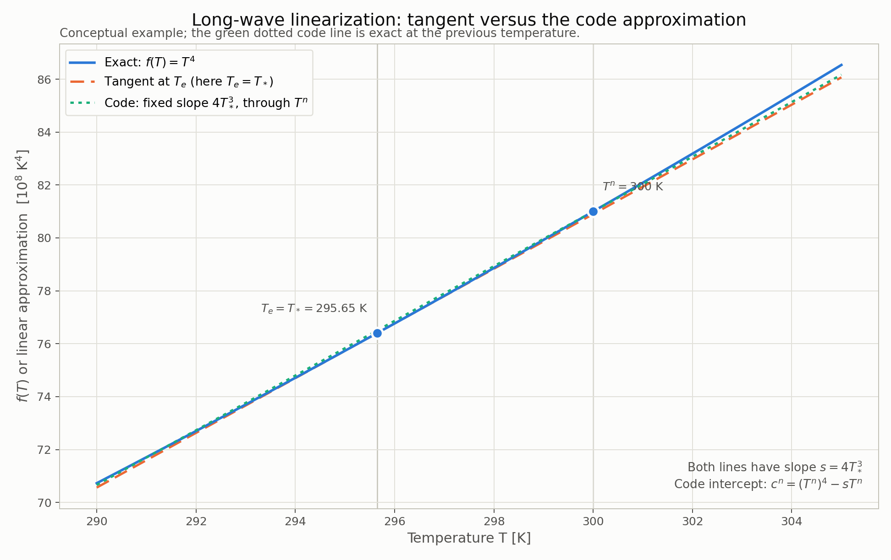

# Matrix Reduction and Longwave-Radiation Linearization of the SBSim Heat Balance

**English** | [한국어](HEAT_BALANCE_EQUATIONS_ko.md)

These equations apply to both the full grid and the grouped grid of
`smart_control.simulator.grouped_jax_simulator.GroupedJaxSimulator`. For groups,
temperatures are constrained to be equal and **the cell-by-cell equations are
summed within each group**. The original grid is used when reading material
properties, areas, and neighbor connections, and when displaying output
temperatures. Solver-specific preparation, the state counts in recent
benchmarks, and result paths are summarized in Section 5.

## 1. Heat Balance on the Original Grid

With temperature as the unknown, the standard notation is $A T^{n+1}=b$. Here,
$T^{n+1}$ is the temperature at the next step, and $b$ represents the previous
temperatures and known heat sources. Before adding longwave radiation and
interior thermal mass, the finite-volume heat balance for cell $i$ is

$$
\frac{C_i}{\Delta t}(T_i^{n+1}-T_i^n) +\sum_{j\sim i}G_{ij}(T_i^{n+1}-T_j^{n+1}) +g_{i,\mathrm{out}}(T_i^{n+1}-T_{\mathrm{out}}) =q_i .
$$

- $C_i=\rho_i c_{p,i}V_i$ is the cell's heat capacity [J/K].
- $G_{ij}$ is the heat-transfer conductance across the shared face [W/K]. The
    code uses the shared area $A_f$ and the half-cell thermal resistances of the
    two cells to calculate $G_{ij}=A_f/(\ell_i/(2k_i)+\ell_j/(2k_j))$. Here,
    $\ell$ is the cell width normal to the face.
- $g_{i,\mathrm{out}}$ is the sum of the heat-transfer paths connected to
    outdoor air. Because outdoor-air temperature is a known boundary value,
    $g_{i,\mathrm{out}}T_{\mathrm{out}}$ appears on the right-hand side.
- $q_i$ is the supplied heat [W]. The heat balance is assembled in `assemble()`
    in `smart_control/simulator/grouped_heat_balance.py`. Shared-face thermal
    resistance is computed through the same path as in the original SBSim.

In the heat-balance matrix $A_{\mathrm{cv}}$ for the grid flattened into one
dimension, the diagonal entries are
$C_i/\Delta t+g_{i,\mathrm{out}}+\sum_j G_{ij}$, and the off-diagonal entries
for neighbors are $-G_{ij}$. At this stage, only cells sharing a face are
connected, so the matrix is sparse.

## 2. Assume Group Temperatures and Reduce the Equations

If there are $N$ active cells and $m$ groups, $P$ is an $N\times m$ binary
sparse matrix. If cell $i$ belongs to group $g$, then $P_{ig}=1$, and all other
entries in that row are zero. Letting $\theta$ denote the group-temperature
vector,

$$
T_{\mathrm{cv}}^{n+1}=P\theta^{n+1}.
$$

Substituting only this relation into the original equations leaves
$A_{\mathrm{cv}}P\theta^{n+1}=b$ with $N$ rows. To obtain one energy balance per
group, **sum the equations for all cells belonging to the same group**. This
summation is multiplication by $P^{\mathsf{T}}$ on the left.

$$
\underbrace{(P^{\mathsf{T}}A_{\mathrm{cv}}P)}_{m\times m}\theta^{n+1} =\underbrace{P^{\mathsf{T}}b}_{m\times 1}.
$$

Solving in this way can leave residuals in the original equations for individual
cells. However, **the residual summed within each group is zero**. On a shared
face between two cells in the same group, heat leaving one cell cancels heat
entering the other. Faces across which heat passes between different groups are
summed. For example, the path between groups $g$ and $h$ is
$G_{gh}=\sum_{i\in g,\; j\in h}G_{ij}$. Storage is likewise
$C_g=\sum_{i\in g}C_i$. If the cells have different initial temperatures, the
group's previous temperature is calculated as a heat-capacity-weighted average
to conserve stored energy.

### Numerical Example

Consider two cells and one wall, with only the first two cells assigned to the
same air group. The values in this example are intended to demonstrate matrix
reduction.

$$
A_{\mathrm{cv}}= \begin{bmatrix}17&-4&-3\\-4&29&-5\\-3&-5&48\end{bmatrix}, \qquad P=\begin{bmatrix}1&0\\1&0\\0&1\end{bmatrix}, \qquad b=\begin{bmatrix}100\\200\\300\end{bmatrix}.
$$

$$
P^{\mathsf{T}}A_{\mathrm{cv}}P= \begin{bmatrix}38&-8\\-8&48\end{bmatrix}, \qquad P^{\mathsf{T}}b=\begin{bmatrix}300\\300\end{bmatrix}.
$$

The 4 W/K term between the air cells disappears, while the 3 W/K and 5 W/K
connections from the two air cells to the wall combine into 8 W/K. The solution
of the 2×2 system is $(9.54545,\; 7.84091)$. Copying these temperatures back to
the cells and substituting them into the original equations gives residuals of
approximately $(+0.56818,\; -0.56818,\; 0)$; the group residuals are zero to
within rounding error.

In the previous 100-zone, 0.50 m office example, $P$ was $10{,}101\times521$,
and the heat-balance system for air, walls, and windows was $521\times521$.
Adding one effective mass state per zone makes the matrix $621\times621$. Groups
may be L-shaped. **Matrix indices are group indices**. If two groups have a
shared face on the original grid, a conduction term is added between those
groups. Groups with multiple neighbors can also be represented in the same
sparse matrix. Indoor longwave radiation also connects surfaces that do not
share a face.

`grouped_heat_balance.assemble()` handles state-wise summation and sparse-matrix
assembly. With `grouped=False`, each active cell has its own temperature state,
so $P$ is effectively the identity matrix. Applying the same boundary faces and
indoor longwave equations in both modes makes it possible to compare the effect
of grouping the grid.

## 3. Longwave-Radiation Matrix

In this section, $T^{\circ4}$ denotes elementwise fourth powers of the
temperature vector. Radiation temperatures are in kelvin. The indoor longwave,
exterior longwave, and interior thermal-mass terms below can each be enabled or
disabled. Using both longwave terms together with mass puts air, walls/windows,
and mass into a single coupled system.

### Indoor Walls, Windows, and Interior Mass

In each zone's radiation enclosure, surface $i$ has area $a_i$ and emissivity
$\epsilon_i$. The current approximation uses area-ratio view factors
$F_{ij}=a_j/\sum_\ell a_\ell$. Consequently, in the expression for the outgoing
radiation flux density $J_i$ from a surface, the incident radiation $H$ is
common to every surface.

$$
J_i=\epsilon_i\sigma T_i^4+(1-\epsilon_i)H, \qquad H=\sum_j\frac{a_j}{\sum_\ell a_\ell}J_j.
$$

Setting $w_i=\epsilon_i a_i$ allows $H$ to be calculated directly from the above
equations.

$$
H=\sigma\frac{\sum_j w_j T_j^4}{\sum_j w_j}, \qquad q_{i,\mathrm{out}}^{\mathrm{LW}} =a_i(J_i-H) =\sigma w_i\left(T_i^4-\frac{\sum_j w_jT_j^4}{\sum_j w_j}\right).
$$

Thus, the net surface emission [W] is $R_{\mathrm{zone}}T^{\circ4}$, where

$$
R_{\mathrm{zone}}=\sigma[\operatorname{diag}(w)-\frac{ww^{\mathsf{T}}}{\sum_i w_i}].
$$

The row and column sums of this matrix are zero. Within a zone, longwave heat
lost by a warm surface or mass is received by the other surfaces. This matrix is
constructed for each room, including walls/windows and mass, and entries
belonging to the same temperature group are summed. Convective exchange between
air and mass, $G_{am}(T_a-T_m)$, is placed in the conduction/storage matrix. A
shared wall has one temperature while providing a radiation surface to each of
the two adjoining rooms.

A separate `InteriorMass` specifies heat capacity per floor area, an
air-exchange coefficient, effective radiating area, and emissivity. If
interior-mass properties are configured on the existing `Building`, those
properties can be used instead. Both inputs enter the same coupled equations;
different properties or state counts produce different results.

### Exterior Longwave and Shortwave Radiation

For an exterior wall or window exposed to outdoor air, net outward emission is
$E_i(T_i^4-T_{\mathrm{rad}}^4)$. Here, $E_i=\sigma\epsilon_i a_i$ is summed over
the exposed surfaces of the corresponding group. $T_{\mathrm{rad}}^4$ is
determined as a weighted average of the fourth powers of the known sky, ground,
and outdoor-air temperatures. Therefore, $E_iT_i^4$ enters the diagonal of the
radiation matrix on the left-hand side, while the known $E_iT_{\mathrm{rad}}^4$
remains on the right-hand side. Absorbed and transmitted solar irradiance,
**shortwave radiation, is also retained as a separate right-hand-side heat
source**. Exterior heat sources are calculated in
`ExteriorRadiationGeometry.forcing()` in
`smart_control/simulator/building_radiation_utils.py`.

## 4. Deriving Longwave Linearization from the Heat Balance

This section starts from a heat balance containing radiation terms and derives
the linear equations actually solved by the code. The key point is that **the
slope is fixed at the reference temperature $T_{\ast}=295.65\,\mathrm{K}$, while
the intercept is recalculated at every step so that the approximation passes
exactly through the previous temperature $\theta^n$**. The current method must
therefore be distinguished from a tangent approximation at $\theta^n$ in the
usual sense.

### 4.1 Heat Balance for One Node Including Radiation

Let the temperature of one node be $T$, its heat capacity be $C$, its equivalent
conduction/convection conductance to a known boundary be $G$, and that boundary
temperature be $T_b^n$. A backward-Euler time step gives

$$
\frac{C}{\Delta t}(T^{n+1}-T^n) +G(T^{n+1}-T_b^n) =Q^n+r\left[(T_{\mathrm{rad}}^n)^4-(T^{n+1})^4\right].
$$

Here, $Q^n$ is the sum of HVAC and known internal heat sources,
$r=\sigma\epsilon a$ is the effective radiation coefficient, and
$T_{\mathrm{rad}}^n$ is the known exterior radiation temperature. The left-hand
side represents storage, conduction, and radiation heat flows leaving the node;
the right-hand side represents incoming heat flows. Other linear couplings, such
as air–mass exchange, are included in $G$ and in the matrix $A_0$.

Collect the unknown $T^{n+1}$ on the left-hand side, and define $d=C/\Delta t$
and

$$
b^n=Q^n+GT_b^n+r(T_{\mathrm{rad}}^n)^4
$$

to obtain

$$
(d+G)T^{n+1}+r(T^{n+1})^4=dT^n+b^n.
$$

For multiple nodes, $d+G$ generalizes to $A_0$, which includes storage,
conduction, convection, and air–mass connections, while $r$ generalizes to $R$,
which includes longwave coupling between nodes. Thus, $A_0$ in the matrix
equations of Section 4.7 already contains storage terms, while $D$ separately
denotes only the storage terms multiplying the previous temperatures $\theta^n$.

### 4.2 What Exactly Must Be Approximated?

Consider again

$$
(d+G)T^{n+1}+r(T^{n+1})^4=dT^n+b^n.
$$

Everything on the right is known from the previous temperature $T^n$, heat
capacity, time interval, and current boundary/radiation inputs. The obstacle is
that the unknown $T^{n+1}$ appears on the left as **both a first-power and a
fourth-power term**. In other words, this is the nonlinear equation

$$
F(T^{n+1})=(d+G)T^{n+1}+r(T^{n+1})^4-dT^n-b^n=0.
$$

Without an approximation, a nonlinear iteration such as Newton's method can find
its root. The point is not that solving one scalar equation is intrinsically
difficult; it is that these steps do not directly give one sparse linear solve
for hundreds or thousands of coupled nodes.

**Only $(T^{n+1})^4$, the fourth power of the unknown, is approximated.**

| Term                                  | Linearized? | Reason                                               |
| ------------------------------------- | ----------- | ---------------------------------------------------- |
| $C/\Delta t$                          | No          | This is a known storage coefficient.                 |
| $G T^{n+1}$                           | No          | It is already first order in the unknown.            |
| $Q^n$, $GT_b^n$, $r(T_{\rm rad}^n)^4$ | No          | These are known right-hand-side inputs for the step. |
| $r(T^{n+1})^4$                        | **Yes**     | This is the nonlinear fourth power of the unknown.   |

This procedure does not neglect conduction or HVAC. Storage, conduction,
convection, HVAC, and weather inputs are retained. Only the fourth power needed
for long-wave radiation is represented by a straight line so that a linear
system can be assembled.

### 4.3 General First-Order Tangent Approximation: What Is $T_e$?

Let $f(T)=T^4$. Here **$T_e$ is the Taylor expansion point**, an independently
selected temperature about which the function is expanded. The subscript does
not mean exterior temperature: $T_e$ is not specifically the outdoor, wall, or
window temperature. It is a mathematical choice that determines where the
curve's value and derivative are matched by its tangent.

The first-order Taylor expansion at $T=T_e$ is

$$
\boxed{f(T)\approx f(T_e)+f'(T_e)(T-T_e)}.
$$

The first term is the value at the contact point, and the second is the tangent
slope multiplied by the distance from that point. At $T=T_e$, the function value
matches exactly. The tangent also has derivative $f'(T_e)$, so its slope matches
the original curve there.

Substituting $f(T_e)=T_e^4$ and $f'(T_e)=4T_e^3$, then expanding the
parentheses, gives

$$
\begin{aligned} T^4 &\approx T_e^4+4T_e^3(T-T_e)\\ &=T_e^4+4T_e^3T-4T_e^4\\ &=4T_e^3T-3T_e^4. \end{aligned}
$$

Writing the tangent as $\widehat f_e(T)=s_eT+c_e$, its coefficients are

$$
\boxed{s_e=4T_e^3,\qquad c_e=-3T_e^4}.
$$

The slope $s_e$ has units [K³], while the intercept term $c_e$ has units [K⁴].
Consequently, $r\widehat f_e(T^{n+1})$ is also first order in the new unknown.

The omitted higher-order terms can grow away from the expansion point. More
specifically,

$$
T^4-\widehat f_e(T) =(T-T_e)^2\left[6T_e^2+4T_e(T-T_e)+(T-T_e)^2\right].
$$

Thus, a first-order tangent is locally accurate about its selected expansion
point; it does not guarantee the same accuracy at arbitrary temperatures.

One could choose $T_e=T^n$ at each step, but then the coefficient $4(T^n)^3$
changes each time. This changes the matrix $(A_0+sR)$ and may require repeated
LU factorization and device-specific solver preparation. The current code avoids
that matrix change by fixing the slope as follows.

### 4.4 Comparing the Tangent and the Code's Fixed-Slope Line



For this conceptual plot, the general tangent's expansion point is chosen equal
to the code reference: $T_e=T_{\ast}=295.65\,\mathrm{K}$. The example previous
temperature is $T^n=300\,\mathrm{K}$. The blue curve is exact $T^4$; the orange
tangent matches both value and slope at $T_e$. The green dotted line retains the
same slope but is shifted to match the exact value at $T^n$. **The green line
passes through the curve at $T^n$, but is generally not tangent there.**

The general tangent has fixed intercept $-3T_e^4$ at its chosen expansion point.
In the code method, a changing $T^n$ produces a different intercept and
therefore a different position of the green line each step. The vertical axis is
scaled by $10^8$ for legibility. This illustration highlights equality points
and slope choices, not the numerical error for a particular simulation.

### 4.5 Fixed-Slope, Moving-Intercept Approximation Used by the Code

The starting point for this choice is the pair of module constants in
`smart_control/simulator/grouped_jax_simulator.py`.

```python
_REFERENCE_K = 295.65          # T_* [K]
_SLOPE = 4.0 * _REFERENCE_K**3  # s = 4 T_*^3 [K^3]
```

`295.65` selects the linearization slope; it does not hold the building or
outdoor temperature at that value. Each node's actual $T^n$ continues to change
and is used to determine the intercept $c^n$. In symbols, the fixed slope is

$$
\boxed{s=4T_{\ast}^3},\qquad T_{\ast}=295.65\,\mathrm{K}
$$

and then imposes the condition that the original radiation value and its
approximation are equal at the previous temperature $T^n$.

$$
(T^n)^4=sT^n+c^n.
$$

Solving this condition for the intercept gives

$$
\boxed{c^n=(T^n)^4-sT^n}.
$$

The new-temperature radiation term is therefore approximated by the following
**affine function**.

$$
\boxed{(T^{n+1})^4\approx sT^{n+1}+c^n}.
$$

Substituting $T^{n+1}=T^n$ makes the two sides exactly equal. However, because
$T^n\ne T_{\ast}$ in general, this line is **not generally a tangent at $T^n$**.
It coincides with the tangent at the reference point only when $T^n=T_{\ast}$.
Because the slope $s$ is constant, $A_0+sR$ below can be reused, while $c^n$,
which varies with the previous temperature, enters only the right-hand side.

### 4.6 Substitution Back into the Original One-Node Governing Equation

Before turning to a matrix, substitute the approximation directly into the
original one-node equation. Recall that the unknown is $T^{n+1}$, while $c^n$ is
known from the previous temperature.

Starting with

$$
(d+G)T^{n+1}+r(T^{n+1})^4=dT^n+b^n,
$$

insert

$$
(T^{n+1})^4\approx sT^{n+1}+c^n
$$

to obtain

$$
(d+G)T^{n+1}+r\left(sT^{n+1}+c^n\right)=dT^n+b^n.
$$

Expanding the parentheses gives

$$
(d+G)T^{n+1}+rsT^{n+1}+rc^n=dT^n+b^n.
$$

Group the two terms containing the unknown and move the known $rc^n$ to the
right:

$$
\boxed{(d+G+rs)T^{n+1}=dT^n+b^n-rc^n}.
$$

This is the original governing equation after the code approximation. The new
unknown on the left has only the constant coefficient $(d+G+rs)$; no quadratic,
cubic, or quartic term remains. The right-hand side is calculated from the
previous state and the current input. It therefore has the same structure as
$aT=x$:

$$
\underbrace{(d+G+rs)}_{\text{known coefficient}} \underbrace{T^{n+1}}_{\text{unknown}} = \underbrace{dT^n+b^n-r(T^n)^4+rsT^n}_{\text{known previous-state/current-input RHS}}.
$$

Here, "linear" means **linear in the new temperature within one step**. The
right-hand side still contains $(T^n)^4$, so this does not claim that the full
state transition over multiple steps is a globally first-order function of
$T^n$.

Expanding $b^n=Q^n+GT_b^n+r(T_{\mathrm{rad}}^n)^4$, the final scalar equation is

$$
\boxed{ (d+G+rs)T^{n+1} =dT^n+Q^n+GT_b^n+r(T_{\mathrm{rad}}^n)^4 -r\left[(T^n)^4-sT^n\right] }.
$$

This explicitly shows which radiation terms move into the left-hand coefficient
and which remain as previous-state corrections on the right.

### 4.7 Substitution into the Full Matrix Heat Balance

Now $\theta$ is the temperature vector including air, walls/windows, and
interior mass. Fourth powers are applied elementwise. In the current VAV path,
$u^n$ is the HVAC heat input by zone computed at the previous step, $H_u$ is the
matrix that injects it into the air nodes, and $f^n$ contains known outdoor-air,
solar, incident-longwave, and internal heat gains.

$$
A_0\theta^{n+1}+R(\theta^{n+1})^{\circ4} =D\theta^n+\underbrace{H_u u^n+f^n}_{b^n}.
$$

Applying the affine approximation above elementwise gives

$$
A_0\theta^{n+1} +R\left(s\theta^{n+1}+c^n\right) =D\theta^n+b^n, \qquad c^n=(\theta^n)^{\circ4}-s\theta^n.
$$

Collecting only terms containing the new temperatures on the left-hand side
gives

$$
\boxed{(A_0+sR)\theta^{n+1} =D\theta^n+b^n-Rc^n}.
$$

Expanding $b^n$, the final equation is

$$
\boxed{(A_0+sR)\theta^{n+1} =D\theta^n+H_u u^n+f^n -R\left[(\theta^n)^{\circ4}-s\theta^n\right]}.
$$

The conduction, convection, and storage terms were not linearized. Only the
nonlinear $T^4$ radiation term was replaced by a first-order affine term in the
new temperatures. Therefore, if $M=A_0+sR$ is sparse, the next temperatures can
be obtained with a single linear solve.

### 4.8 Temperature-Increment Form Actually Solved by the Code

Numerically, the unknown is $\delta=\theta^{n+1}-\theta^n$. Substituting
$\theta^{n+1}=\theta^n+\delta$ into the linear equation above gives

$$
(A_0+sR)(\theta^n+\delta) =D\theta^n+b^n-R(\theta^n)^{\circ4}+sR\theta^n.
$$

Rearranging $(A_0+sR)\theta^n$ on both sides cancels $sR\theta^n$.

$$
\boxed{(A_0+sR)\delta =b^n-(A_0-D)\theta^n-R(\theta^n)^{\circ4}}, \qquad \boxed{\theta^{n+1}=\theta^n+\delta}.
$$

Thus, the radiation term at the previous state can be inserted all at once as
$-R(\theta^n)^{\circ4}$ without calculating the intercept separately. The
following is the core form of the host `sparse_lu` path used by
`_solve_on_host()` in `grouped_jax_simulator.py`. JAX's `_make_device_step()`
likewise passes the same right-hand side to the selected linear solver.

```python
rhs = forcing - self._conductance @ previous - radiation @ previous**4
change = self._factor.solve(rhs)
temperature = previous + change
```

Here, `forcing` corresponds to $b^n$, `previous` to $\theta^n$,
`self._conductance` to $A_0-D$, and `change` to $\delta$. In the increment form,
the storage matrix $D$ is included in $A_0\theta^n$; using $A_0-D$ instead
reduces cancellation of large storage terms.

### 4.9 Where Each Equation Term Is Built in the Code

The following excerpts are from
`smart_control/simulator/grouped_jax_simulator.py`. Let $N$ be the full state
count. Then `previous`, `forcing`, and `change` are length-$N$ vectors, and
`matrix` is $N\times N$ sparse. The order below follows the actual step inputs.

**① Assemble `HeatBalance`, then prepare the fixed left-hand side $A_0+sR$ and
LU in `prepare_thermal_system()`**

```python
system = grouped_heat_balance.assemble(
    self, h,
    grouped=self.grouped,
    wall_depth_cells=self.wall_depth_cells,
    air_block_cells=self.air_block_cells,
    # Radiation/mass option arguments are also forwarded
)
matrix = (system.conduction + _SLOPE * system.radiation).tocsr()
conductance = (
    system.conduction - sparse.diags(system.storage)
).tocsr()
factor = linalg.splu(matrix.tocsc(), permc_spec='MMD_AT_PLUS_A')
```

| Code                | Equation          | Meaning                                                                      |
| ------------------- | ----------------- | ---------------------------------------------------------------------------- |
| `system.conduction` | $A_0=D+K$         | Includes storage $D=C/\Delta t$ and conduction/convection/mass coupling $K$. |
| `system.radiation`  | $R$               | Interior-surface and exterior longwave coefficients.                         |
| `_SLOPE`            | $s=4T_{\ast}^3$   | Fixed slope at the reference temperature.                                    |
| `matrix`            | $M=A_0+sR$        | Linear coefficient matrix multiplying the new temperatures or increments.    |
| `conductance`       | $A_0-D$           | Matrix multiplying $\theta^n$ in the increment-form right-hand side.         |
| `factor`            | Sparse LU factors | Reused by `solve(rhs)`; not an explicit inverse of the whole matrix.         |

`grouped_heat_balance.py` performs grouping and radiation assembly. This
function uses those results to prepare the factorization of $M$. The LU factors
are used by `sparse_lu` and to prepare the device-side `dense` response; `cg`
and `spsolve` prepare their own device solves instead.

**② Previous cell temperatures → previous group state $\theta^n$ in
`_previous_temperature()`**

```python
grid = self.building.temp.ravel()[system.active]
summed = np.bincount(
    system.groups,
    weights=system.cv_storage * grid,
    minlength=system.storage.size,
)
if system.mass_nodes.size:
  summed += np.bincount(
      system.mass_nodes,
      weights=system.mass_cell_storage
      * native_mass.ravel()[system.mass_active],
      minlength=system.storage.size,
  )
return summed / system.storage
```

The function sums $C_iT_i^n$ within each group and divides by
$C_g=\sum_{i\in g}C_i$, giving $\bar T_g^n$. Interior mass is included with its
grouped storage weights. This weighted mean **projects the initial original-cell
state into the grouped state**. Once the grouped model has advanced, all
original cells in a group already share the same temperature.

**③ Ambient, HVAC, solar, and incident longwave → $b^n$ in `_forcing()`**

```python
power = system.ambient * outdoor + np.bincount(
    system.groups,
    weights=self.building.input_q.ravel()[system.active],
    minlength=system.storage.size,
)
forcing = system.geometry.forcing(weather, poa_irradiance=poa)
return (
    power
    + forcing.shortwave_air_gain
    + forcing.mass_gain
    + forcing.emission * forcing.radiant_temperature**4
)
```

The first statement combines $\sum G_{b,i}T_b^n$ at ambient boundaries with the
group sum of `building.input_q`, which includes the VAV's previously calculated
zone-air heat input and known internal gains in this path. `geometry.forcing()`
uses exterior geometry and weather to produce absorbed/transmitted shortwave and
known incident longwave. Thus `forcing` is the known $b^n$; it contains no
unknown $T^{n+1}$ and enters unchanged after the radiation linearization.

**④ Construct the right-hand side and solve in `_solve_on_host()` or
`_make_device_step()`**

```python
# Host sparse_lu
rhs = (
    forcing
    - self._conductance @ previous
    - radiation @ previous**4
)
change = self._factor.solve(rhs)

# JAX CPU/GPU step: the same RHS
rhs = (
    forcing
    - conductance_vector(previous)
    - radiation_vector(previous**4)
)
initial, ok = linear_solve(rhs, jnp.zeros_like(previous))
```

These implement $\mathrm{rhs}=b^n-(A_0-D)\theta^n-R(\theta^n)^{\circ4}$.
`previous**4` is an elementwise fourth power representing the **previous-state**
correction left by the increment derivation, not an evaluation at the new
temperature. The resulting `change` is $\delta$ in linear mode, and
`temperature = previous + change` gives the new state.

**⑤ If nonlinear, restore the actual fourth power via `_radiation_remainder()`**

```python
current = previous + change
return change * (
    (current + previous) * (current**2 + previous**2)
    - _SLOPE
)
```

Because `current = previous + change`, mathematically this returns

$$
(T_{\rm old}+\delta)^4-T_{\rm old}^4-s\delta.
$$

The factorization

$$
T_{\rm new}^4-T_{\rm old}^4 =(T_{\rm new}-T_{\rm old})(T_{\rm new}+T_{\rm old}) (T_{\rm new}^2+T_{\rm old}^2)
$$

reduces floating-point cancellation between two large fourth powers. Nonlinear
mode subtracts `radiation @ _radiation_remainder(previous, change)` from the RHS
and reuses the same factorized $A_0+sR$. This fixed-point **nonlinear outer
correction** is skipped when `linearized_radiative_heat_transfer=True`.

**⑥ Grouped solution → original grid and mass grid in
`finite_differences_timestep()`**

```python
temperature = previous + change
grid.ravel()[system.active] = temperature[system.groups]
self.building.temp = grid
# Only when mass is present:
self._mass_temperature.ravel()[system.mass_active] = temperature[
    system.mass_nodes
]
self._state_temperatures = temperature
```

`system.groups[i]` gives the temperature-state ID of active original-cell $i$.
Therefore the indexing expression `temperature[system.groups]` implements
$P\theta^{n+1}$ by copying a group temperature back to its original cells.
`Building.get_zone_average_temps()` then averages active air cells in each zone;
it is not recomputing a grouped temperature, but mapping the solved state to
cells and averaging each zone's observation.

**⑦ Input-to-output flow for one step**

```text
building.temp, interior_mass_temp
  → _previous_temperature() : θ^n
weather + ambient boundaries + input_q + radiation geometry
  → _forcing()              : b^n
HeatBalance + slope s
  → prepare_thermal_system(): M=A0+sR, A0-D, selected linear solver
θ^n, b^n
  → linear solve            : δ=M^(-1)[b^n-(A0-D)θ^n-R(θ^n)^4]
  → stop in linear mode; outer corrections in nonlinear mode
  → temperature = θ^n+δ
  → use groups/mass_nodes for grids and zone observations
```

### 4.10 Relationship Between Approximation Error and Nonlinear Iteration

Let $e$ be the difference between the actual fourth power and the affine
approximation at one node:

$$
e(T^{n+1}) =(T^{n+1})^4-\left[sT^{n+1}+c^n\right] =(T^{n+1})^4-(T^n)^4-s(T^{n+1}-T^n).
$$

A Taylor expansion with $\delta_T=T^{n+1}-T^n$ gives

$$
\boxed{e=6(T^n)^2\delta_T^2+4T^n\delta_T^3+\delta_T^4 +\left[4(T^n)^3-s\right]\delta_T}.
$$

If $T^n=T_{\ast}$, the final first-order term vanishes and the error starts at
$\delta_T^2$. If $T^n$ is far from $T_{\ast}$, the difference $4(T^n)^3-s$
between the fixed slope and the actual tangent slope can produce a first-order
error. In either case, when $\delta_T=0$, $e=0$, so the approximation is exact
at the previous temperature.

The current nonlinear mode computes this $e$ with `_radiation_remainder()` and
corrects it on the right-hand side, then uses the same $A_0+sR$ to solve for
$\delta$ again. This **nonlinear outer correction** repeats until the
temperature change after accounting for the fourth power of the new temperature
is below the convergence criterion. By contrast,
`linearized_radiative_heat_transfer=True` solves the linear equation above once,
without this nonlinear outer iteration. CG's **inner iterations** within each
linear solve are distinct from the nonlinear outer radiation-correction
iterations.

## 5. Solver Selection and Matrix Storage

| `solver_method` | Preparation and step computation                                                                                                                                                                                                    |
| --------------- | ----------------------------------------------------------------------------------------------------------------------------------------------------------------------------------------------------------------------------------- |
| `sparse_lu`     | The default CPU path. Prepares a sparse LU factorization of $M=A_0+sR$ and reuses it while the coefficients remain unchanged. A linear step including interior thermal mass also directly solves the combined right-hand side once. |
| `cg`            | Solves the sparse system with the conjugate-gradient method on JAX CPU or GPU. Even when longwave radiation is linear, iterations within this linear solve are still required.                                                      |
| `dense`         | Applies, on JAX CPU or GPU, a dense response precomputed using sparse LU on the host. Preparation and storage costs grow with the number of states.                                                                                 |
| `spsolve`       | Calls the JAX sparse direct solver. CUDA uses sparse QR, while the JAX CPU implementation calls the SciPy sparse solver.                                                                                                            |

`prepare_thermal_system(h)` can prepare the system for outdoor convective
coefficient $h$ before stepping. For the same coefficient, outdoor-air
temperature, solar irradiance, and HVAC heat input at each step change only the
right-hand side. In the current model, changing the outdoor convective
coefficient requires preparing the matrix again for that value. Basic use of the
linear model and the paths to new comparison results are documented in
`benchmarks/grouped_jax_study/README.md`.

Rather than multiplying directly by the room radiation matrix, JAX CG uses each
zone's $w$ to construct vectors
$W_z=\sqrt{\sigma/\sum_{i\in z} w_i}\,w^{\mathsf{T}}$. Placing each $W_z$ at the
full-state indices gives a matrix $W$ such that
$Rx=\operatorname{diag}(r)x-W^{\mathsf{T}}(Wx)$. Here, $r$ is the sum of the
indoor-emission and exterior-longwave diagonal terms. `grouped_heat_balance.py`
constructs these arguments, and `_make_device_step()` in
`grouped_jax_simulator.py` applies them. The indices and coefficients of the
short sparse rows are also prepared once; CG reads and multiplies neighbor
values. While using the same linear system, this reduces the cost of repeatedly
traversing every pair of radiating surfaces in each room on the full grid.

### State Counts and Results in the Current Benchmark

The current `benchmarks/grouped_jax_study/run.py` calls `GroupedJaxSimulator`
from `_SbsimOffice`, rather than using the previous `JaxOffice` multi-building
dense transition. SAC is handled by `train.py` and `sac.py` in the same
directory, while a separate process in `eplus_env.py` runs the EnergyPlus
environment.

In the saved 100-zone, 0.50 m office results, the temperature states including
air, walls, windows, and interior thermal mass number **18,101** for the full
grid and **621** for the grouped grid. Each run's `summary.json` also records
the two models' `thermal_node_count` and `mass_node_count`. The full grid gives
each active air cell its own mass state, whereas the grouped grid combines mass
states by air group.

In the CPU and GPU reports replaying the same 7 days of diffuser heat input, the
grouped-linear versus full-nonlinear zone-temperature mean absolute error was
**0.1022 K**, and the maximum error was **0.5597 K**. These are measurements for
the saved scenario, not error bounds for other floor plans, weather conditions,
or controls. Timings by run date and device are provided in
`results/cpu/REPORT.md` and `results/gpu/REPORT.md`.

If the current step does not meet the configured convergence conditions,
`finite_differences_timestep()` raises an error. The final solve count and
maximum temperature correction can be inspected through `last_solve_count`,
`last_outer_iteration_count`, and `last_outer_max_delta`. Usage and reproduction
commands are provided in `benchmarks/grouped_jax_study/README.md`.

### Note: Batched Transitions in the Previous SAC Benchmark (Not the Current Execution Path)

| Path                                        | Preparation                                                                                                             | At every step                                                                                                               |
| ------------------------------------------- | ----------------------------------------------------------------------------------------------------------------------- | --------------------------------------------------------------------------------------------------------------------------- |
| Batched SciPy heat balance at that time     | Convert the assembled sparse matrix to CSC and factorize with LU                                                        | For a linear system, solve the right-hand side once using the LU factors                                                    |
| 621-state JAX linear system at that time    | On the CPU, factorize the sparse matrix $M=A_0+sR$ with SciPy LU and precompute solutions for multiple right-hand sides | Transition-matrix multiplication and weather-response addition in JAX                                                       |
| Batched JAX iterative longwave at that time | Prepare the same $M$ and response                                                                                       | Iterate while correcting the difference between the actual fourth-power radiation at $T^{n+1}$ and the linear approximation |

The previous benchmark's `JaxOffice` used LU to solve multiple right-hand sides
and prepare the transition matrix and weather response. Mathematically, these
were $B=M^{-1}[D,\; -R,\; H_u]$ and $p^n=M^{-1}f^n$. At each step,

$$
\theta^{n+1}=B\begin{bmatrix}\theta^n\\c^n\\u^n\end{bmatrix}+p^n.
$$

The code stores $B^{\mathsf{T}}$ so that multiple buildings can be computed in
the same format. This is the equation implemented by
`channels @ transition + source` in `_temperature_update()` in `jax_env.py`.
**Assembly and factorization use sparse matrices**, **whereas the transition
matrix multiplied at every step in JAX is dense**. Because responses from all
states connected to the previous state are precomputed, the transition matrix is
generally dense. For 100 zones at 0.50 m, the size of $B^{\mathsf{T}}$ is
$(2\cdot621+100)\times621=1{,}342\times621$. Fewer bundles make this matrix
multiplication smaller, whereas refining the grid and adding many wall states
increase both computation and memory.

The actual assembled matrices in the 100-zone, 0.50 m example were also
inspected. $P$ contained **10,101** nonzeros, one per active cell; the
$521\times521$ conduction/storage matrix contained **2,521**; and the
$621\times621$ matrix $M$, including mass and linear longwave radiation,
contained **5,573 nonzeros (1.45% of all entries)**. These counts are before LU
factorization.

In the common scenario used at that time, wall/window properties, areas, the
5-minute interval, and the outdoor convective coefficient were fixed, while
weather and HVAC heat inputs on the right-hand side were varied. Computation
times and state counts by grid are in `results/cpu/REPORT.md`, the group map is
in `LUMPED_MODEL.md`, and the code and commands used by the previous execution
path are in `README.md`.
