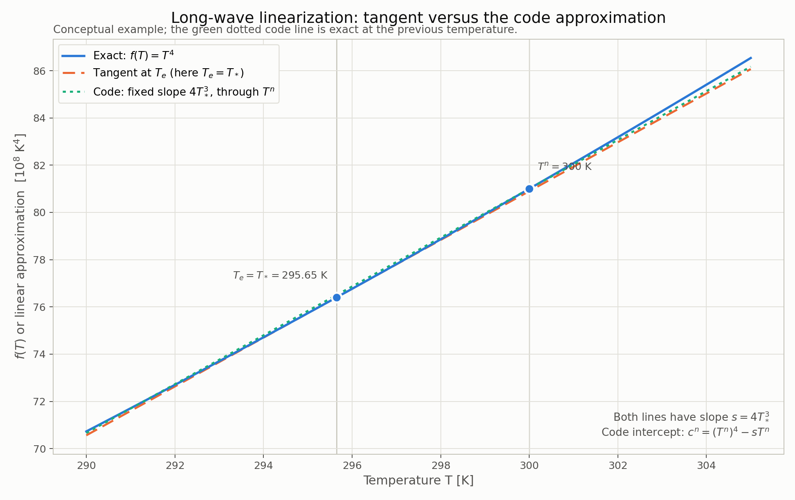

# SBSim 열수지의 행렬 축소와 장파복사 선형화

[English](HEAT_BALANCE_EQUATIONS.md) | **한국어**

이 수식은 `smart_control.simulator.grouped_jax_simulator.GroupedJaxSimulator`의 전체
격자와 그룹 격자에 공통으로 적용된다. 그룹에서는 같은 온도를 쓰도록 제약하고 **셀별 방정식을 그룹별로 합산**한다. 원래 격자는 물성,
면적과 이웃 연결을 읽을 때와 출력 온도를 표시할 때 사용한다. 솔버별 준비, 최근 벤치마크의 상태 수와 결과 경로는 5절에 정리했다.

## 1. 원래 격자의 열수지

온도를 미지수로 쓰면 표준 표기는 $A T^{n+1}=b$다. $T^{n+1}$은 다음 스텝의 온도, $b$는 직전 온도와 알려진 열원이다.
장파복사와 내부 열질량을 붙이기 전, 셀 $i$의 유한체적 열수지는 다음과 같다.

$$
\frac{C_i}{\Delta t}(T_i^{n+1}-T_i^n) +\sum_{j\sim i}G_{ij}(T_i^{n+1}-T_j^{n+1}) +g_{i,\mathrm{out}}(T_i^{n+1}-T_{\mathrm{out}}) =q_i .
$$

- $C_i=\rho_i c_{p,i}V_i$는 셀의 열용량 [J/K]이다.
- $G_{ij}$는 서로 맞닿은 면의 열전달 컨덕턴스 [W/K]다. 코드에서는 공유 면적 $A_f$와 두 셀의 반 셀 열저항을 써서
    $G_{ij}=A_f/(\ell_i/(2k_i)+\ell_j/(2k_j))$로 계산한다. $\ell$은 면에 수직인 셀 폭이다.
- $g_{i,\mathrm{out}}$은 외기에 연결된 열전달 경로의 합이다. 외기온도는 알려진 경계값이므로
    $g_{i,\mathrm{out}}T_{\mathrm{out}}$이 우변에 들어간다.
- $q_i$는 공급되는 열 [W]이다. 열수지는 `smart_control/simulator/grouped_heat_balance.py`의
    `assemble()`에서 조립한다. 공유 면의 열저항은 기존 SBSim과 같은 경로로 계산한다.

격자를 1차원으로 편 열수지 행렬 $A_{\mathrm{cv}}$에서 대각항은
$C_i/\Delta t+g_{i,\mathrm{out}}+\sum_j G_{ij}$, 이웃에 대한 비대각항은 $-G_{ij}$다. 면을
공유하는 셀끼리만 연결되는 이 단계의 행렬은 희소하다.

## 2. 그룹의 온도를 가정하고 방정식도 줄인다

활성 셀 수가 $N$, 그룹 수가 $m$이면 $P$는 $N\times m$인 이진 희소 행렬이다. 셀 $i$가 그룹 $g$이면
$P_{ig}=1$이고, 그 행의 나머지 값은 0이다. 그룹 온도 벡터를 $\theta$로 쓰면

$$
T_{\mathrm{cv}}^{n+1}=P\theta^{n+1}.
$$

이 값만 원래 식에 대입하면 $A_{\mathrm{cv}}P\theta^{n+1}=b$는 여전히 $N$행이다. 그룹당 하나의 에너지 수지를
얻으려면 **같은 그룹에 속한 셀의 식을 모두 더한다**. 이 합산이 왼쪽에서 $P^{\mathsf{T}}$를 곱하는 연산이다.

$$
\underbrace{(P^{\mathsf{T}}A_{\mathrm{cv}}P)}_{m\times m}\theta^{n+1} =\underbrace{P^{\mathsf{T}}b}_{m\times 1}.
$$

이렇게 풀면 개별 셀의 원래 방정식에는 잔차가 남을 수 있다. **각 그룹 안에서 합한 잔차는 0**이 된다. 같은 그룹에 있는 두 셀의
접촉면은 한쪽의 열 유출과 반대쪽의 열 유입으로 상쇄된다. 다른 그룹에 열이 오가는 면은 합산된다. 예를 들어 그룹 $g$, $h$ 간 경로는
$G_{gh}=\sum_{i\in g,\; j\in h}G_{ij}$다. 저장항도 $C_g=\sum_{i\in g}C_i$가 된다. 셀별 초기
온도가 서로 다르면 그룹의 직전 온도를 열용량 가중 평균으로 계산해 저장 열량을 보존한다.

### 숫자 예제

셀 두 개와 벽 하나에서 앞의 두 셀만 같은 공기 그룹으로 둔다. 이 예제의 수치는 행렬 축소를 보여주기 위한 값이다.

$$
A_{\mathrm{cv}}= \begin{bmatrix}17&-4&-3\\-4&29&-5\\-3&-5&48\end{bmatrix}, \qquad P=\begin{bmatrix}1&0\\1&0\\0&1\end{bmatrix}, \qquad b=\begin{bmatrix}100\\200\\300\end{bmatrix}.
$$

$$
P^{\mathsf{T}}A_{\mathrm{cv}}P= \begin{bmatrix}38&-8\\-8&48\end{bmatrix}, \qquad P^{\mathsf{T}}b=\begin{bmatrix}300\\300\end{bmatrix}.
$$

공기 셀 사이의 4 W/K 항은 사라지고, 두 공기 셀이 벽과 연결된 3 W/K와 5 W/K는 합쳐져 8 W/K가 된다. 2×2 식의 해는
$(9.54545,\; 7.84091)$이다. 다시 셀에 복사해 원래 방정식에 넣으면 잔차가 약
$(+0.56818,\; -0.56818,\; 0)$이고, 그룹별 잔차는 반올림 오차 범위에서 0이다.

기존 100존·0.50 m 사무실 예제에서는 $P$가 $10{,}101\times521$이고, 공기·벽·창의 열수지는
$521\times521$이다. 존당 유효 질량 상태 하나를 붙이면 행렬은 $621\times621$이 된다. 그룹은 ㄴ자 모양이어도 된다.
**행렬의 인덱스는 그룹 번호**다. 원래 격자에서 두 그룹 사이에 접촉면이 있으면 두 그룹 간 전도 항을 추가한다. 이웃이 여러 개인 그룹도
같은 희소 행렬에 표현할 수 있다. 방 안의 장파복사는 접촉면을 공유하지 않는 표면도 연결한다.

`grouped_heat_balance.assemble()`가 상태별 합산과 희소 행렬 조립을 담당한다. `grouped=False`에서는 활성
셀마다 하나의 온도 상태를 두므로 $P$가 단위행렬에 해당한다. 두 모드에 같은 경계면과 실내 장파식을 적용하면 격자를 묶는 효과를 비교할 수
있다.

## 3. 장파복사 행렬

이 절에서 $T^{\circ4}$는 온도 벡터의 각 원소를 4제곱한 값이다. 복사에서 온도는 켈빈을 사용한다. 아래 식의 실내 장파, 외부
장파, 내부 열질량은 각각 켜거나 끌 수 있다. 두 장파 항과 질량을 함께 사용하면 공기, 벽·창, 질량을 한 시스템에 넣어 푼다.

### 실내의 벽·창·내부 질량

각 존의 복사 공간에서 표면 $i$의 면적은 $a_i$, 방사율은 $\epsilon_i$다. 현재 근사는 면적비 시야계수
$F_{ij}=a_j/\sum_\ell a_\ell$를 사용한다. 따라서 표면에서 나가는 복사량 밀도 $J_i$에 대해 모든 면의 입사량
$H$는 공통이다.

$$
J_i=\epsilon_i\sigma T_i^4+(1-\epsilon_i)H, \qquad H=\sum_j\frac{a_j}{\sum_\ell a_\ell}J_j.
$$

$w_i=\epsilon_i a_i$로 두면 위 식에서 $H$를 직접 계산할 수 있다.

$$
H=\sigma\frac{\sum_j w_j T_j^4}{\sum_j w_j}, \qquad q_{i,\mathrm{out}}^{\mathrm{LW}} =a_i(J_i-H) =\sigma w_i\left(T_i^4-\frac{\sum_j w_jT_j^4}{\sum_j w_j}\right).
$$

따라서 표면의 순방출 [W]는 $R_{\mathrm{zone}}T^{\circ4}$이며,

$$
R_{\mathrm{zone}}=\sigma[\operatorname{diag}(w)-\frac{ww^{\mathsf{T}}}{\sum_i w_i}].
$$

이 행렬의 행과 열 합이 0이다. 존 안에서 뜨거운 표면이나 질량이 잃은 장파 열량은 다른 면이 받는다. 벽·창과 질량을 포함한 방마다 이
행렬을 만들고 같은 온도 그룹의 항을 합산한다. 공기와 질량의 대류성 교환 $G_{am}(T_a-T_m)$은 전도·저장 행렬에 넣는다. 공유벽은
한 온도를 가지면서 접한 두 방에 각각 복사면을 제공한다.

별도의 `InteriorMass`는 바닥면적당 열용량·공기 교환 계수와 복사 유효 면적·방사율을 지정한다. 기존 `Building`의 내부 질량
물성이 설정된 경우에는 그 물성을 사용할 수 있다. 두 입력은 같은 결합 방정식에 들어가며, 물성이나 상태 수가 달라지면 결과도 달라진다.

### 외부 장파와 단파

외기에 노출된 벽이나 창의 바깥 방향 순방출은 $E_i(T_i^4-T_{\mathrm{rad}}^4)$다.
$E_i=\sigma\epsilon_i a_i$는 해당 그룹의 노출 면을 합산한 값이다. $T_{\mathrm{rad}}^4$는 알려진
하늘·지면·외기 온도의 4제곱을 가중 평균해 정한다. 따라서 $E_iT_i^4$는 좌변의 복사 행렬 대각항에 들어가고, 알려진
$E_iT_{\mathrm{rad}}^4$는 우변에 남는다. 흡수·투과 일사인 **단파도 별도 우변 열원으로 유지**한다. 외부 열원 계산은
`smart_control/simulator/building_radiation_utils.py`의
`ExteriorRadiationGeometry.forcing()`에 있다.

## 4. 열수지에서 장파 선형화 유도

이 절은 복사 항이 들어간 열수지에서 출발해 코드가 실제로 푸는 선형식까지 전개한다. 핵심은 **기울기는 기준 온도
$T_{\ast}=295.65\,\mathrm{K}$에서 고정하고, 절편은 직전 온도 $\theta^n$을 정확히 지나도록 매 스텝 다시
계산한다**는 것이다. 따라서 현재 방식은 일반적인 의미의 $\theta^n$에서의 접선 근사와 구분해야 한다.

### 4.1 복사가 포함된 한 노드의 열수지

한 노드의 온도를 $T$, 열용량을 $C$, 알려진 경계와의 등가 전도·대류 컨덕턴스를 $G$, 그 경계 온도를 $T_b^n$라고 하자. 후진
오일러 시간 스텝을 쓰면

$$
\frac{C}{\Delta t}(T^{n+1}-T^n) +G(T^{n+1}-T_b^n) =Q^n+r\left[(T_{\mathrm{rad}}^n)^4-(T^{n+1})^4\right].
$$

여기서 $Q^n$은 HVAC와 알려진 내부 열원을 합한 값이고, $r=\sigma\epsilon a$는 유효 복사 계수다.
$T_{\mathrm{rad}}^n$은 알려진 외부 복사 온도다. 왼쪽이 노드에서 나가는 저장·전도·복사 열류, 오른쪽이 들어오는 열류다.
공기–질량 교환 같은 다른 선형 결합이 있으면 $G$와 행렬 $A_0$에 포함된다.

미지수 $T^{n+1}$를 왼쪽에 모으고, $d=C/\Delta t$ 및

$$
b^n=Q^n+GT_b^n+r(T_{\mathrm{rad}}^n)^4
$$

로 정의하면

$$
(d+G)T^{n+1}+r(T^{n+1})^4=dT^n+b^n.
$$

여러 노드에서는 $d+G$가 저장·전도·대류 및 공기–질량 연결을 포함한 $A_0$로, $r$은 노드 간 장파 결합을 포함한 $R$로
일반화된다. 따라서 4.7절의 행렬식에서 $A_0$에는 이미 저장 항이 들어 있고, $D$는 직전 온도 $\theta^n$에 곱하는 저장 항만
따로 표시한 것이다.

### 4.2 정확히 무엇을 근사해야 하는가?

바로 위의

$$
(d+G)T^{n+1}+r(T^{n+1})^4=dT^n+b^n
$$

에서 오른쪽은 모두 안다. 이전 시각 온도 $T^n$, 열용량 $C$, 시간 간격 $\Delta t$, 경계와 복사 환경에서 계산한 $b^n$이
주어져 있기 때문이다. 문제는 왼쪽에 미지수 $T^{n+1}$가 **1차 항과 4차 항으로 동시에** 들어 있다는 점이다. 따라서

$$
F(T^{n+1})=(d+G)T^{n+1}+r(T^{n+1})^4-dT^n-b^n=0
$$

이라는 비선형 방정식이 된다. 근사를 사용하지 않는다면 Newton법 같은 비선형 반복으로 이 식의 해를 찾아야 한다. 스칼라 하나이므로 수치
해를 구하는 것 자체가 어렵다는 뜻은 아니지만, 수백~수만 노드가 결합된 희소 시스템을 매 스텝 한 번의 선형 풀이로 처리할 수는 없다.

**근사 대상은 미지수에 적용된 $(T^{n+1})^4$뿐이다.** 다음은 그대로 둔다.

| 항                                    | 선형화하는가? | 이유                                   |
| ------------------------------------- | ------------- | -------------------------------------- |
| $C/\Delta t$                          | 아니오        | 이미 알려진 열저장 계수다.             |
| $G T^{n+1}$                           | 아니오        | 미지수에 이미 1차로 나타난다.          |
| $Q^n$, $GT_b^n$, $r(T_{\rm rad}^n)^4$ | 아니오        | 모두 이 스텝 우변에서 알려진 입력이다. |
| $r(T^{n+1})^4$                        | **예**        | 미지수의 비선형 4제곱 항이다.          |

이것은 전도나 난방·냉방을 무시하는 근사가 아니다. 열용량, 전도·대류, HVAC 및 기상 입력을 유지한 채, 실제 장파를 계산할 때 필요한 새
온도의 4제곱만 직선으로 표현해 선형 시스템을 얻는 절차다.

### 4.3 일반적인 1차 접선근사: $T_e$는 무엇인가?

스칼라 함수를 $f(T)=T^4$로 놓는다. 여기서 **$T_e$는 Taylor expansion point, 즉 전개를 시작하는 기준
온도**다. exterior temperature를 뜻하는 약자가 아니며, 외기·벽·창의 특정 실제 온도도 아니다. 수학적으로 선택하는
온도이며, 선택값에서 함수값과 미분을 계산해 그 주변의 곡선을 접선으로 대신한다.

$T=T_e$에서 $f$의 1차 Taylor 전개는 다음과 같다.

$$
\boxed{f(T)\approx f(T_e)+f'(T_e)(T-T_e)}.
$$

첫 번째 항은 접점에서의 함수값, 두 번째 항은 접선의 기울기와 접점으로부터의 온도차를 곱한 값이다. $T=T_e$이면 함수값 $f(T_e)$가
정확히 일치한다. 또한 접선의 미분은 $f'(T_e)$이어서 접점에서 곡선과 직선의 기울기도 같다.

$f(T_e)=T_e^4$와 $f'(T_e)=4T_e^3$을 대입하고 괄호를 풀면

$$
\begin{aligned} T^4 &\approx T_e^4+4T_e^3(T-T_e)\\ &=T_e^4+4T_e^3T-4T_e^4\\ &=4T_e^3T-3T_e^4. \end{aligned}
$$

따라서 접선을 $\widehat f_e(T)=s_eT+c_e$로 쓰면

$$
\boxed{s_e=4T_e^3,\qquad c_e=-3T_e^4}.
$$

여기서 $\widehat f_e$는 근사 함수라는 뜻이고, $s_e$는 접선 기울기 [K³], $c_e$는 $T$에 곱하지 않는 절편 항
[K⁴]다. 이를 다시 원래 복사열에 곱하면 $r\widehat f_e(T^{n+1})$가 되므로 복사 항도 미지수 $T^{n+1}$의 1차식이
된다. 생략되는 2차 이상 항은 확장점에서 멀수록 커질 수 있다. 정확히는

$$
T^4-\widehat f_e(T) =(T-T_e)^2\left[6T_e^2+4T_e(T-T_e)+(T-T_e)^2\right]
$$

이므로, 1차 접선은 $T_e$ 근방에서 좋은 근사라는 뜻이지 모든 온도 구간에서 같은 정확도를 보장한다는 뜻이 아니다.

매 스텝 $T_e=T^n$으로 두는 방법도 가능하다. 그러나 새 미지수 계수 $4(T^n)^3$이 매번 달라지므로 행렬 $(A_0+sR)$도 매
스텝 바뀐다. 그러면 LU 분해와 장치별 선형계산 준비를 반복해야 할 수 있다. 현재 코드는 이 비용을 피하기 위해 아래와 같이 기울기를
고정한다.

### 4.4 접선과 코드의 고정기울기 직선을 그림으로 비교



그림에서는 이해하기 쉽도록 일반 접선의 확장점도 코드의 기준온도와 같은 $T_e=T_{\ast}=295.65\,\mathrm{K}$로 두었다.
직전 온도는 예로 $T^n=300\,\mathrm{K}$다. 파란 곡선은 정확한 $T^4$이고, 주황색 접선은 $T_e$에서 곡선과 값·기울기가
모두 같다. 녹색 점선은 같은 기울기를 유지한 채 $T^n$에서 정확한 값을 지나도록 평행이동한 직선이다. **녹색 선은 $T^n$에서 곡선을
지나지만 일반적으로 거기서 접하지는 않는다.**

접선은 선택한 $T_e$에 고정된 절편 $-3T_e^4$를 갖는다. 코드 방식은 매 스텝 $T^n$이 바뀌면 절편도 바뀐다. 그래서 그림의 녹색
선 위치도 스텝마다 달라진다. 이 그림은 계산 크기를 비교하기 위해 $f$와 직선의 값을 $10^8$로 나누어 표시한 개념도다. 수치 해를
그대로 곡선의 모양에서 판단하려는 그림이 아니라, 어느 점이 일치하고 어떤 기울기가 고정되는지를 보여주는 그림이다.

### 4.5 코드가 쓰는 고정기울기·이동절편 근사

이 선택의 시작점은 `smart_control/simulator/grouped_jax_simulator.py`의 모듈 상수다.

```python
_REFERENCE_K = 295.65          # T_* [K]
_SLOPE = 4.0 * _REFERENCE_K**3  # s = 4 T_*^3 [K^3]
```

`295.65`은 선형화 기울기를 정하는 기준점이지 건물이나 외기의 온도를 고정한다는 뜻이 아니다. 각 노드의 실제 온도 $T^n$은 매 스텝
변하며 절편 $c^n$ 계산에 그대로 사용된다. 이 상수로 표현한 기울기는 다음과 같다.

$$
\boxed{s=4T_{\ast}^3},\qquad T_{\ast}=295.65\,\mathrm{K}
$$

로 고정한다. 그다음 직전 온도 $T^n$에서 원래 복사값과 근사값이 같다는 조건을 적용한다.

$$
(T^n)^4=sT^n+c^n.
$$

이 조건에서 절편을 구하면

$$
\boxed{c^n=(T^n)^4-sT^n}.
$$

따라서 새 온도의 복사 항을 다음과 같은 **아핀 함수**로 근사한다.

$$
\boxed{(T^{n+1})^4\approx sT^{n+1}+c^n}.
$$

이 식은 $T^{n+1}=T^n$을 대입하면 양변이 정확히 같다. 하지만 일반적으로 $T^n\ne T_{\ast}$이므로 이 직선은
$T^n$에서의 접선은 아니다. $T^n=T_{\ast}$일 때만 기준점 접선과 일치한다. 기울기 $s$가 상수이므로 아래의 $A_0+sR$은
재사용할 수 있고, 직전 온도에 따라 바뀌는 $c^n$은 우변에만 들어간다.

### 4.6 처음의 한 노드 governing equation에 다시 대입

위에서 얻은 근사를 추상적인 행렬에 바로 대입하지 말고, 처음의 한 노드 식에 그대로 대입해 보자. 미지수는 $T^{n+1}$이고, $c^n$은
이전 온도로 계산한 알려진 값이다.

$$
(d+G)T^{n+1}+r(T^{n+1})^4=dT^n+b^n
$$

에서

$$
(T^{n+1})^4\approx sT^{n+1}+c^n
$$

를 넣으면

$$
(d+G)T^{n+1}+r\left(sT^{n+1}+c^n\right)=dT^n+b^n.
$$

괄호를 펼치면

$$
(d+G)T^{n+1}+rsT^{n+1}+rc^n=dT^n+b^n.
$$

미지수가 들어간 두 항을 하나로 묶고, 알려진 $rc^n$을 오른쪽으로 넘기면

$$
\boxed{(d+G+rs)T^{n+1}=dT^n+b^n-rc^n}.
$$

이것이 초기 governing equation이 코드의 근사를 거쳐 표현된 모습이다. 좌변에서 $T^{n+1}$에는 상수 계수
$(d+G+rs)$가 곱해져 있고, 2차·3차·4차 항은 남아 있지 않다. 오른쪽은 이전 상태와 현재 입력으로 계산할 수 있는 값이다. 즉
다음은 $aT=x$와 같은 구조의 선형식이다.

$$
\underbrace{(d+G+rs)}_{\text{알려진 계수}} \underbrace{T^{n+1}}_{\text{미지수}} = \underbrace{dT^n+b^n-r(T^n)^4+rsT^n}_{\text{직전 온도와 현재 입력으로 계산하는 우변}}.
$$

여기서 선형이 되었다는 것은 **한 스텝 안에서 새 온도에 대한 방정식이 선형**이라는 뜻이다. 우변에는 여전히 $(T^n)^4$가 있으므로,
여러 스텝을 잇는 전체 상태전이 함수를 $T^n$에 대한 전역적인 1차함수라고 부르는 것은 아니다.

원래 $b^n=Q^n+GT_b^n+r(T_{\mathrm{rad}}^n)^4$까지 대입한 최종 한 노드 식은 다음과 같다.

$$
\boxed{ (d+G+rs)T^{n+1} =dT^n+Q^n+GT_b^n+r(T_{\mathrm{rad}}^n)^4 -r\left[(T^n)^4-sT^n\right] }.
$$

이로써 초기의 저장·전도·장파 식에서 어떤 항이 좌변 계수로 이동하고 어떤 항이 우변 보정으로 남는지를 볼 수 있다.

### 4.7 전체 행렬 열수지에 대입

이제 $\theta$는 공기, 벽·창과 내부 질량을 모두 포함하는 온도 벡터다. 네제곱은 원소별로 적용한다. $u^n$은 현재 VAV 경로에서
직전 스텝에 계산된 존 별 HVAC 열량, $H_u$는 이를 공기 노드에 넣는 행렬, $f^n$은 알려진 외기·일사·장파 입사·실내발열이다.

$$
A_0\theta^{n+1}+R(\theta^{n+1})^{\circ4} =D\theta^n+\underbrace{H_u u^n+f^n}_{b^n}.
$$

위의 아핀 근사를 벡터별로 적용하면

$$
A_0\theta^{n+1} +R\left(s\theta^{n+1}+c^n\right) =D\theta^n+b^n, \qquad c^n=(\theta^n)^{\circ4}-s\theta^n.
$$

새 온도를 포함하는 항만 왼쪽에 모으면

$$
\boxed{(A_0+sR)\theta^{n+1} =D\theta^n+b^n-Rc^n}.
$$

$b^n$을 풀어 쓴 최종식은

$$
\boxed{(A_0+sR)\theta^{n+1} =D\theta^n+H_u u^n+f^n -R\left[(\theta^n)^{\circ4}-s\theta^n\right]}.
$$

전도·대류와 저장 항은 선형화하지 않았다. 비선형 $T^4$ 복사 항만 새 온도에 대한 1차 아핀 항으로 바꿨으므로, $M=A_0+sR$이 희소
행렬이면 한 번의 선형 풀이로 다음 온도를 구할 수 있다.

### 4.8 코드가 실제로 푸는 온도 증가분 형태

수치 계산에서는 $\delta=\theta^{n+1}-\theta^n$을 미지수로 둔다. 위 선형식에
$\theta^{n+1}=\theta^n+\delta$를 대입하면

$$
(A_0+sR)(\theta^n+\delta) =D\theta^n+b^n-R(\theta^n)^{\circ4}+sR\theta^n.
$$

양변에서 $(A_0+sR)\theta^n$을 정리하면 $sR\theta^n$은 상쇄된다.

$$
\boxed{(A_0+sR)\delta =b^n-(A_0-D)\theta^n-R(\theta^n)^{\circ4}}, \qquad \boxed{\theta^{n+1}=\theta^n+\delta}.
$$

즉 직전 상태의 복사 항은 절편을 따로 계산하지 않고 $-R(\theta^n)^{\circ4}$로 한 번에 넣을 수 있다. 다음은
`grouped_jax_simulator.py`의 `_solve_on_host()`가 사용하는 호스트 `sparse_lu` 경로의 핵심 형태다.
JAX의 `_make_device_step()`에서도 같은 우변을 선택한 선형 풀이에 전달한다.

```python
rhs = forcing - self._conductance @ previous - radiation @ previous**4
change = self._factor.solve(rhs)
temperature = previous + change
```

여기서 `forcing`은 $b^n$, `previous`는 $\theta^n$, `self._conductance`는 $A_0-D$,
`change`는 $\delta$에 해당한다. 증가분 형태에서는 저장 행렬 $D$가 포함된 $A_0\theta^n$ 대신 $A_0-D$를 사용해
큰 저장 항의 상쇄를 줄인다.

### 4.9 수식의 각 항이 코드에서 만들어지는 위치

아래 발췌는 모두 `smart_control/simulator/grouped_jax_simulator.py`다. 전체 상태 수를 $N$이라고 할
때 `previous`, `forcing`, `change`는 길이 $N$의 벡터고, `matrix`는 $N\times N$ 희소 행렬이다.
코드의 흐름은 처음 온도 격자를 읽는 순서와 같다.

**① `HeatBalance` 조립 후, 고정 좌변 $A_0+sR$과 LU 준비 — `prepare_thermal_system()`**

```python
system = grouped_heat_balance.assemble(
    self, h,
    grouped=self.grouped,
    wall_depth_cells=self.wall_depth_cells,
    air_block_cells=self.air_block_cells,
    # 복사·질량 on/off 옵션도 전달
)
matrix = (system.conduction + _SLOPE * system.radiation).tocsr()
conductance = (
    system.conduction - sparse.diags(system.storage)
).tocsr()
factor = linalg.splu(matrix.tocsc(), permc_spec='MMD_AT_PLUS_A')
```

| 코드                | 수식            | 역할                                                                         |
| ------------------- | --------------- | ---------------------------------------------------------------------------- |
| `system.conduction` | $A_0=D+K$       | 저장 $D=C/\Delta t$, 전도·대류·질량 결합 $K$를 포함한 행렬이다.              |
| `system.radiation`  | $R$             | 실내 면 간 및 외부 장파 계수를 모은 행렬이다.                                |
| `_SLOPE`            | $s=4T_{\ast}^3$ | 기준온도에서 고정한 복사 근사 기울기다.                                      |
| `matrix`            | $M=A_0+sR$      | 새 온도나 증가분에 곱하는 선형계수 행렬이다.                                 |
| `conductance`       | $A_0-D$         | 증분식 우변에서 $\theta^n$에 곱하는 행렬이다.                                |
| `factor`            | 희소 LU 인수    | 전체 행렬의 explicit inverse가 아니라 `solve(rhs)`에 재사용하는 분해 결과다. |

즉 그룹핑과 복사 조립은 `grouped_heat_balance.py`가 하고, 이 함수가 그 결과를 이용해 $M$의 분해를 준비한다. LU는
`sparse_lu` 경로와 장치용 `dense` 응답 준비에 사용한다. `cg`, `spsolve`는 이 LU 인수 대신 각자의 장치 풀이를
준비한다.

**② 직전 셀 온도 → 직전 그룹 상태 $\theta^n$ — `_previous_temperature()`**

```python
grid = self.building.temp.ravel()[system.active]
summed = np.bincount(
    system.groups,
    weights=system.cv_storage * grid,
    minlength=system.storage.size,
)
if system.mass_nodes.size:
  summed += np.bincount(
      system.mass_nodes,
      weights=system.mass_cell_storage
      * native_mass.ravel()[system.mass_active],
      minlength=system.storage.size,
  )
return summed / system.storage
```

먼저 그룹 안의 $C_iT_i^n$를 더하고 $C_g=\sum_{i\in g}C_i$로 나눠 $\bar T_g^n$를 구한다. 내부 질량도
그룹별 저장계수 가중치로 같은 방식으로 모은다. 여기서 평균은 **초기 직전 상태를 그룹 상태로 투영하는 절차**다. 그룹 모델이 진행한 뒤에는
같은 그룹의 셀 온도가 이미 같다.

**③ 외기·HVAC·일사·입사 장파 → 우변 입력 $b^n$ — `_forcing()`**

```python
power = system.ambient * outdoor + np.bincount(
    system.groups,
    weights=self.building.input_q.ravel()[system.active],
    minlength=system.storage.size,
)
forcing = system.geometry.forcing(weather, poa_irradiance=poa)
return (
    power
    + forcing.shortwave_air_gain
    + forcing.mass_gain
    + forcing.emission * forcing.radiant_temperature**4
)
```

첫 줄은 외기 경계의 $\sum G_{b,i}T_b^n$과 셀별 `building.input_q`의 그룹 합이다. 후자에는 현재 경로의 VAV가
앞서 계산한 존 공기 열 입력과 알려진 내부 발열이 반영된다. `geometry.forcing()`은 외부 기하와 기상을 이용해 흡수·투과 단파
및 알려진 입사 장파를 계산한다. 즉 `forcing`은 새 온도 $T^{n+1}$을 포함하지 않는 $b^n$이며, 이미 선형화가 끝난 상태에서
그대로 우변에 들어간다.

**④ 우변과 선형 풀이 — `_solve_on_host()` 및 `_make_device_step()`**

```python
# host sparse_lu
rhs = (
    forcing
    - self._conductance @ previous
    - radiation @ previous**4
)
change = self._factor.solve(rhs)

# JAX CPU/GPU step: 같은 우변
rhs = (
    forcing
    - conductance_vector(previous)
    - radiation_vector(previous**4)
)
initial, ok = linear_solve(rhs, jnp.zeros_like(previous))
```

이 두 코드가 $\mathrm{rhs}=b^n-(A_0-D)\theta^n-R(\theta^n)^{\circ4}$를 직접 구현한다.
`previous**4`가 원소별 4제곱이고, 여기에 **new** 상태의 $T^4$를 넣는 것이 아니라 증분 유도에서 남은
**previous** 상태의 복사 보정을 넣는다. 선형 모드에서는 한 번 구한 `change`가 $\delta$이며,
`temperature = previous + change`가 새 상태다.

**⑤ 비선형 모드라면 새 온도의 실제 $T^4$를 다시 반영 — `_radiation_remainder()`**

```python
current = previous + change
return change * (
    (current + previous) * (current**2 + previous**2)
    - _SLOPE
)
```

`current = previous + change`이므로 이 반환값은 수식으로

$$
(T_{\rm old}+\delta)^4-T_{\rm old}^4-s\delta
$$

다. 큰 네제곱끼리 직접 뺄 때의 부동소수점 상쇄를 줄이려고

$$
T_{\rm new}^4-T_{\rm old}^4 =(T_{\rm new}-T_{\rm old})(T_{\rm new}+T_{\rm old}) (T_{\rm new}^2+T_{\rm old}^2)
$$

로 인수분해해 계산한다. 비선형 모드는
`rhs - radiation @ _radiation_remainder(previous, change)`로 이 차이를 보정하지만, 분해한 좌변
$A_0+sR$은 재사용한다. 이는 직전 보정값을 이용한 **비선형 고정점 반복**이며,
`linearized_radiative_heat_transfer=True`에서는 실행하지 않는다.

**⑥ 그룹 해 → 원래 격자와 질량 격자 — `finite_differences_timestep()`**

```python
temperature = previous + change
grid.ravel()[system.active] = temperature[system.groups]
self.building.temp = grid
# 질량이 있는 경우에만
self._mass_temperature.ravel()[system.mass_active] = temperature[
    system.mass_nodes
]
self._state_temperatures = temperature
```

`system.groups[i]`는 원래 활성 셀 $i$가 속한 온도상태 번호다. 따라서 인덱싱
`temperature[system.groups]`가 $P\theta^{n+1}$의 역할을 해 그룹 온도를 원래 셀에 복사한다. 각 존의
관측값은 `Building.get_zone_average_temps()`가 그 존의 활성 공기 셀에 대해 계산한다. 여기서도 그룹 온도를 다시
만드는 것이 아니라 표시용 셀 온도로 펼치고 존 범위의 평균을 계산한다.

**⑦ 한 스텝의 입력부터 출력까지 정리**

```text
building.temp, interior_mass_temp
  → _previous_temperature() : θ^n
날씨 + 외기 경계 + input_q + 복사 기하
  → _forcing()              : b^n
HeatBalance + 기울기 s
  → prepare_thermal_system(): M=A0+sR, A0-D, 선택한 선형 솔버
θ^n, b^n
  → 선형 풀이               : δ=M^(-1)[b^n-(A0-D)θ^n-R(θ^n)^4]
  → 선형 모드는 종료, 비선형 모드는 outer 보정 반복
  → temperature = θ^n+δ
  → groups/mass_nodes로 셀과 관측값에 전달
```

### 4.10 근사 오차와 비선형 반복의 관계

한 노드에서 실제 4제곱과 아핀 근사의 차이를 $e$라고 하면

$$
e(T^{n+1}) =(T^{n+1})^4-\left[sT^{n+1}+c^n\right] =(T^{n+1})^4-(T^n)^4-s(T^{n+1}-T^n).
$$

$\delta_T=T^{n+1}-T^n$로 테일러 전개하면

$$
\boxed{e=6(T^n)^2\delta_T^2+4T^n\delta_T^3+\delta_T^4 +\left[4(T^n)^3-s\right]\delta_T}.
$$

$T^n=T_{\ast}$이면 마지막 1차 항이 사라져 오차는 $\delta_T^2$부터 시작한다. $T^n$이 $T_{\ast}$와 멀면 고정
기울기와 실제 접선 기울기의 차이인 $4(T^n)^3-s$가 1차 오차를 만들 수 있다. 어느 경우든 $\delta_T=0$에서는
$e=0$이어서 직전 온도에서는 정확하다.

현재 비선형 모드는 이 $e$를 `_radiation_remainder()`로 계산해 우변에서 보정하고, 같은 $A_0+sR$을 이용해
$\delta$를 다시 푼다. 새 온도의 4제곱을 반영한 온도 변화가 수렴 기준보다 작아질 때까지 반복한다. 반면
`linearized_radiative_heat_transfer=True`는 이 외부 반복 없이 위 선형식을 한 번 푼다. CG 자체의 내부
반복과 이 비선형 복사 보정 반복은 서로 다른 반복이다.

## 5. 솔버 선택과 행렬의 저장 방식

| `solver_method` | 준비와 스텝 계산                                                                                                                         |
| --------------- | ---------------------------------------------------------------------------------------------------------------------------------------- |
| `sparse_lu`     | 기본 CPU 경로다. $M=A_0+sR$의 희소 LU를 준비하고 계수가 같으면 재사용한다. 내부 열질량을 포함한 선형 스텝도 모은 우변을 한 번 직접 푼다. |
| `cg`            | JAX CPU 또는 GPU에서 희소 시스템을 켤레기울기법으로 푼다. 장파가 선형이어도 이 선형 풀이 안의 반복은 필요하다.                           |
| `dense`         | 호스트의 희소 LU로 미리 구한 밀집 응답을 JAX CPU 또는 GPU에서 적용한다. 준비와 저장 비용은 상태 수에 따라 커진다.                        |
| `spsolve`       | JAX 희소 직접 풀이를 호출한다. CUDA는 희소 QR을 사용하며, CPU의 JAX 구현은 SciPy 희소 풀이를 호출한다.                                   |

`prepare_thermal_system(h)`로 외기 대류 계수 $h$에 맞는 시스템을 스텝 전에 준비할 수 있다. 동일한 계수에서는 각
스텝의 외기온도, 일사와 HVAC 열량이 우변만 바꾼다. 현재 모델에서 외기 대류 계수가 달라지면 그 값에 맞는 행렬을 다시 준비한다. 선형
모델의 기본 사용법과 새 비교 결과 경로는 `benchmarks/grouped_jax_study/README_ko.md`에 있다.

JAX CG는 방 안의 복사 행렬을 직접 곱하는 대신, 각 존의 $w$로 만든 벡터
$W_z=\sqrt{\sigma/\sum_{i\in z} w_i}\,w^{\mathsf{T}}$를 사용한다. 각 $W_z$를 전체 상태 인덱스로
배치해 행렬 $W$를 만들면 $Rx=\operatorname{diag}(r)x-W^{\mathsf{T}}(Wx)$다. $r$에는 실내 방출
대각항과 외부 장파 대각항을 더한다. `grouped_heat_balance.py`가 이 인자를 만들고
`grouped_jax_simulator.py`의 `_make_device_step()`이 이를 적용한다. 짧은 희소 행의 인덱스와 계수도 한
번 준비해 CG에서는 이웃의 값을 읽어 곱한다. 같은 선형식을 사용하면서 전체 격자에서 한 방의 모든 복사면 쌍을 반복해서 순회하는 비용을
줄인다.

### 현재 벤치마크의 상태 수와 결과

현재 `benchmarks/grouped_jax_study/run.py`는 이전 `JaxOffice`의 다중 건물 밀집 전이 대신
`_SbsimOffice`에서 `GroupedJaxSimulator`를 호출한다. SAC는 같은 폴더의 `train.py`와 `sac.py`가
담당하고, EnergyPlus 환경은 `eplus_env.py`의 별도 프로세스가 실행한다.

저장된 100존·0.50 m 사무실 결과에서 공기·벽·창·내부 열질량을 포함한 온도 상태는 전체 격자 **18,101개**, 그룹 격자
**621개**다. 두 모델의 `thermal_node_count`와 `mass_node_count`는 각 실행의 `summary.json`에도
기록된다. 전체 격자는 활성 공기 셀의 질량을 개별 상태로 두고, 그룹 격자는 공기 그룹별로 질량 상태를 합친다.

같은 7일 디퓨저 열량을 재생한 CPU·GPU 보고서에서는 그룹 선형 대 전체 비선형의 존 온도 평균 절대 오차가 **0.1022 K**, 최대
오차가 **0.5597 K**였다. 이것은 저장된 시나리오의 측정치이며, 다른 평면·기상·제어 조건의 오차 한도는 아니다. 실행 시점과 장치에
따른 시간은 `results/cpu/REPORT_ko.md`와 `results/gpu/REPORT_ko.md`에서 확인한다.

현재 스텝이 설정한 수렴 조건을 만족하지 못하면 `finite_differences_timestep()`이 오류를 발생시킨다. 마지막 풀이
횟수와 최대 온도 보정량은 `last_solve_count`, `last_outer_iteration_count`,
`last_outer_max_delta`로 확인할 수 있다. 사용법과 재현 명령은
`benchmarks/grouped_jax_study/README_ko.md`에 있다.

### 참고: 이전 SAC 벤치마크의 배치 전이 (현재 실행 경로 아님)

| 경로                    | 준비                                                                                | 매 스텝                                                        |
| ----------------------- | ----------------------------------------------------------------------------------- | -------------------------------------------------------------- |
| 당시 묶음 SciPy 열수지  | 조립한 희소 행렬을 CSC로 변환하고 LU 분해                                           | 선형이면 LU 인수로 우변 한 번 해결                             |
| 당시 621상태 JAX 선형   | 희소 행렬 $M=A_0+sR$을 CPU에서 SciPy로 LU 분해하고, 여러 우변에 대한 해를 미리 계산 | JAX에서 전이 행렬 곱과 기상 응답 덧셈                          |
| 당시 묶음 JAX 반복 장파 | 같은 $M$과 응답 준비                                                                | $T^{n+1}$의 실제 4제곱 복사와 선형 근사의 차이를 보정하며 반복 |

이전 벤치마크의 `JaxOffice`는 LU로 여러 우변을 해결해 전이 행렬과 기상 응답을 준비했다. 수식으로는
$B=M^{-1}[D,\; -R,\; H_u]$와 $p^n=M^{-1}f^n$이다. 스텝에서는

$$
\theta^{n+1}=B\begin{bmatrix}\theta^n\\c^n\\u^n\end{bmatrix}+p^n.
$$

코드는 여러 건물을 같은 형식으로 계산하기 위해 $B^{\mathsf{T}}$를 저장한다. `jax_env.py`의
`_temperature_update()`에 있는 `channels @ transition + source`가 이 식이다. **조립과 분해는
희소 행렬**, **JAX에서 매 스텝 곱하는 전이 행렬은 밀집 행렬**이다. 직전 상태에서 연결된 모든 상태의 응답을 미리 풀어 두기 때문에
전이 행렬은 일반적으로 조밀하다. 100존·0.50 m에서는 $B^{\mathsf{T}}$의 크기가
$(2\cdot621+100)\times621=1{,}342\times621$이다. 묶음이 줄면 이 행렬 곱이 작아지고, 격자를 세분화해 벽
상태를 많이 추가하면 연산과 메모리가 함께 커진다.

100존·0.50 m 예제의 실제 조립 행렬도 확인했다. $P$에는 활성 셀마다 하나씩 **10,101개**, $521\times521$
전도·저장 행렬에는 **2,521개**, 질량과 선형 장파를 포함한 $621\times621$의 $M$에는 \*\*5,573개(전체 원소의
1.45%)\*\*가 0이 아닌 값이다. 이 개수는 LU 분해 전이다.

당시 공통 시나리오에서는 벽·창 물성, 면적, 5분 간격과 외기 대류 계수를 고정하고 우변의 기상과 HVAC 열량을 바꿨다. 계산 시간과 격자별
상태 수는 `results/cpu/REPORT_ko.md`, 그룹 지도는 `LUMPED_MODEL_ko.md`, 기존 실행 코드와 명령은
`README_ko.md`에 있다.
