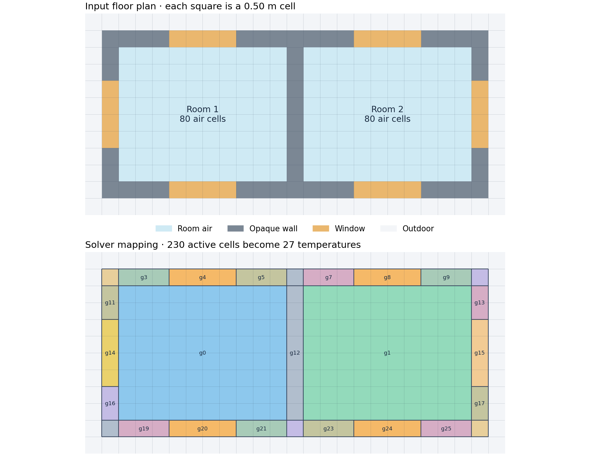
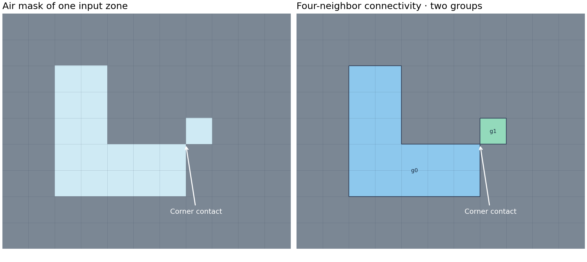
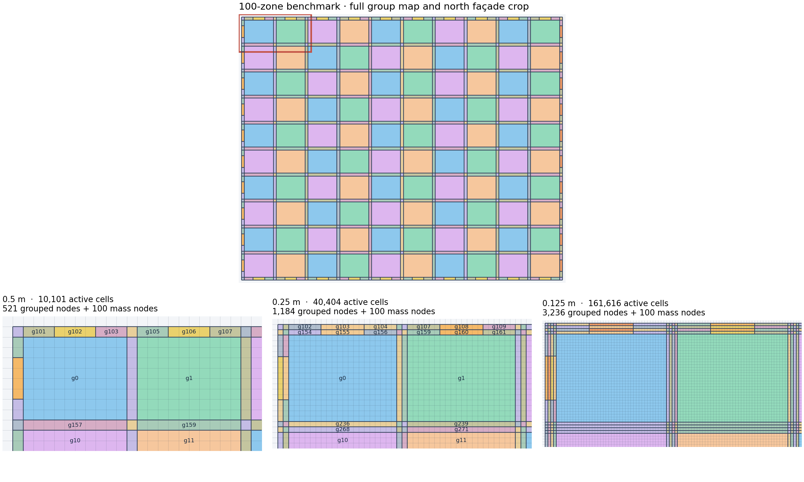
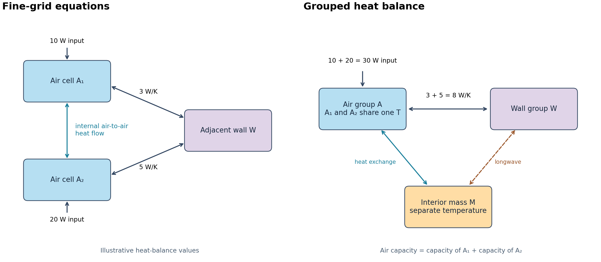

# SBSim grouped temperature nodes, linearized long-wave radiation, and interior thermal mass

**English** | [한국어](LUMPED_MODEL_ko.md)

The input floor plan remains unchanged. During model construction, **each solved
cell is assigned a group ID once; thereafter, the model computes one temperature
per group**. Lumping a room's air replaces 80 temperature unknowns for 80 cells
with one room-air temperature. Walls, windows, and interior thermal mass remain
separate temperature states.

The current model is `GroupedJaxSimulator` in
`smart_control/simulator/grouped_jax_simulator.py`. With `grouped=True`, it uses
air, wall, and window groups; with `grouped=False`, it applies the same physics
to the full cell grid. Both modes retain the existing `Building`, HVAC, weather,
and `step_sim()` interfaces. Heat-balance assembly and `InteriorMass` live in
`smart_control/simulator/grouped_heat_balance.py`.

## 1. Following the actual group IDs in two rooms



The upper panel is the input material map. In the lower panel, thin lines show
the original grid and thick lines show group boundaries. Labels such as `g0` are
the **temperature-state IDs computed by the code**. Colors can recur in
different locations, so use the thick outlines and IDs to distinguish groups.
This example reduces **230 active cells**, excluding ambient cells, to **27 air,
wall, and window temperatures**. Enabling interior mass adds two mass states
when each room has one air group.

| Location in the figure                         | Temperature computed by the model                                                             |
| ---------------------------------------------- | --------------------------------------------------------------------------------------------- |
| Left room `g0`                                 | Common temperature of 80 air cells at 0.50 m resolution                                       |
| Right room `g1`                                | Common temperature of 80 air cells in the other zone                                          |
| Left room's north exterior wall `g3 → g4 → g5` | Separate temperatures for the opaque wall, window, and opaque wall                            |
| Between the rooms `g12`                        | Temperature of the central shared wall; air on each side exchanges heat with it independently |
| Corner where a thick outline turns             | Individual temperatures of cells that do not satisfy the grouping criteria                    |
| Outdoors                                       | Boundary condition supplying ambient temperature to the heat balance                          |

### Air connectivity follows shared edges only

Candidate air cells are separated by zone boundary, and four-connected air
regions are identified within each zone. The L-shaped example below shows that
air cells touching only diagonally are not connected, even within the same zone.
Rooms do not need to be rectangular.

The current `GroupedJaxSimulator` can also split each zone's air candidates into
smaller blocks with `air_block_cells`. The default, `None`, applies no
additional block subdivision. When a block size is supplied, four-connected
components are found again within each block, so a physical zone can have
multiple air-temperature states. Interior mass is aggregated for each
corresponding air group, so the number of mass states in that zone increases as
well.



### Walls and windows are grouped along continuous runs at the same depth

For each wall or window cell, the grouping logic looks in both directions for
cells with the same **material, adjacent zones or ambient boundary, face
orientation, and distance to each boundary**. Four-connected portions of those
cells along the run form a group. An intervening window changes the material and
splits a run into wall–window–wall. A group also ends when a shared wall meets
another zone or when its two boundaries become ambiguous at a corner.

`wall_depth_cells` specifies, in cells, the wall depth over which distances to
boundaries are examined; its default is 1. Distinct depth layers retain separate
temperature states.



The map and enlarged sections were computed from the actual 100-zone input. Red
rectangles mark the enlarged regions. Wall thickness is 0.50 m in all three
cases. It therefore spans one cell at 0.50 m resolution, two layers at 0.25 m,
and four layers at 0.125 m. Each layer is grouped separately along the wall, so
exterior and interior wall surfaces can have different temperatures.

The following state counts are for grouped mode without additional air-block
subdivision, giving one air group per zone.

| Grid width for the 100-zone input | Active cells | Air, wall, and window groups | Temperature states including interior mass |
| --------------------------------: | -----------: | ---------------------------: | -----------------------------------------: |
|                            0.50 m |       10,101 |                          521 |                                        621 |
|                            0.25 m |       40,404 |                        1,184 |                                      1,284 |
|                           0.125 m |      161,616 |                        3,236 |                                      3,336 |

All three cases have 100 air states and 100 interior-mass states. The additional
states at finer resolutions belong to walls, windows, and boundaries.

### Aggregating cell heat balances in one step



Suppose air cells A₁ and A₂ have heat-transfer paths of 3 W/K and 5 W/K to wall
group W and receive heat inputs of 10 W and 20 W. Assigning the same air
temperature to A₁ and A₂ gives an **8 W/K** path to the wall and a **30 W**
group heat input. Heat exchanged between air cells enters their two balances
with opposite signs and cancels during aggregation. Air heat capacities are also
summed: a 20 m² × 3 m zone has 80 air cells × 904.5 J/K = **72,360 J/K**.
Interior mass M in the figure is a separate temperature state that exchanges
heat with the air and long-wave radiation with walls and windows.

In the code, `P` represents these group assignments. Each active cell has a
single 1 in its group's column. `P T_group` copies group temperatures back to
cell positions, while `Pᵀ q_cv` sums cell heat inputs by group. Reducing the
original grid heat-balance matrix `A_cv` to `Pᵀ A_cv P` aggregates heat
capacities, heat transfer between groups, and conduction/convection paths to
ambient boundaries. With `grouped=False`, `P` is effectively the identity
matrix.

```text
One-time initialization
Floor plan and zone map → cell group IDs → grouped heat-balance matrix and mass states
                                                   ↓
Every 5-minute step
Previous group temperatures + weather and HVAC heat inputs → new group temperatures
                                                   → zone observations
                                                   ↘ copy temperatures to the display grid
```

For the 100-zone, 0.50 m case with one effective mass state per zone, each step
solves a heat balance with **621 temperature states**. To display temperatures
on the floor plan, each group's temperature is copied to every cell in that
group. Results therefore retain the input floor-plan geometry, but temperature
variations around windows and diffusers within a group are not represented. Use
`air_block_cells` to refine the air states or use the full grid when local
temperatures are required.

| Code path                                          | Role                                                                                                      |
| -------------------------------------------------- | --------------------------------------------------------------------------------------------------------- |
| `smart_control/simulator/grouped_heat_balance.py`  | Sparse heat balances, interior long-wave matrices, and `InteriorMass` assembly for full and grouped grids |
| `smart_control/simulator/grouped_jax_simulator.py` | Common SBSim step interface, solver selection, state/convergence diagnostics, and HVAC state updates      |
| `benchmarks/grouped_jax_study/run.py`              | Current timing, physics, and SAC runs on the common office floor plan                                     |
| `benchmarks/grouped_jax_study/train.py`, `sac.py`  | Replay and updates for the current SAC benchmark                                                          |
| `benchmarks/grouped_jax_study/eplus_env.py`        | Process-isolated EnergyPlus environment                                                                   |

The 3×3 matrix-reduction example and derivations of interior/exterior long-wave
radiation and the time step are in
[HEAT_BALANCE_EQUATIONS.md](HEAT_BALANCE_EQUATIONS.md) in this directory.

## 2. Heat balance with interior thermal mass

`InteriorMass` represents furniture and other indoor objects as independent
temperature states. Air heat capacity remains unchanged, and the following
effective properties are applied per unit floor area.

| Explicit `InteriorMass()` property    |                                    Default |             20 m² zone |
| ------------------------------------- | -----------------------------------------: | ---------------------: |
| Heat capacity                         | 30,000 J/(m² floor·K) = 30 kJ/(m² floor·K) | 600,000 J/K = 600 kJ/K |
| Air-to-mass heat-transfer coefficient |                           3 W/(m² floor·K) |                 60 W/K |
| Radiation-exposed area                |                       1.0 times floor area |                  20 m² |
| Emissivity                            |                                       0.90 |                   0.90 |

These values can be changed with `capacity_per_m2`, `air_conductance_per_m2`,
`exposed_area_per_m2`, and `emissivity`. They are effective model inputs, not
furniture properties calibrated against measurements. If no explicit
configuration is supplied and the `Building` already has native interior-mass
properties, the same coupling equations use those properties instead.

The current full-grid baseline has **one mass state per active air cell**.
Grouped mode sums the mass capacity and coupling of the cells assigned to each
air group. The current full-grid baseline therefore differs from the historical
one-mass-state-per-zone prototype. Splitting air groups with `air_block_cells`
also splits their corresponding mass groups.

Heat flowing from air to mass is `G (T_air - T_mass)`. The air and mass
equations contain this quantity with opposite signs. Mass has a `C_mass/Δt`
storage term, and its previous temperature contributes to the right-hand side of
the next step. HVAC heat is applied to zone air rather than directly to mass.
The exterior-radiation model handles the distribution of shortwave radiation
transmitted through windows.

For both full and grouped grids, the current interior long-wave model places
each room's interior wall/window faces and active interior mass in one radiative
enclosure. Areas of adjacent wall/window faces belonging to the same temperature
state are summed. The approximation uses emissivity and area-ratio view factors,
`F_ij = A_j / ΣA`. A wall shared by two rooms provides a separate face to each
room while sharing its temperature state. Under the area-ratio approximation,
every face receives the same irradiation, allowing the radiosity unknown to be
eliminated. With `w = εA`, a zone's net-emission operator is:

```text
σ [diag(w) − w wᵀ / Σw]
```

This matrix is symmetric, and its row and column sums are zero, so long-wave
exchange conserves energy within the zone. View factors that depend on object
placement or shading are outside the scope of this approximation.

Interior long-wave radiation and exterior sky radiation are linearized using the
slope `s = 4 T_ref³` at the reference temperature of 295.65 K (22.5°C), together
with the previous-temperature correction `T_old⁴ - s T_old`. Exterior solar
gains and window transmission are retained. Air, walls/windows, and mass are
placed in one vector and solved as:

```text
(A + s R) T_new = C/Δt · T_old + Q - R (T_old⁴ - s T_old)
```

Fourth powers are elementwise, and radiation calculations always use kelvin. `A`
contains storage, conduction, convection, and air–mass coupling; `Q` contains
known heat inputs such as ambient boundaries, solar gains, and HVAC. With
`linearized_radiative_heat_transfer=False`, the same spatial and mass
configuration iteratively corrects long-wave radiation at the current step.
Linear mode solves one equation in the new temperatures, but the transition
between steps remains nonlinear in the previous temperatures.

### Solvers and physics options

The default `solver_method='sparse_lu'` reuses a sparse LU factorization on CPU.
With linearized radiation, it solves one assembled linear system for air,
walls/windows, and mass per step. JAX `cg`, `dense`, and `spsolve` paths are
also available.

| `solver_method` | Supported devices | Method                                                                                                                                  |
| --------------- | ----------------- | --------------------------------------------------------------------------------------------------------------------------------------- |
| `sparse_lu`     | CPU               | Reuses the sparse LU factorization while the exterior convection coefficient is unchanged.                                              |
| `cg`            | CPU, GPU          | Solves the same sparse system with JAX conjugate gradients. Linearized radiation still requires inner CG iterations.                    |
| `dense`         | CPU, GPU          | Applies a dense response prepared with host sparse LU as a JAX matrix product. Preparation and storage costs grow with the state count. |
| `spsolve`       | CPU, GPU          | Uses the JAX sparse direct solve. CUDA uses sparse QR; the CPU implementation uses the SciPy path.                                      |

`prepare_thermal_system(h)` can assemble the system in advance for exterior
convection coefficient `h`. If omitted, preparation occurs on the first
heat-balance step. Assembly is reused for the same `h` and rebuilt when it
changes.

`include_interior_radiative_heat_transfer`,
`include_exterior_radiative_heat_transfer`, and `include_interior_mass` each
accept `True` or `False`. With `None`, they follow the corresponding `Building`
settings, except that an explicit `interior_mass` configuration enables mass
when `include_interior_mass=None`. `include_interior_mass=False` takes
precedence and disables mass.

After preparation and stepping, the following properties expose state and
convergence information.

| Property                      | Meaning                                                                                |
| ----------------------------- | -------------------------------------------------------------------------------------- |
| `thermal_node_count`          | Total number of air, wall/window, and mass temperature states                          |
| `mass_node_count`             | Number of interior-mass states within that total                                       |
| `group_map`                   | Temperature-state ID for each original physical cell; -1 marks the ambient boundary    |
| `state_temperatures`          | Most recently solved temperatures in kelvin for all states                             |
| `mass_temperature`            | Kelvin field at the original grid size, with solved values at active mass positions    |
| `last_solve_count`            | Number of linear-system solves in the last step, not the number of inner CG iterations |
| `last_outer_iteration_count`  | Number of long-wave outer iterations/linear solves in the last step                    |
| `last_outer_max_delta`        | Last maximum temperature correction in the nonlinear long-wave iteration               |
| `last_heat_balance_converged` | Whether the last step produced a finite solution and met its convergence criteria      |

`finite_differences_timestep()` raises an error if the configured convergence
criteria are not met. A linearized-radiation step solves one linear system
without an outer radiation iteration.

## 3. Current 100-zone, 5-minute, 7-day benchmark

`benchmarks/grouped_jax_study/run.py` compares **2,016 steps starting on July
15, 2024**, using the common office floor plan and Chicago O’Hare TMY3 EPW. The
current code runs one `GroupedJaxSimulator` through `_SbsimOffice`. `train.py`
and `sac.py` in this directory handle SAC replay and updates, while
`eplus_env.py` provides the process-isolated EnergyPlus environment.

In the stored 100-zone, 0.50 m runs, the total air, wall/window, and
interior-mass temperature-state count is **18,101 on the full grid** and **621
on the grouped grid**. The full grid consists of 10,101 active air/wall/window
cells plus 8,000 mass states, one for each active air cell. The grouped grid has
521 air/wall/window states and 100 mass states aggregated by air group. The
state counts and properties for each run are recorded under `thermal_nodes`,
`mass_nodes`, and `effective_interior_mass` in `summary.json`.

### Timing: mean excluding the first step

The following are warm-step means from the stored 100-zone timing results, with
the first step excluded. They include setpoint application, simulation,
observation, and EnergyPlus process communication.

| Run           | Timing / physics grouped solver |  Full JAX | Grouped JAX | EnergyPlus | Report                              |
| ------------- | ------------------------------- | --------: | ----------: | ---------: | ----------------------------------- |
| CPU           | `dense` / `sparse_lu`           | 34.624 ms |    2.400 ms |   7.493 ms | [CPU report](results/cpu/REPORT.md) |
| GPU: RTX 3080 | `dense` / `cg`                  | 15.663 ms |    2.551 ms |   2.853 ms | [GPU report](results/gpu/REPORT.md) |

Full JAX uses nonlinear radiation; Grouped JAX uses linearized radiation. CPU
and GPU runs differ in their execution environments as well as their devices, so
the ratio between their timings must not be interpreted as a hardware-only
performance ratio. EnergyPlus still runs its native HVAC and heat balance on CPU
during GPU runs, including process-communication overhead.

### Physics: temperature differences with identical diffuser heat inputs

Diffuser-specific HVAC heat applied by the 100-zone full nonlinear SBSim model
was recorded and replayed into the full linear and grouped linear models. All
three variants use interior/exterior radiation and interior thermal mass. The
temperature errors stored in the CPU and GPU reports are:

| Comparison                        | Mean absolute error | 95th percentile | Maximum error |
| --------------------------------- | ------------------: | --------------: | ------------: |
| Grouped linear vs. full nonlinear |        **0.1022 K** |    **0.3500 K** |  **0.5597 K** |
| Full linear vs. full nonlinear    |            0.0001 K |        0.0006 K |  **0.0022 K** |

The grouped-linear versus full-nonlinear comparison includes **both spatial
grouping and long-wave linearization**. These measurements come from identical
heat-input replay under this office, weather, and VAV scenario; they are not
error bounds for other conditions. In closed loop, small temperature differences
can change VAV control transitions and heat input at the next step. EnergyPlus
uses different envelope, load, and HVAC models, so this physics comparison is
not a validation against EnergyPlus.

### SAC: elapsed times for completed CPU runs

The CPU results also include SAC. The following elapsed times cover one 100-zone
episode with seed 0, comprising 2,016 transitions and 168 updates. Eight updates
with batch size 256 were performed every 96 transitions.

| Engine      | Transitions | Updates | Total elapsed time |
| ----------- | ----------: | ------: | -----------------: |
| Full JAX    |       2,016 |     168 |        **89.46 s** |
| Grouped JAX |       2,016 |     168 |        **14.84 s** |
| EnergyPlus  |       2,016 |     168 |        **37.94 s** |

This is a throughput comparison for the stated training configuration, not a
policy-convergence or energy-savings experiment. The current
[GPU report](results/gpu/REPORT.md) contains timing and physics only; it has no
completed SAC result. See `summary.json` and `REPORT.md` in each results
directory for the latest completed sections and run conditions.

### Reproducing with the current path

See [README.md](README.md) for API usage and all run options. From the
repository root, set `EPW` to the Chicago O’Hare TMY3 EPW and `EPLUS_DIR` to an
EnergyPlus installation containing `pyenergyplus`, then run the current local
benchmark:

```bash
OPENBLAS_NUM_THREADS=1 OMP_NUM_THREADS=1 MKL_NUM_THREADS=1 \
.venv/bin/python -m benchmarks.grouped_jax_study.run \
  --epw "$EPW" --energyplus-dir "$EPLUS_DIR" \
  --zones 100 --physics-zones 100 --days 7 \
  --platform cpu --grouped-method dense --physics-grouped-method sparse_lu \
  --output /tmp/sbsim-grouped-jax-study
```

Use a new `--output` path for a new run. Select only the required portions with
`--section timing`, `--section physics`, or `--section sac`, repeating the
option for multiple sections. See [README.md](README.md) for GPU usage, resume
behavior, and the locations of raw data and figures.
