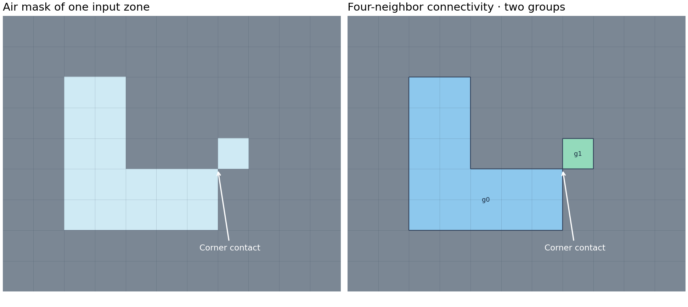

# SBSim의 그룹 온도 노드, 선형 장파복사와 내부 열질량

[English](LUMPED_MODEL.md) | **한국어**

입력 평면은 그대로 유지한다. 모델을 만들 때 **계산할 셀마다 그룹 번호를 한 번 붙이고, 이후에는 그룹당 온도 하나를 계산**한다. 한 방의
공기를 묶으면 셀 80개에 온도 미지수 80개를 두는 대신 그 방의 공기 온도 하나를 둔다. 벽·창과 내부 열질량은 별도의 온도 상태다.

현재 모델은 `smart_control/simulator/grouped_jax_simulator.py`의
`GroupedJaxSimulator`다. `grouped=True`는 공기·벽·창 그룹을 사용하고, `grouped=False`는 같은
물리식을 전체 셀 격자에 적용한다. 두 모드 모두 기존 `Building`, HVAC, 기상 및 `step_sim()` 인터페이스를 사용한다.
열수지 조립과 `InteriorMass`는 `smart_control/simulator/grouped_heat_balance.py`에 있다.

## 1. 두 방에서 실제 그룹 번호 따라가기


위쪽은 입력의 재료 지도다. 아래쪽의 가는 선은 원래 격자이고, 굵은 선은 그룹 경계다. `g0`처럼 적힌 값은 코드가 계산한 **온도 상태
번호**다. 같은 색이 다른 위치에 반복될 수 있으므로 그룹은 굵은 테두리와 번호로 구분한다. 이 예제는 외기를 제외한 활성 셀
**230개**를 공기·벽·창 온도 **27개**로 묶는다. 내부 열질량을 켜고 방마다 공기 그룹을 하나씩 사용하면 여기에 질량 상태 두 개가
추가된다.

| 그림에서 볼 곳                   | 모델이 계산하는 온도                                        |
| -------------------------------- | ----------------------------------------------------------- |
| 왼쪽 방 `g0`                     | 0.50 m 공기 셀 80개의 공통 온도                             |
| 오른쪽 방 `g1`                   | 다른 존의 공기 셀 80개의 공통 온도                          |
| 왼쪽 방 북쪽 외벽 `g3 → g4 → g5` | 불투명 벽, 창, 불투명 벽 각각의 온도                        |
| 두 방 사이 `g12`                 | 중앙 공유벽의 온도. 양쪽 방의 공기가 이 벽과 각각 열을 교환 |
| 굵은 선이 꺾이는 모서리          | 묶음 조건을 충족하지 않는 셀의 개별 온도                    |
| 실외                             | 열수지에 외기온도를 제공하는 경계조건                       |

### 공기는 변을 공유하는 방향으로만 찾아간다

존 경계로 공기 셀 후보를 나누고, 각 존 안에서 위·아래·왼쪽·오른쪽으로 연결된 공기를 찾는다. 아래 ㄴ자 예는 같은 존 안에서 대각선으로만
접촉한 공기 셀이 서로 연결되지 않는다는 것을 보여준다. 방이 직사각형일 필요는 없다.

현재 `GroupedJaxSimulator`는 `air_block_cells`로 각 존의 공기 후보를 더 작은 블록으로 나눌 수도 있다. 기본값
`None`은 추가 블록 분할을 하지 않는다. 블록을 지정하면 각 블록 안에서 다시 사방 연결 성분을 찾으므로 한 물리 존에 공기 온도 상태가
여러 개 생길 수 있다. 실내 질량도 각 공기 그룹에 대응해 합산되므로 해당 존의 질량 상태 수도 함께 늘어난다.



### 벽과 창은 같은 깊이의 연속 구간을 묶는다

벽 또는 창 셀의 양쪽을 살펴 **재료, 양쪽에 접한 존 또는 외기, 면의 방향, 각 경계까지의 깊이**가 같은 셀을 찾는다. 이들 중 길이
방향으로 연결된 부분이 한 그룹이다. 창이 끼면 재료가 바뀌어 벽–창–벽으로 나뉜다. 공유벽이 다른 존을 만나거나 모서리에서 양쪽 경계가
모호해지면 그룹이 끊긴다.

`wall_depth_cells`는 경계까지의 거리를 검사할 벽 깊이를 셀 단위로 지정하며 기본값은 1이다. 서로 다른 깊이 층은 별도의 온도
상태로 유지한다.


위 지도와 확대 그림은 실제 100존 입력에서 계산했다. 빨간 사각형이 아래 확대 영역이다. 벽 두께는 세 경우 모두 0.50 m다. 따라서
0.50 m 격자에서는 두께가 셀 1개이고, 0.25 m에서는 2개 층, 0.125 m에서는 4개 층이다. 각 층을 벽 길이 방향으로 따로
묶으므로 바깥쪽 벽 표면과 안쪽 표면은 서로 다른 온도를 가질 수 있다.

다음은 추가 공기 블록 분할 없이 존당 공기 그룹 하나를 사용한 그룹 모드의 상태 수다.

| 100존 입력의 격자 폭 | 활성 셀 | 공기·벽·창 그룹 | 실내 열질량을 더한 온도 상태 |
| -------------------: | ------: | --------------: | ---------------------------: |
|               0.50 m |  10,101 |             521 |                          621 |
|               0.25 m |  40,404 |           1,184 |                        1,284 |
|              0.125 m | 161,616 |           3,236 |                        3,336 |

세 경우 모두 공기 상태는 100개, 실내 열질량 상태도 100개다. 해상도를 높였을 때 늘어나는 상태는 벽·창과 경계에 해당한다.

### 한 스텝에서 셀별 열수지를 합치는 방법


공기 셀 A₁과 A₂가 벽 그룹 W를 향해 각각 3 W/K와 5 W/K의 열전달 경로를 갖고, 열원으로 10 W와 20 W를 받는다고 하자.
A₁과 A₂에 같은 공기 온도를 사용하면 벽으로 향하는 경로는 **8 W/K**, 그룹에 넣는 열 입력은 **30 W**가 된다. 공기 셀끼리
주고받는 열은 두 열수지에 반대 부호로 들어가 합산할 때 상쇄된다. 공기의 열용량도 더한다. 20 m² × 3 m 존에서는 공기 셀 80개 ×
904.5 J/K = **72,360 J/K**다. 그림의 실내 열질량 M은 별도 온도 상태로 공기와 열을 교환하고, 벽·창과 장파복사를
주고받는다.

코드에서는 `P`가 이 그룹 번호를 표현한다. 활성 셀마다 자기 그룹 열에 1이 하나 있다. `P T_group`은 그룹 온도를 셀 위치에
복사하고, `Pᵀ q_cv`는 셀별 열원을 그룹별로 합산한다. 원래 격자의 열수지 행렬 `A_cv`를 `Pᵀ A_cv P`로 줄이면 열용량,
그룹 간 열전달, 외기에 면한 전도·대류 경로를 합산한 행렬이 된다. `grouped=False`에서는 `P`가 단위행렬에 해당한다.

```text
초기화 한 번
평면과 존 지도 → 셀별 그룹 번호 → 그룹 열수지 행렬과 열질량 상태 준비
                                          ↓
매 5분 스텝
직전 그룹 온도 + 기상과 HVAC 열원 → 새 그룹 온도 → 존 관측값
                                               ↘ 표시용 격자에 온도 복사
```

0.50 m, 100존에서 존당 유효 질량 상태 하나를 쓰면 매 스텝에 **621개 온도 상태의 열수지**를 푼다. 평면에 온도를 표시할 때는
각 그룹의 온도를 해당 그룹의 모든 셀에 복사한다. 따라서 결과를 입력과 같은 평면에 표시할 수 있지만, 그룹 안의 창가·디퓨저 주변 온도차는
이 표현에서 사라진다. 국소 온도가 필요하면 `air_block_cells`로 공기 상태를 세분화하거나 전체 격자를 사용해야 한다.

| 코드 경로                                          | 역할                                                                   |
| -------------------------------------------------- | ---------------------------------------------------------------------- |
| `smart_control/simulator/grouped_heat_balance.py`  | 전체·그룹 격자의 희소 열수지, 실내 장파 행렬 및 `InteriorMass` 조립    |
| `smart_control/simulator/grouped_jax_simulator.py` | 공통 SBSim 스텝 인터페이스, 솔버 선택, 상태·수렴 정보와 HVAC 상태 갱신 |
| `benchmarks/grouped_jax_study/run.py`              | 현재 공통 사무실 평면의 timing, physics, SAC 실행                      |
| `benchmarks/grouped_jax_study/train.py`, `sac.py`  | 현재 벤치마크의 SAC 리플레이와 업데이트                                |
| `benchmarks/grouped_jax_study/eplus_env.py`        | 프로세스 분리 EnergyPlus 환경                                          |

행렬 축소의 3×3 예제, 실내·외부 장파복사와 시간 스텝의 유도는 같은 디렉터리의
[HEAT_BALANCE_EQUATIONS_ko.md](HEAT_BALANCE_EQUATIONS_ko.md)에 있다.

## 2. 그룹과 희소 열수지를 실제로 만드는 코드 흐름

이 절은 그림으로 본 그룹화가 어떤 Python 객체와 희소 행렬로 바뀌는지를 따라간다. 핵심 파일은
`smart_control/simulator/grouped_heat_balance.py`의 `assemble()`이다. 솔버가 매 스텝 그룹을
다시 찾는 것이 아니라, `GroupedJaxSimulator.prepare_thermal_system()`에서 **외기 대류 계수 $h$에
대해 이 조립을 한 번 한 뒤 재사용**한다.

```text
building.floor_plan, building._room_dict
        │
        ├─ CachedLUSimulator._build_static() → 원래 셀의 active, A_cv, 저장·외기 경계
        ├─ _room_enclosures()               → 각 물리 공기 영역 rooms
        ├─ group_cells()                    → 공기 상태 번호, 나머지 셀의 초기 번호
        ├─ group_envelope_cells()           → 벽·창 상태 번호로 병합
        └─ projection(groups)               → P
                                               │
                         A0=P^T A_cv P, 저장·외기·열량 벡터도 그룹별 합산
                                               │
                 내부 질량 결합 추가 → 실내·외부 장파 조립 → HeatBalance
                                               │
                GroupedJaxSimulator.prepare_thermal_system()
                       → A0+sR, 선택한 sparse/JAX 선형 풀이 준비
```

아래에서는 열질량 추가 전의 활성 셀 수를 $N_{\rm cv}$, 공기·벽·창 그룹 수를 $N_{\rm core}$라고 쓴다.
100존·0.50 m 예제에서는 각각 10,101과 521이다. 발췌 코드는 두 파일의 구현을 그대로 줄여 표시한 것이며 생략된 옵션은 별도로
설명한다.

### 2.1 원래 셀 행렬과 공기 영역 후보 만들기

`assemble()`은 먼저 입력 평면을 패딩하고, 기존 SBSim의 정적 조립기를 이용해 그룹화 **이전** 원래 셀 행렬을 얻는다.

```python
floor = building_utils.guarantee_air_padding_in_frame(
    building.floor_plan
)
native = cached_lu_simulator.CachedLUSimulator._build_static(
    sim, convection_coefficient
)
active = native['solved']
air = floor == constants.INTERIOR_SPACE_VALUE_IN_FILE_INPUT
rooms = _room_enclosures(building, air)
```

| 반환값                           | 크기·형태                            | 여기서의 의미                                                  |
| -------------------------------- | ------------------------------------ | -------------------------------------------------------------- |
| `native['solved']` → `active`    | 길이 $N_{\rm cv}$의 정수 인덱스      | 외기가 아니라 실제 온도를 푸는 원래 셀 위치다.                 |
| `native['a_cond']`               | $N_{\rm cv}\times N_{\rm cv}$ sparse | 원래 셀들의 후진 Euler 저장·전도·대류 행렬 $A_{\rm cv}$다.     |
| `native['storage']`              | 길이 $N_{\rm cv}$                    | 셀별 저장계수 $C_i/\Delta t$다.                                |
| `native['boundary_conductance']` | 길이 $N_{\rm cv}$                    | 셀에서 알려진 외기 경계로 가는 컨덕턴스다.                     |
| `native['mass_conductance']`     | 길이 $N_{\rm cv}$                    | 기존 `Building` 내부 질량 결합이 있는 경우 제거·재구성에 쓴다. |
| `rooms`                          | 물리 공기 영역 목록                  | 각 항목은 `(row, column)` 셀 좌표 배열이다.                    |

`rooms`는 단순히 존 이름 하나에 셀을 모두 넣는 배열이 아니다. `_room_enclosures()`는
`building._room_dict`에서 `room`으로 시작하는 논리 존을 읽고, 그 안에서도 사방으로 연결된 실제 공기 영역을 분리한다.

```python
for name, indices in building._room_dict.items():
  if not name.startswith(constants.ROOM_STRING_DESIGNATOR):
    continue
  cells = np.asarray(indices)
  cells = cells[air[tuple(cells.T)]]  # 벽 등 non-air 후보 제거
  labels, count = _label_cells(cells)  # 기본 4-connectivity
  if count == 1:
    rooms.append(cells)
  else:
    rooms.extend(
        cells[labels == label] for label in range(1, count + 1)
    )
```

따라서 한 HVAC 존의 공기가 벽으로 둘로 갈라져 있으면 room record가 둘 생긴다. 이때 각각 별도 공기 온도를 계산한다.
`_label_cells()`는 좌표 집합을 작은 boolean mask로 옮기고 `scipy.ndimage.label()`로 연결 성분을
붙이는 공통 도우미다. 대각선끼리는 같은 성분이 되지 않는다.

### 2.2 공기 그룹 번호 → 벽·창 그룹 번호

**공기:** `group_cells()`가 각 `room`의 셀을 순서대로 본다. 기본 `air_block_cells=None`이면
`_tile_cells()`가 영역을 더 나누지 않는다. 지정한 경우 먼저 좌표 블록으로 자르고 각 블록에 연결 성분을 찾는다.

```python
for cells in rooms:
  cells = cells[active_air[tuple(cells.T)]]
  for tile in _tile_cells(cells, block_cells):
    labels, count = _label_cells(tile)
    groups[tuple(tile.T)] = next_group + labels - 1
    next_group += count

positions = groups.ravel()[solved]
individual = positions < 0  # 아직 번호를 받지 못한 벽·창 등
positions[individual] = (
    next_group + np.arange(np.count_nonzero(individual))
)
```

여기서 `solved`는 위의 `active`, `block_cells`는 시뮬레이터의 `air_block_cells`다. `labels`가
1부터 시작하므로 `next_group + labels - 1`로 0부터 시작하는 연속 상태 번호를 만든다. 처음에는 아직 병합하지 않은
벽·창에 임시로 셀 하나당 번호 하나를 준다.

**벽·창:** 이어서 `group_envelope_cells()`가 각 셀의 재료와 사방의 접촉 정보로 signature를 만든다.

```python
for side, (dr, dc) in enumerate(directions):
  for distance in range(1, wall_depth_cells + 1):
    r, c = row + dr * distance, col + dc * distance
    if contacts[r, c] != -1:
      signature.append((side, contacts[r, c], distance))
      break
    if floor_plan[r, c] != material:
      break
if len(signature) == 2 and signature[0][0] // 2 == signature[1][0] // 2:
    faces[(material, tuple(signature))].append((row, col))
```

서로 반대 방향에서 읽은 경계 두 개가 있을 때만 직선 벽 구간 후보로 묶는다. `contacts`에는 존 번호 또는 외기 `-2`가 있으므로
어느 존의 어느 면에 접하는지가 signature에 들어간다. `distance`와 `wall_depth_cells`가 깊이 층을 구분한다.
같은 signature를 가진 좌표에서 다시 사방 연결 성분을 찾아 기존 임시 번호를 대표 번호로 바꾼다.

```python
labels, count = _label_cells(coords)
for label in range(1, count + 1):
  members = positions[labels == label]
  result[members] = result[members[0]]
return np.unique(result, return_inverse=True)[1]
```

마지막 `return_inverse=True`는 임의로 뛰는 옛 번호를 $0,\ldots,N_{\rm core}-1$의 연속 번호로 다시
매긴다. 최종 `groups`는 2차원 격자가 아니라 **원래 활성 셀 배열 `active`와 같은 길이 $N_{\rm cv}$의 1차원 정수
벡터**다. 두 벡터의 같은 위치 $i$에서 `active[i]`는 원래 셀 위치, `groups[i]`는 그 셀의 그룹 상태 번호다.
시뮬레이터의 `group_map` 속성은 이를 원래 격자 크기로 펼친 표시용 배열이다.

### 2.3 그룹 번호 벡터로 할당 행렬 $P$ 만들기

`projection(groups)`는 각 원래 셀에 해당하는 행 하나를 만들고, 자기 그룹의 열에만 1을 넣는다.

```python
def projection(positions):
  return sparse.csr_matrix(
      (
          np.ones(len(positions)),
          (np.arange(len(positions)), positions),
      ),
      shape=(len(positions), int(positions.max()) + 1),
  )
```

따라서 `mapping`의 크기는 $N_{\rm cv}\times N_{\rm core}$이고 nonzero는 정확히
$N_{\rm cv}$개다.

```python
groups = [0, 0, 1]  # 원래 활성 셀 0·1은 그룹 0, 셀 2는 그룹 1
# P = [[1, 0],
#      [1, 0],
#      [0, 1]]
```

이때 `P @ group_temperature`은 그룹 온도를 원래 셀 위치에 복사한다. `P.T @ cell_vector`는 셀 벡터를
그룹별로 합산한다. 저장 행렬이 대각 $D$이므로 `P.T @ D @ P`도 그룹 저장계수의 대각행렬이 되지만, 저장계수 벡터는 실제로
`np.bincount()`로 더 빠르게 합산한다.

### 2.4 $P^TA_{\rm cv}P$, 저장계수, 외기 경계로 축소하기

`grouped_heat_balance.assemble()`의 분기는 다음과 같이 구성된다. 다만 `positions`는
`group_cells`의 지역 변수명이고, 함수 반환값을 `assemble()`에서는 `groups`로 받는다는 점을 구분해야 한다.

```python
if grouped:
  groups = group_cells(
      active, air, rooms, block_cells=air_block_cells
  )
  groups = group_envelope_cells(
      active, floor, rooms, groups,
      wall_depth_cells=wall_depth_cells,
  )
  mapping = projection(groups)
else:
  groups = np.arange(len(active))  # 활성 셀마다 별도 상태
  mapping = None

core = native['a_cond']
if building.include_interior_mass:
  core = core - sparse.diags(native['mass_conductance'])
if mapping is not None:
  core = (mapping.T @ core @ mapping).tocsr()

node_count = core.shape[0]
storage = np.bincount(
    groups, weights=cv_storage, minlength=node_count
)
ambient = np.bincount(
    groups, weights=native['boundary_conductance'],
    minlength=node_count,
)
```

`mapping.T @ core @ mapping`이 $P^TA_{\rm cv}P$다. 이 한 줄이 대각 저장항, 같은 온도를 공유하는 그룹
사이 전도·대류, 원래 셀들의 결합을 모두 그룹 상태 위에서 합산한다. `storage`와 `ambient`의 `bincount`도 각각
`mapping.T @ cv_storage`, `mapping.T @ native['boundary_conductance']`와 같은 합산이다.

`ambient`의 첨자 g는 외기온도를 의미하는 것이 아니라 그룹 g에서 외기로 나가는 컨덕턴스 합이다. 매 스텝에는
`system.ambient * outdoor`로 만들어 우변 외기 열 입력으로 들어간다. `grouped=False`에서는
`mapping=None`이므로 sparse $P^TAP$ 곱을 생략하고, `groups=np.arange(N_cv)` 때문에 저장·경계 합산도
셀 값을 그대로 유지한다. 이 경우를 개념적으로 $P=I$라고 부르는 이유다.

기존 빌딩 질량이 켜져 있으면 `_build_static()`이 넣은 기존 결합을 여기서 빼고, 다음 절의 공통 질량 조립에서 다시 넣어 중복을
막는다.

### 2.5 내부 질량을 푸는 행렬의 오른쪽 아래에 연결

`include_interior_mass=True`이면 `_mass_properties()`가 원래 공기 셀마다 면적과 다음 계수를 만든다.

```python
storage = config.capacity_per_m2 * area / sim._time_step_sec
conductance = config.air_conductance_per_m2 * area
gray_area = (
    config.emissivity * config.exposed_area_per_m2
) * area
```

위는 명시적 `InteriorMass` 사용 경로다. `capacity_per_m2`의 단위는 J/(m²·K)이므로 여기서 만든
`storage`는 $C_m/\Delta t$ [W/K]이고, $C_m$은 열용량 [J/K]이다. `include_interior_mass`가
켜졌지만 명시적 config가 없고 기존 빌딩의 native mass가 있으면 밀도 [kg/m³], 비열 [J/(kg·K)], 셀 면적
[m²], 건물 높이 [m]를 다음처럼 사용한다.

```python
height = building.floor_height_cm / 100
storage = (
    building.interior_mass_density[cells]
    * building.interior_mass_heat_capacity[cells]
    * area
    * height
    / sim._time_step_sec
)
conductance = native['mass_conductance'][mass_positions]
```

따라서 native 저장계수는 $\rho_m c_m A h/\Delta t$ [W/K]이며, $\rho_m c_m$만이 아니다. 면적·높이를
곱해 열용량 [J/K]을 먼저 만들고 $\Delta t$로 나눠 후진 Euler 저장계수 [W/K]를 만든다. 공기–질량 컨덕턴스는 native
`mass_conductance`에서 가져오고, 복사용 gray area는 native 방사율에 셀 면적을 곱한다. 두 경로의 결과는 아래에서
같은 방식으로 그룹화한다.

다음 부분이 **원래 셀별 질량을 공기 그룹에 합쳐 새 상태를 추가**하고 두 상태의 열교환을 행렬에 붙이는 곳이다.

```python
mass_air = groups[mass_positions]  # 각 mass 셀이 연결될 공기 그룹
_, mass_group = np.unique(mass_air, return_inverse=True)
mass_nodes = node_count + mass_group
mass_storage = np.bincount(
    mass_group, weights=mass_cell_storage, minlength=mass_count
)
links = sparse.csr_matrix(
    (-conductance, (mass_air, mass_group)),
    shape=(node_count, mass_count),
)
core = sparse.bmat(
    (
        (core + sparse.diags(air_exchange), links),
        (links.T, sparse.diags(mass_storage + mass_exchange)),
    ),
    format='csr',
)
storage = np.concatenate((storage, mass_storage))
```

`air_exchange`와 `mass_exchange`는 각 셀의 $G_{am}$을 공기/질량 그룹별로 합산한 벡터다. `links` 안의
음수 항은 off-diagonal의 $-G_{am}$이고, 대각에 더한 `air_exchange`, `mass_exchange`는 각각
$+G_{am}$이다. 따라서 공기와 질량 방정식에 $G_{am}(T_a-T_m)$이 반대 부호로 들어가고 에너지가 보존된다.

이 확장 뒤 상태 벡터와 행렬 배치는 다음과 같다.

$$
\theta= \begin{bmatrix}\theta_{\rm core}\\theta_m\end{bmatrix}, \qquad A_0= \begin{bmatrix} A_{\rm core}+\operatorname{diag}(G_a)&L\\ L^{\mathsf{T}}&D_m+\operatorname{diag}(G_m) \end{bmatrix}, \qquad L_{gm}=-G_{gm}.
$$

`mass_nodes[k] = node_count + mass_group[k]`는 질량 셀 k의 전체 상태 인덱스다. 질량 그룹 g 자체의 상태
번호는 `node_count + g`다. `mass_at`에는 이 번호를 원래 질량 셀 위치에 기록해 이후 복사 조립과 출력에 사용한다.
`HeatBalance.storage`도 질량 저장계수가 붙은 길이 $N_{\rm core}+N_m$의 벡터가 된다. 공기 블록을 나누면 질량이
묶이는 공기 그룹 수가 늘므로 질량 상태 수도 그만큼 늘어난다.

### 2.6 실내 장파 저차 인수와 외부 장파 대각항 조립

공기 온도상태 자체를 벽·창 복사면으로 넣는 것이 아니다. `_interior_radiation()`은 각 방에 접한 solid 면과 내부
질량을 찾아 해당 상태의 $w=\epsilon a$를 합산한다.

```python
nodes = np.concatenate((group_at[face_coords], mass_at[room][room_mass]))
weights = np.concatenate((weight_at[face_coords], mass_area_at[room][room_mass]))
nodes, inverse = np.unique(nodes[keep], return_inverse=True)
weights = np.bincount(inverse, weights=weights[keep])
diagonal[nodes] += sigma * weights
values.extend(np.sqrt(sigma / weights.sum()) * weights)
factors = sparse.csr_matrix(
    (values, (row_indices, columns)), shape=(len(rooms), size)
)
```

각 방 z에 대해 짧은 행벡터 $W_z=\sqrt{\sigma/\sum_{i\in z}w_i}\,w^{\mathsf{T}}$가
`room_factors`의 한 행이 된다. `_exterior_geometry()`는 외기에 노출된 면적과 방사율을 상태별로 합산하고
`geometry.emission`에 $\sigma\sum_i\epsilon_i a_i$ 대각항을 만든다. 동시에 흡수·투과 단파와 입사 장파를
매 스텝 받을 외부 기하 객체도 준비한다.

마지막 조립은 코드 그대로 다음 compact 형태다.

```python
radiation = (
    sparse.diags(radiative_diag) - room_factors.T @ room_factors
).tocsr()
```

즉 $R=\operatorname{diag}(r)-W^{\mathsf{T}}W$다. 방 하나에서 전개하면 앞 절의
$\sigma[\operatorname{diag}(w)-ww^T/\sum w]$와 같다. 방별 $W_z$ 행을 모으므로 별도 존 사이에 허위
복사 연결을 만들지 않는다. 외부 장파는 대각 방출과 알려진 우변 입사항으로 분리하고, 단파 흡수·투과는 이 $T^4$ 행렬과 섞지 않는다.

### 2.7 `HeatBalance`에서 실제 솔버 행렬로 전달

마지막 `HeatBalance(...)`는 위에서 만든 상태 번호와 행렬을 `GroupedJaxSimulator`에 전달하는 frozen
dataclass다.

| 필드                                 | 무엇을 전달하는가?                                              |
| ------------------------------------ | --------------------------------------------------------------- |
| `active`, `groups`                   | 원래 셀 위치와 셀별 그룹 ID. 이전 그룹 온도와 출력 격자에 쓴다. |
| `storage`                            | 공기·벽·창·질량을 포함한 상태별 $C/\Delta t$ 벡터다.            |
| `conduction`                         | 질량까지 확장된 $A_0$ 희소 행렬이다.                            |
| `radiation`                          | 실내·외부 장파 $R$ 희소 행렬이다.                               |
| `ambient`                            | 외기 경계 컨덕턴스를 상태별로 합산한 벡터다.                    |
| `geometry`                           | 단파·입사 장파의 매 스텝 외기 우변을 계산하는 외부 기하 정보다. |
| `mass_active`, `mass_nodes`          | 원래 질량 셀과 해당 질량 상태 번호다.                           |
| `cv_storage`, `mass_cell_storage`    | 원래 셀별 저장계수를 직전 그룹 온도의 가중 평균에 쓴다.         |
| `radiation_diagonal`, `room_factors` | JAX CG에서 $Rx=rx-W^T(Wx)$로 계산할 수 있게 전달한다.           |

이를 소비하는 `GroupedJaxSimulator.prepare_thermal_system()`은
`smart_control/simulator/grouped_jax_simulator.py`에 있다.

```python
system = grouped_heat_balance.assemble(
    self, h, grouped=self.grouped,
    wall_depth_cells=self.wall_depth_cells,
    air_block_cells=self.air_block_cells,
    # 나머지 복사·질량 설정도 전달
)
matrix = (system.conduction + _SLOPE * system.radiation).tocsr()
conductance = (
    system.conduction - sparse.diags(system.storage)
).tocsr()
```

여기서 `matrix`가 $M=A_0+sR$이다. `_SLOPE`가 고정이고
`system.conduction`·`system.radiation`도 같은 $h$ 설정에서 재사용되므로 새 기상·HVAC 입력에 따라 매 스텝
그룹이나 행렬을 다시 만들 필요가 없다. 우변 만드는 방법, 고정 기울기를 쓰는 이유와 실제 매 스텝 풀이는
[HEAT_BALANCE_EQUATIONS_ko.md](HEAT_BALANCE_EQUATIONS_ko.md)의 4.8~4.9절에 코드와 함께
있다.

## 3. 실내 열질량을 포함한 열수지

`InteriorMass`는 가구와 실내 물체를 대표하는 독립 온도 상태다. 각 존의 공기 열용량은 그대로 두고, 바닥면적에 따라 다음 유효
물성을 붙인다.

| 명시적 `InteriorMass()` 물성 | 기본값                                   |               20 m² 존 |
| ---------------------------- | ---------------------------------------- | ---------------------: |
| 열용량                       | 30,000 J/(m² 바닥·K) = 30 kJ/(m² 바닥·K) | 600,000 J/K = 600 kJ/K |
| 공기와의 열교환 계수         | 3 W/(m² 바닥·K)                          |                 60 W/K |
| 복사에 노출되는 면적         | 바닥면적의 1.0배                         |                  20 m² |
| 방사율                       | 0.90                                     |                   0.90 |

`capacity_per_m2`, `air_conductance_per_m2`, `exposed_area_per_m2`,
`emissivity`로 이 값을 바꿀 수 있다. 이 기본값은 실측으로 보정된 가구 물성이 아니라 유효 모델 입력이다. 별도 설정을 생략하고
`Building`에 기존 실내 질량 물성이 있으면 그 물성으로 같은 결합식을 구성한다.

현재 전체 격자 기준 모델은 **활성 공기 셀마다 질량 상태 하나**를 둔다. 그룹 모드는 각 공기 그룹에 연결된 셀들의 질량 열용량과
공기–질량 결합을 합산한다. 따라서 현재 전체 격자 기준은 과거의 존당 질량 상태 하나 모델과 구분해야 한다. `air_block_cells`로
공기 그룹을 나누면 대응하는 질량 그룹도 나뉜다.

공기에서 질량으로 이동하는 열은 `G (T_air - T_mass)`다. 공기와 질량의 방정식에는 같은 값이 반대 부호로 들어간다. 질량에는
`C_mass/Δt` 저장 항이 있고, 이전 질량 온도는 다음 스텝의 우변에 들어간다. 질량에 HVAC를 직접 넣는 대신 존 공기에 넣는다.
창을 통과한 단파의 분배는 외부 복사 모델이 처리한다.

현재 전체·그룹 격자의 실내 장파는 각 방의 벽·창 안쪽 면과 활성 실내 질량을 한 복사 공간으로 둔다. 접한 벽·창 면적을 같은 온도 상태끼리
합산하고, 면적비 `F_ij = A_j / ΣA`와 방사율을 사용한다. 양쪽 방이 공유하는 벽은 방마다 별도 면으로 열을 교환하고, 벽 온도
상태는 공유한다. 면적비 근사에서는 모든 면의 입사 장파가 같아 복사 미지수를 식에서 제거할 수 있다. `w = εA`라고 하면 존의 순방출
연산자는 다음과 같다.

```text
σ [diag(w) − w wᵀ / Σw]
```

이 행렬은 대칭이고 행과 열의 합이 0이므로 존 안에서 장파 교환 에너지를 보존한다. 물체 배치나 차폐에 따른 개별 시야계수는 이 근사의 범위
밖이다.

실내 장파와 외부 하늘 장파는 기준 온도 295.65 K, 즉 22.5°C에서의 기울기 `s = 4 T_ref³`와 직전 온도의
`T_old⁴ - s T_old` 보정으로 선형화한다. 외부 일사와 창의 투과는 유지한다. 공기, 벽·창, 질량을 한 벡터에 넣고 다음 식을
푼다.

```text
(A + s R) T_new = C/Δt · T_old + Q - R (T_old⁴ - s T_old)
```

여기서 네 제곱은 온도 벡터의 원소별 연산이며, 복사 계산에는 항상 켈빈을 사용한다. `A`에는 저장·전도·대류와 공기–질량 결합이 들어가고,
`Q`에는 외기·일사·HVAC 등의 알려진 열원이 들어간다. `linearized_radiative_heat_transfer=False`는
동일한 공간·질량 구성에서 현재 스텝의 장파를 반복 보정한다. 선형 모드는 새 온도에 대한 방정식 하나를 풀지만, 스텝 사이의 전이는 여전히
직전 온도에 비선형으로 의존한다.

### 풀이와 물리 옵션

기본 `solver_method='sparse_lu'`는 CPU에서 희소 LU를 재사용한다. 선형 장파를 사용하면 공기·벽·창·질량을 묶은
우변을 스텝당 한 번 직접 푼다. JAX의 `cg`, `dense`, `spsolve` 경로도 선택할 수 있다.

| `solver_method` | 지원 장치 | 처리                                                                                                    |
| --------------- | --------- | ------------------------------------------------------------------------------------------------------- |
| `sparse_lu`     | CPU       | 외기 대류 계수가 같으면 희소 LU를 재사용한다.                                                           |
| `cg`            | CPU, GPU  | 같은 희소 시스템을 JAX 켤레기울기법으로 푼다. 선형 장파라도 CG 자체의 반복이 필요하다.                  |
| `dense`         | CPU, GPU  | 호스트 희소 LU로 준비한 밀집 응답을 JAX 행렬 곱으로 적용한다. 준비와 저장 비용은 상태 수에 따라 커진다. |
| `spsolve`       | CPU, GPU  | JAX 희소 직접 풀이를 사용한다. CUDA는 희소 QR, CPU 구현은 SciPy 경로를 사용한다.                        |

`prepare_thermal_system(h)`로 외기 대류 계수 `h`에 맞는 시스템을 미리 준비할 수 있다. 생략하면 첫 열수지 스텝에서
준비한다. 같은 `h`에서는 조립 결과를 재사용하고, 달라지면 행렬을 다시 준비한다.

`include_interior_radiative_heat_transfer`,
`include_exterior_radiative_heat_transfer`, `include_interior_mass`에는 각각 `True`
또는 `False`를 지정할 수 있다. `None`이면 `Building`의 해당 설정을 따르는데, 실내 질량은 명시적
`interior_mass`가 있으면 활성화한다. `include_interior_mass=False`는 명시적 설정보다 우선하여 질량을 끈다.

준비와 스텝 이후에는 다음 속성으로 상태와 수렴을 확인할 수 있다.

| 속성                          | 의미                                                              |
| ----------------------------- | ----------------------------------------------------------------- |
| `thermal_node_count`          | 공기·벽·창·질량을 포함한 전체 온도 상태 수                        |
| `mass_node_count`             | 그중 실내 질량 상태 수                                            |
| `group_map`                   | 원래 물리 셀의 온도 상태 번호. 외기 경계는 -1                     |
| `state_temperatures`          | 마지막으로 푼 전체 상태의 켈빈 온도                               |
| `mass_temperature`            | 활성 질량 위치의 해를 원래 격자 크기로 표시한 켈빈 온도           |
| `last_solve_count`            | 마지막 스텝에서 선형 시스템을 푼 횟수. CG 자체의 반복 횟수가 아님 |
| `last_outer_iteration_count`  | 마지막 스텝의 장파 외부 반복·선형 풀이 횟수                       |
| `last_outer_max_delta`        | 비선형 장파 보정의 마지막 최대 온도 변화량                        |
| `last_heat_balance_converged` | 마지막 스텝의 유한한 해와 수렴 조건 충족 여부                     |

설정한 수렴 조건을 만족하지 못하면 `finite_differences_timestep()`이 오류를 발생시킨다. 선형 장파 스텝은 외부 반복
없이 선형 시스템을 한 번 푼다.

## 4. 현재 100존, 5분, 7일 벤치마크

`benchmarks/grouped_jax_study/run.py`는 공통 사무실 평면과 Chicago O’Hare TMY3 EPW를 사용해
**2024년 7월 15일부터 2,016스텝**을 비교한다. 현재 코드는 `_SbsimOffice`를 통해 한 건의
`GroupedJaxSimulator`를 실행한다. 같은 디렉터리의 `train.py`와 `sac.py`가 SAC 리플레이와 업데이트를,
`eplus_env.py`가 프로세스 분리 EnergyPlus 환경을 담당한다.

저장된 100존·0.50 m 실행에서 공기·벽·창·실내 열질량을 포함한 온도 상태는 전체 격자 **18,101개**, 그룹 격자
**621개**다. 전체 격자는 활성 공기·벽·창 셀 10,101개와 활성 공기 셀별 질량 상태 8,000개로 구성된다. 그룹 격자는
공기·벽·창 521개와 공기 그룹별로 합산한 질량 상태 100개를 사용한다. 실행별 상태 수와 물성은 `summary.json`의
`thermal_nodes`, `mass_nodes`, `effective_interior_mass`에서 확인할 수 있다.

### 계산 시간(Timing): 첫 스텝을 제외한 평균

다음은 현재 저장소에 있는 100존 timing 결과의 후기 스텝 평균이다. 첫 스텝은 제외했다. 설정온도 적용, 시뮬레이션, 관측과
EnergyPlus 프로세스 통신이 포함된다.

| 실행          | timing / physics 그룹 풀이 |  Full JAX | Grouped JAX | EnergyPlus | 보고서                                 |
| ------------- | -------------------------- | --------: | ----------: | ---------: | -------------------------------------- |
| CPU           | `dense` / `sparse_lu`      | 34.624 ms |    2.400 ms |   7.493 ms | [CPU 보고서](results/cpu/REPORT_ko.md) |
| GPU: RTX 3080 | `dense` / `cg`             | 15.663 ms |    2.551 ms |   2.853 ms | [GPU 보고서](results/gpu/REPORT_ko.md) |

Full JAX는 비선형 장파를 사용하고 Grouped JAX는 선형 장파를 사용한다. CPU와 GPU는 장치뿐 아니라 실행 환경도 다르다.
따라서 두 플랫폼 시간의 비율을 하드웨어 자체의 성능비로 해석하면 안 된다. GPU 실행에서도 EnergyPlus는 CPU의 네이티브
공조·열수지를 사용하며, 프로세스 통신 시간이 포함된다.

### 물리 비교(Physics): 같은 디퓨저 열 입력을 재생한 온도 차이

100존 전체 비선형 SBSim에서 적용한 디퓨저별 HVAC 열 입력을 기록하고, 전체 선형 및 그룹 선형 모델에 같은 열 입력을 재생했다. 세
변형 모두 실내·외부 복사와 실내 열질량을 사용한다. CPU와 GPU 보고서에 저장된 온도 오차는 다음과 같다.

| 비교                     | 평균 절대 오차 |   95백분위수 |    최대 오차 |
| ------------------------ | -------------: | -----------: | -----------: |
| 그룹 선형 대 전체 비선형 |   **0.1022 K** | **0.3500 K** | **0.5597 K** |
| 전체 선형 대 전체 비선형 |       0.0001 K |     0.0006 K | **0.0022 K** |

그룹 선형 대 전체 비선형 비교에는 **그룹화와 장파 선형화의 효과가 함께** 들어간다. 이 수치는 해당 사무실·기상·VAV 조건에서 같은 열
입력을 재생한 측정치이며, 다른 조건에 적용되는 오차 한도가 아니다. 폐루프에서는 작은 온도 차이도 VAV 제어 전환과 다음 스텝 열 입력을
바꿀 수 있다. EnergyPlus는 별도의 외피·부하·공조 모델이므로 이 물리 비교가 EnergyPlus에 대한 검증은 아니다.

### SAC: 완료된 CPU 실행 시간

CPU 결과에는 SAC도 포함된다. 다음은 시드 0, 100존 한 에피소드에서 2,016개 전이와 168회 업데이트를 수행한 전체 경과
시간이다. 96개 전이마다 배치 크기 256으로 8회 업데이트했다.

| 엔진        |  전이 | 업데이트 | 전체 경과 시간 |
| ----------- | ----: | -------: | -------------: |
| Full JAX    | 2,016 |      168 |    **89.46초** |
| Grouped JAX | 2,016 |      168 |    **14.84초** |
| EnergyPlus  | 2,016 |      168 |    **37.94초** |

이 측정은 정책 수렴이나 에너지 절감 실험이 아니라 주어진 학습 구성의 처리량 비교다. 현재
[GPU 보고서](results/gpu/REPORT_ko.md)에는 timing과 physics만 있으며 완료된 SAC 결과는 없다. 완료된
최신 섹션과 실행 조건은 각 디렉터리의 `summary.json`과 `REPORT_ko.md`에서 확인한다.

### 현재 경로로 재현

API 사용법과 전체 실행 옵션은 [README_ko.md](README_ko.md)에 있다. 저장소 루트에서 `EPW`에 Chicago
O’Hare TMY3 EPW 경로를, `EPLUS_DIR`에 `pyenergyplus`가 있는 EnergyPlus 설치 경로를 지정한 뒤 다음과
같이 현재 로컬 벤치마크를 실행할 수 있다.

```bash
OPENBLAS_NUM_THREADS=1 OMP_NUM_THREADS=1 MKL_NUM_THREADS=1 \
.venv/bin/python -m benchmarks.grouped_jax_study.run \
  --epw "$EPW" --energyplus-dir "$EPLUS_DIR" \
  --zones 100 --physics-zones 100 --days 7 \
  --platform cpu --grouped-method dense --physics-grouped-method sparse_lu \
  --output /tmp/sbsim-grouped-jax-study
```

새 실행에는 새 `--output` 경로를 사용한다. 필요한 부분만 실행하려면 `--section timing`,
`--section physics`, `--section sac`를 지정하고, 여러 섹션이 필요하면 옵션을 반복한다. GPU 사용법, 재개
규칙, 개별 원자료와 그림의 위치는 [README_ko.md](README_ko.md)를 참조한다.
