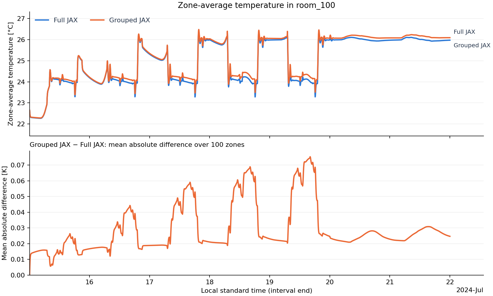

# SBSim Benchmark Material Properties, HVAC Settings, and Model Alignment

**English** | [한국어](SBSIM_BENCHMARK_SETTINGS_DIAGNOSIS_ko.md)

> Target: `benchmarks/grouped_jax_study/` 100-zone office benchmark
> (`USA_IL_Chicago-OHare.Intl.AP.725300_TMY3.epw`, 7 days starting 2024-07-15,
> 5-minute steps, 2,016 steps total)

______________________________________________________________________

## 1. Executive Summary

On the same 100-zone floor plan (`5.0 × 4.0 × 3.0 m` per room, `20 m²` floor
area), the detailed EnergyPlus 24.2 model maintains zone air temperatures within
**21.07–26.89 °C** across the full summer week. In contrast, the original SBSim
benchmark overheated to **32–33.7 °C on weekdays** and **40–42 °C on weekends**,
with ±8 °C reheat spikes even in interior zones.

Root-cause diagnosis identified two implementation bugs and four
benchmark-configuration mismatches—all of which have now been resolved:

| Stage                                                                    | Key Changes                                                                                                                                              |  100-Zone 7-Day Range  | `room_1` / `room_100` Max | Grouped vs. Full MAE / Max |
| :----------------------------------------------------------------------- | :------------------------------------------------------------------------------------------------------------------------------------------------------- | :--------------------: | :-----------------------: | :------------------------: |
| **1. Original 1-CV** (`results/physics_cpu`)                             | 1-CV uninsulated wall (`k=0.5`), solar→air, `PASSIVE_COOL` bug, light mass (`30 kJ/m²K`), Bang-Bang VAV (`0.1 kg/s, 16 °C`)                              |   `19.80 – 42.00 °C`   |   `39.79` / `39.95 °C`    |   `0.1022` / `0.5597 K`    |
| **2. Solar + `PASSIVE_COOL` Fix** (`results/physics_solar_passive_fix`)  | Transmitted solar → interior mass by default; `PASSIVE_COOL` exits above cooling setpoint                                                                |   `19.81 – 30.68 °C`   |   `29.62` / `29.86 °C`    |   `0.1299` / `0.5598 K`    |
| **3. Matched 2-CV + Slab Mass + PI-VAV** (`results/physics_matched_2cv`) | 2-CV insulated exterior wall (`k=0.26, ρ=1200`), slab-equivalent `InteriorMass` (`200 kJ/m²K`), weekend load setback, PI-damped VAV (`0.12 kg/s, 14 °C`) | **`22.10 – 26.46 °C`** | **`26.42` / `26.40 °C`**  | **`0.0292` / `0.2269 K`**  |
| **4. EnergyPlus 24.2** (Reference)                                       | Detailed office (`Insulated Facade`, 10 cm concrete floor/roof, autosized VAV `14 °C`, proportional control)                                             | **`21.07 – 26.89 °C`** | **`26.56` / `26.89 °C`**  |             —              |

With the 2-CV exterior wall and matched material/HVAC properties, SBSim holds
**24.0 °C on occupied weekdays** and **26.0 °C on nights/weekends** across all
100 zones—including all four corner rooms—while keeping the **exact same `0.5 m`
grid and `20.0 m²` room floor area as EnergyPlus**, and reducing Grouped-vs-Full
error by **3.5×** (`MAE 0.029 K`, `max 0.227 K`).

______________________________________________________________________

## 2. Benchmark Material Properties and Settings (Original vs. Updated vs. EnergyPlus)

### 2.1 Geometry and Grid (`matched_vav/floorplan.py`, `run.py`)

| Parameter               | Original Benchmark                                     | Updated Matched Benchmark                                       | EnergyPlus (`detailed_office.py`)                   |
| :---------------------- | :----------------------------------------------------- | :-------------------------------------------------------------- | :-------------------------------------------------- |
| Zones / Layout          | 100 zones (10 × 10)                                    | 100 zones (10 × 10)                                             | 100 zones (10 × 10)                                 |
| Room Air Footprint      | `10 × 8` CVs (`5.0 × 4.0 m = 20.0 m²`, `60 m³`)        | **`10 × 8` CVs (`20.0 m²`, `60 m³`, identical)**                | `20.0 m²`, `60 m³`                                  |
| Interior Wall Thickness | `0.5 m` (1 CV)                                         | `0.5 m` (1 CV)                                                  | `0.5 m` (`Solid Wall`)                              |
| Exterior Wall Thickness | `0.5 m` (1 CV → halved to `0.25 m`)                    | **`1.0 m` (2 CVs → `0.25 + 0.50 = 0.75 m` FVM depth)**          | `0.5 m` `Solid Wall` + `R=1.75` `Facade Insulation` |
| Grid Shape (100 zones)  | `(93, 113)`                                            | `(95, 115)` (+1 perimeter CV ring only)                         | Exact room polygons (`bounds_m`)                    |
| `wall_depth_cells`      | `1`                                                    | **`2`** (outer & inner exterior wall layers grouped separately) | Multi-layer CTF                                     |
| Windows                 | `2.0 m` wide × `0.6` height fraction (`3.6 m²`/facade) | Identical (`3.6 m²`/facade, 2-CV glazing span)                  | `2.0 × 1.8 m = 3.6 m²`/facade                       |

### 2.2 Thermal & Optical Material Properties

| Component              | Property                                                   | SBSim Class Defaults (`building.py`)    | Original Benchmark                        | Updated Matched Benchmark (`settings.py`, `sbsim_model.py`, `run.py`)                     | Detailed EnergyPlus                                                                    |
| :--------------------- | :--------------------------------------------------------- | :-------------------------------------- | :---------------------------------------- | :---------------------------------------------------------------------------------------- | :------------------------------------------------------------------------------------- |
| **Inside Air**         | $k$ / $c_p$ / $\rho$                                       | `50.0` / `700.0` / `1.2`                | `50.0` / `1005.0` / `1.2`                 | `50.0` W/(m·K) / `1005.0` J/(kg·K) / `1.2` kg/m³                                          | Well-mixed zone air                                                                    |
| **Interior Wall**      | $k$ / $c_p$ / $\rho$                                       | `2.0` / `1000.0` / `1800.0`             | `0.5` / `800.0` / `1800.0`                | `0.5` / `800.0` / `1800.0`                                                                | `Solid Wall` (`0.5` / `800` / `1800`)                                                  |
| **Exterior Wall**      | $k$ / $c_p$ / $\rho$                                       | `0.05` / `1000.0` / `3000.0`            | `0.5` / `800.0` / `1800.0` ($U=1.70$)     | **`0.26` / `800.0` / `1200.0`** ($U \approx 0.34$, $C/A = 720\ \text{kJ/(m}^2\text{·K)}$) | `R=1.75` ins. + `Solid Wall` ($U \approx 0.34$, $C/A = 720\ \text{kJ/(m}^2\text{·K)}$) |
| **Exterior Wall Rad.** | $\alpha$ / $\varepsilon$ / $\tau$                          | `0.65` / `0.93` / `0.0`                 | `0.65` / `0.93` / `0.0`                   | `0.65` / `0.93` / `0.0`                                                                   | MediumRough exterior surface                                                           |
| **Interior Wall Rad.** | $\alpha$ / $\varepsilon$ / $\tau$                          | `0.20` / `0.80` / `0.0`                 | `0.20` / `0.80` / `0.0`                   | `0.20` / `0.80` / `0.0`                                                                   | Standard interior longwave                                                             |
| **Glazing**            | Optical / Conduction                                       | $\alpha=0.1, \varepsilon=0.9, \tau=0.8$ | $\alpha=0.06, \varepsilon=0.9, \tau=0.33$ | Same optical (`SHGC 0.55 × 0.6`); conduction inherits exterior wall props                 | `SimpleGlazingSystem` ($U=2.8$, $\text{SHGC}=0.55$, massless)                          |
| **Interior Mass**      | $C/A$, $h_{\text{air}}$, $A_{\text{exp}}/A$, $\varepsilon$ | `30,000`, `3.0`, `1.0`, `0.9`           | `30,000`, `3.0`, `1.0`, `0.9`             | **`200,000` J/(m²·K), `6.0` W/(m²·K), `2.0` m²/m², `0.9`**                                | `10 cm` concrete floor + roof (`~414,000` J/(m²·K), 2 surfaces)                        |
| **Transmitted Solar**  | Destination                                                | Mass if enabled                         | Air (bug for `InteriorMass()`)            | **Interior Mass (`solar_to_interior_mass=True` default)**                                 | Floor & interior surfaces (radiative)                                                  |

### 2.3 Internal Loads and HVAC Settings

| Parameter                     | Original Benchmark                                               | Updated Matched Benchmark                                                         | Detailed EnergyPlus                                         |
| :---------------------------- | :--------------------------------------------------------------- | :-------------------------------------------------------------------------------- | :---------------------------------------------------------- |
| **Internal Gains**            | Open Office max `396.7 W/zone`; weekday schedule on weekends too | Same weekday schedule + **weekend setback (`0%` occ, `20%` lights, `35%` plugs)** | Same densities with radiant splits + same weekend setback   |
| **Setpoints**                 | Weekdays 07–19: `21–24 °C`; other/weekend: `19–26 °C`            | Identical                                                                         | Identical                                                   |
| **Thermostat `PASSIVE_COOL`** | No upper bound check (locked off all weekend)                    | **Exits to `COOL` above `cooling_setpoint`**                                      | Dual-setpoint thermostat + NightCycle                       |
| **VAV Max Flow**              | `0.005 × 20 = 0.1` (`kg/s`, missing `ρ=1.2`)                     | **`0.006 × 20 = 0.12 kg/s`** (`0.005 m³/s/m² × 1.2`)                              | Autosized (`room_1`: `0.113 kg/s`, `room_55`: `0.038 kg/s`) |
| **AHU Supply Air**            | Cooling `16.0 °C`, Heating `15.0 °C`                             | **Cooling `14.0 °C`, Heating `13.0 °C`**                                          | Cooling design `14.0 °C`                                    |
| **VAV Control**               | Binary Bang-Bang (`0.1 / 1.0`) + 1-step delay                    | **Integral-damped modulating VAV (`gain = 0.06 / K`)** stable under 1-step delay  | Continuous proportional modulation                          |

______________________________________________________________________

## 3. Root Causes Diagnosed and Resolved

### 3.1 [Fixed] Transmitted Window Solar Bypassed Effective Interior Mass

- **Problem**: `grouped_heat_balance.assemble()` routed glazing shortwave to
    `mass_at` only when
    `interior_mass is None and building.include_interior_mass`, leaving
    `solar_mass_at = None` whenever `InteriorMass()` was used (`run.py`,
    `jax_env.py`). As a result, `+1,554 W` of peak transmitted solar in `room_1`
    went straight into the `72.4 kJ/K` air node.
- **Fix**: Made `solar_to_interior_mass=True` the default whenever
    `include_interior_mass` is enabled across `grouped_heat_balance.py`,
    `grouped_jax_simulator.py`, `interior_mass.py`, and `jax_env.py` (both Full
    JAX and Grouped JAX).

### 3.2 [Fixed] `Thermostat.PASSIVE_COOL` Ignored the Cooling Setpoint

- **Problem**: `SetpointSchedule(0, 24, ...)` still treats Saturday and Sunday
    as Eco mode (`is_comfort_mode() == False`). Entering Eco mode triggered
    `PASSIVE_COOL`, which checked only `zone_temp > heating_setpoint (19 °C)`
    and ignored `cooling_setpoint (26 °C)`, pinning dampers at `10%` for all 48
    weekend hours and driving corner rooms to `40–42 °C`.
- **Fix**: Added `zone_temp <= temperature_window[1]` to both entering and
    holding `PASSIVE_COOL` in `thermostat.py` and `jax_env.py`.

### 3.3 [Fixed] 1-CV Exterior Wall Half-Thickness, Missing Insulation, and Solar-Trapping Paradox

- **Problem**: `_get_cv_dimensions()` halves the outward width of boundary CVs
    (`0.5 m → 0.25 m`). On a 1-CV exterior wall (`k=0.5`), this produced
    $U \approx 1.70\ \text{W/(m}^2\text{·K)}$ (**5×** EnergyPlus's `0.34`),
    injected ~`3,100 W` of wall-absorbed solar into the single wall node
    (`G_in = 11.8 > G_out = 9.0 W/K`), and forced >50% of absorbed solar inward.
    Worse, simply lowering `k_ext` to `0.05` on a 1-CV wall made `room_1`
    **hotter** (`29.8 → 31.5 °C`) by trapping solar heat on the same node that
    radiates longwave ($\sigma T^4$) to the interior.
- **Fix**: Added `exterior_wall_thickness_m=1.0` (2 CVs) to `PlanSpec` in
    `floorplan.py` (keeping interior partitions at 1 CV and every room's air
    grid at `10 × 8 = 20.0 m²`, identical to EnergyPlus) and
    `wall_depth_cells=2` in `run.py`. With `k_ext = 0.26 W/(m·K)` and
    `ρ_ext = 1200 kg/m³` across the `0.75 m` FVM depth (`0.25 m` outer +
    `0.50 m` inner), the wall matches EnergyPlus's
    $U \approx 0.34\ \text{W/(m}^2\text{·K)}$ and
    $C/A = 720\ \text{kJ/(m}^2\text{·K)}$, decouples exterior solar absorption
    from interior longwave radiation, and rejects >80% of absorbed solar to
    ambient.

### 3.4 [Fixed] Light `InteriorMass`, Undersized/Unstable VAV, and Missing Weekend Setback

- **Slab-equivalent `InteriorMass`**: Updated benchmark `InteriorMass` from
    `30,000 J/(m²·K)` (`h=3, A=1`) to `200,000 J/(m²·K)` (`h=6, A=2`) to
    represent concrete floor + ceiling slabs.
- **VAV sizing & stability under 1-step lag**: Converted `0.005 m³/s/m²` to mass
    flow `0.006 kg/(s·m²)` (`0.12 kg/s` per zone) and `14 °C` supply air
    (`1,207 W` max cooling at `24 °C`, matching EnergyPlus). Because
    `execute_step_sim` applies `input_q` with a 1-step (5-minute) delay, both
    Bang-Bang (`0.1/1.0`) and high-gain proportional (`0.5 K` band) VAVs
    triggered discrete-time period-2 oscillations. Replacing them in
    `detailed_office` mode with an integral-damped modulating VAV
    (`_ProportionalVav`, `gain = 0.06 / K`) eliminates both overshoot spikes and
    ringing while achieving zero steady-state setpoint offset (`24.0 °C` weekdays,
    `26.0 °C` weekends).
- **Weekend load setback**: Added `office_loads.weekend_sensible_watts()` (`0%`
    occ, `20%` lights, `35%` plugs) to `_OfficeForcing` when
    `detailed_office=True`.

______________________________________________________________________

## 4. Final 100-Zone 7-Day Physics Comparison Results

Results saved in `results/physics_matched_2cv/` (`100 zones`, `2024-07-15`,
`7 days`, CPU `sparse_lu`, `18,509` full states vs `789` grouped states =
**23.5× state reduction**).

### 4.1 Zone Temperature Alignment vs. EnergyPlus 24.2

| Zone                   | Original 1-CV [min, max] | Matched 2-CV SBSim [min, max] (wkday occ / wkend max) | EnergyPlus 24.2 [min, max] (wkday occ / wkend max) |
| :--------------------- | :----------------------: | :---------------------------------------------------: | :------------------------------------------------: |
| **All 100 zones**      |    `19.80 – 42.00 °C`    |     **`22.10 – 26.46 °C`** (`26.36` / `26.13 °C`)     |   **`21.07 – 26.89 °C`** (`24.94` / `26.89 °C`)    |
| `room_1` (NW corner)   |    `21.78 – 39.79 °C`    |     **`22.17 – 26.42 °C`** (`26.32` / `26.12 °C`)     |     `23.62 – 26.56 °C` (`24.21` / `26.56 °C`)      |
| `room_5` (1 ext wall)  |    `21.39 – 31.81 °C`    |     **`22.18 – 25.83 °C`** (`24.83` / `25.83 °C`)     |     `22.57 – 25.18 °C` (`24.00` / `25.18 °C`)      |
| `room_55` (interior)   |    `20.00 – 29.29 °C`    |     **`22.17 – 24.42 °C`** (`24.42` / `23.37 °C`)     |     `21.48 – 24.14 °C` (`23.56` / `24.14 °C`)      |
| `room_91` (SW corner)  |    `21.75 – 42.00 °C`    |     **`22.16 – 26.39 °C`** (`26.31` / `26.12 °C`)     |     `23.65 – 26.88 °C` (`24.27` / `26.88 °C`)      |
| `room_100` (SE corner) |    `21.89 – 39.95 °C`    |     **`22.27 – 26.40 °C`** (`26.36` / `26.13 °C`)     |     `23.92 – 26.89 °C` (`24.94` / `26.89 °C`)      |

### 4.2 Linearization and Grid-Grouping Accuracy (Fixed-HVAC Replay)

| Comparison                        |       MAE [K] |      RMSE [K] | 95th Percentile [K] |   Maximum [K] |
| :-------------------------------- | ------------: | ------------: | ------------------: | ------------: |
| Full linear vs. Full nonlinear    |     `0.00003` |     `0.00008` |           `0.00018` |     `0.00084` |
| Grouped linear vs. Full nonlinear | **`0.02917`** | **`0.03908`** |       **`0.08851`** | **`0.22686`** |
| Grouped linear vs. Full linear    | **`0.02915`** | **`0.03905`** |       **`0.08838`** | **`0.22671`** |

### 4.3 Three-Way Adiabatic Comparison (Full JAX vs. Grouped JAX vs. Adiabatic EnergyPlus)

For a symmetric multi-story middle floor, adjacent floors experience the same
thermal cycle, so the net vertical flux across the slab mid-plane is zero
(**adiabatic**—no `T_ground` boundary). Running the detailed EnergyPlus model
with adiabatic 10 cm concrete floor/ceiling slabs
(`results/physics_matched_2cv/energyplus_adiabatic/`) yields:

| Zone                   | Full JAX (Adiabatic) | Grouped JAX (Adiabatic) | EnergyPlus (Adiabatic) | MAE (Full JAX vs. E+ Adiab) |
| :--------------------- | :------------------: | :---------------------: | :--------------------: | --------------------------: |
| **All 100 zones**      |  `22.10 – 26.46 °C`  |   `22.12 – 26.49 °C`    |   `20.09 – 27.18 °C`   |                   `1.417 K` |
| `room_1` (NW corner)   |  `22.17 – 26.42 °C`  |   `22.18 – 26.43 °C`    |   `23.74 – 26.93 °C`   |               **`0.683 K`** |
| `room_100` (SE corner) |  `22.27 – 26.40 °C`  |   `22.28 – 26.48 °C`    |   `24.00 – 27.18 °C`   |               **`0.581 K`** |
| `room_5` (N perimeter) |  `22.18 – 25.83 °C`  |   `22.19 – 25.83 °C`    |   `22.48 – 25.02 °C`   |                   `1.185 K` |
| `room_55` (interior)   |  `22.17 – 24.42 °C`  |   `22.19 – 24.43 °C`    |   `20.48 – 23.11 °C`   |                   `1.645 K` |

Remaining differences versus EnergyPlus are driven primarily by HVAC control
conventions rather than envelope physics:

- **Off-hours EnergyPlus oscillations (`0.17–0.33 K/step` vs. `0.000 K/step`
    daytime)**: `detailed_vav_hvac.py` shuts AHUs off during `22:00–06:00` and
    weekends and uses `AvailabilityManager:NightCycle` (`CycleOnAny`, 30-minute
    fixed runtime), repeatedly blasting all 20 zones on a loop whenever a corner
    zone crosses the eco cooling threshold.
- **Wider EnergyPlus inter-zone spread (`std = 0.87 K` weekday / `1.89 K`
    weekend vs. SBSim `0.04 K` / `1.19 K`)**: EnergyPlus enforces a `30%` VAV
    minimum damper fraction (`constant_minimum_air_flow_fraction = 0.30`, plus
    ASHRAE 62.1 ventilation minimums), overcooling low-load interior rooms
    (`room_55`) into the `21–24 °C` deadband (`~22.1 °C` daytime, `~20.6 °C`
    during weekend NightCycle), whereas SBSim uses a `10%` minimum damper
    (`~-120 W < ~300 W` daytime office load), so all zones ride the `24.0 °C`
    cooling setpoint during occupied hours.

______________________________________________________________________

## 5. Remaining Minor Structural Differences vs. EnergyPlus

Even after full alignment, three inherent 2D-FVM modeling simplifications remain
(and are intentionally noted for interpretation):

1. **Glazing conduction material**: `building.py` maps fenestration cells (`4`)
    to `building_exterior_properties` during conduction assembly (`U ≈ 0.34`
    with thermal mass instead of massless `U = 2.8` glazing). Optical solar
    transmission (`SHGC = 0.55 × 0.6`) matches EnergyPlus.
2. **2D ground & roof boundary**: SBSim represents floor/ceiling thermal
    capacitance via `InteriorMass`, without a direct conductive sink to the
    `22.2 °C` July ground temperature or sun-exposed roof loss.
3. **Convective internal gains**: Office people/lighting/plug sensible gains are
    injected convectively into room air rather than split into convective +
    radiant fractions.
