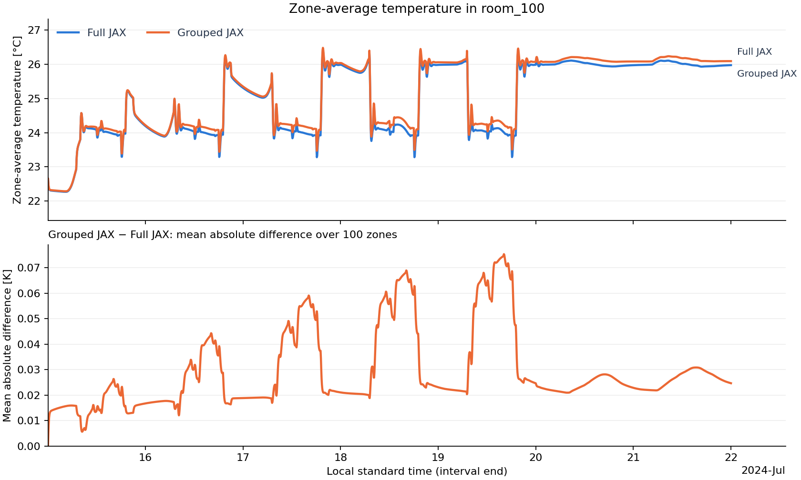

# SBSim 벤치마크 물성치·설비 셋팅 진단 및 정합화 결과

[English](SBSIM_BENCHMARK_SETTINGS_DIAGNOSIS.md) | **한국어**

> 대상: `benchmarks/grouped_jax_study/` 100-zone 사무실 벤치마크
> (`USA_IL_Chicago-OHare.Intl.AP.725300_TMY3.epw`, 2024-07-15부터 7일, 5분 간격
> 2,016스텝)

______________________________________________________________________

## 1. 요약

동일 평면(`5.0 × 4.0 × 3.0 m`, 바닥면적 `20 m²`, 100존)에서 상세 EnergyPlus 24.2 모델은 7일 전체 실내
온도를 **21.07–26.89 °C**로 안정 제어하는 반면, 기존 SBSim 벤치마크는 **평일 32–33.7 °C, 주말 40–42
°C**까지 과열되고 내부존에서도 ±8 °C 재열 스파이크가 발생했습니다.

진단을 통해 확인된 구현 버그 2건과 벤치마크 셋팅 불일치 4건을 모두 수정한 결과는 다음과 같습니다.

| 단계                                                                    | 주요 변경 사항                                                                                                                   |  100존 7일 온도 범위   | `room_1` / `room_100` 최고 | Grouped vs. Full MAE / Max |
| :---------------------------------------------------------------------- | :------------------------------------------------------------------------------------------------------------------------------- | :--------------------: | :------------------------: | :------------------------: |
| **1. 기존 1-CV** (`results/physics_cpu`)                                | 1-CV 무단열 외벽(`k=0.5`), 일사→공기, `PASSIVE_COOL` 버그, 소용량 질량(`30 kJ/m²K`), Bang-Bang VAV(`0.1 kg/s, 16 °C`)            |   `19.80 – 42.00 °C`   |    `39.79` / `39.95 °C`    |   `0.1022` / `0.5597 K`    |
| **2. 일사 + `PASSIVE_COOL` 수정** (`results/physics_solar_passive_fix`) | 투과 일사 → Interior Mass 기본 적용, `PASSIVE_COOL` 냉방 상한 탈출 추가                                                          |   `19.81 – 30.68 °C`   |    `29.62` / `29.86 °C`    |   `0.1299` / `0.5598 K`    |
| **3. 2-CV 외벽 + 정합 물성치 + PI-VAV** (`results/physics_matched_2cv`) | 2-CV 단열 외벽(`k=0.26, ρ=1200`), 슬래브 등가 `InteriorMass`(`200 kJ/m²K`), 주말 내부발열 감소, 적분감쇠 VAV(`0.12 kg/s, 14 °C`) | **`22.10 – 26.46 °C`** |  **`26.42` / `26.40 °C`**  | **`0.0292` / `0.2269 K`**  |
| **4. EnergyPlus 24.2** (기준)                                           | 상세 오피스(`Insulated Facade`, 10 cm 콘크리트 바닥/지붕, Autosize VAV `14 °C`, 비례 제어)                                       | **`21.07 – 26.89 °C`** |  **`26.56` / `26.89 °C`**  |             —              |

`0.5 m` 격자와 EnergyPlus와 동일한 `20.0 m²` 바닥면적을 100% 유지하면서 2-CV 외벽·정합 물성치·적분감쇠 VAV를
적용하자, 코너존 포함 100개 존 모두가 **평일 24.0 °C, 야간/주말 26.0 °C**를 안정 추종하고 Grouped-vs-Full
오차도 \*\*3.5배 감소(`MAE 0.029 K`, `max 0.227 K`)\*\*했습니다.

______________________________________________________________________

## 2. 벤치마크 물성치 및 셋팅 비교 (기존 vs 수정 후 vs EnergyPlus)

### 2.1 기하 및 격자 (`matched_vav/floorplan.py`, `run.py`)

| 항목                   | 기존 벤치마크                           | 수정된 정합 벤치마크                                       | EnergyPlus (`detailed_office.py`)      |
| :--------------------- | :-------------------------------------- | :--------------------------------------------------------- | :------------------------------------- |
| 존 수 / 배치           | 100존 (10 × 10)                         | 100존 (10 × 10)                                            | 100존 (10 × 10)                        |
| 방 실내 면적/체적      | `10 × 8` CVs (`20.0 m²`, `60 m³`)       | **`10 × 8` CVs (`20.0 m²`, `60 m³`, 완전 동일)**           | `20.0 m²`, `60 m³`                     |
| 내벽 두께              | `0.5 m` (1 CV)                          | `0.5 m` (1 CV)                                             | `0.5 m` (`Solid Wall`)                 |
| 외벽 두께              | `0.5 m` (1 CV → 반감 후 `0.25 m`)       | **`1.0 m` (2 CVs → `0.25 + 0.50 = 0.75 m` FVM 유효 두께)** | `0.5 m` `Solid Wall` + `R=1.75` 외단열 |
| 전체 격자 크기 (100존) | `(93, 113)`                             | `(95, 115)` *(외곽 외벽 1층만 확장)*                       | 동일 `bounds_m` 다각형                 |
| `wall_depth_cells`     | `1`                                     | **`2`** *(외측/내측 외벽 층 분리 그룹화)*                  | 다층 CTF                               |
| 창문                   | 폭 `2.0 m` × 높이비 `0.6` (`3.6 m²`/면) | 동일 (`3.6 m²`/면, 2-CV 관통)                              | `2.0 × 1.8 m = 3.6 m²`/면              |

### 2.2 열·광학 물성치

| 구분              | 항목                                                       | SBSim 기본값 (`building.py`)            | 기존 벤치마크                             | 수정된 정합 벤치마크 (`settings.py`, `sbsim_model.py`, `run.py`)                          | EnergyPlus 상세 모델                                                                     |
| :---------------- | :--------------------------------------------------------- | :-------------------------------------- | :---------------------------------------- | :---------------------------------------------------------------------------------------- | :--------------------------------------------------------------------------------------- |
| **실내 공기**     | $k$ / $c_p$ / $\rho$                                       | `50.0` / `700.0` / `1.2`                | `50.0` / `1005.0` / `1.2`                 | `50.0` W/(m·K) / `1005.0` J/(kg·K) / `1.2` kg/m³                                          | 완전 혼합 존 공기                                                                        |
| **내벽**          | $k$ / $c_p$ / $\rho$                                       | `2.0` / `1000.0` / `1800.0`             | `0.5` / `800.0` / `1800.0`                | `0.5` / `800.0` / `1800.0`                                                                | `Solid Wall` (`0.5` / `800` / `1800`)                                                    |
| **외벽**          | $k$ / $c_p$ / $\rho$                                       | `0.05` / `1000.0` / `3000.0`            | `0.5` / `800.0` / `1800.0` ($U=1.70$)     | **`0.26` / `800.0` / `1200.0`** ($U \approx 0.34$, $C/A = 720\ \text{kJ/(m}^2\text{·K)}$) | `R=1.75` 외단열 + `Solid Wall` ($U \approx 0.34$, $C/A = 720\ \text{kJ/(m}^2\text{·K)}$) |
| **외벽 복사**     | $\alpha$ / $\varepsilon$ / $\tau$                          | `0.65` / `0.93` / `0.0`                 | `0.65` / `0.93` / `0.0`                   | `0.65` / `0.93` / `0.0`                                                                   | MediumRough 외벽 표면                                                                    |
| **내벽 복사**     | $\alpha$ / $\varepsilon$ / $\tau$                          | `0.20` / `0.80` / `0.0`                 | `0.20` / `0.80` / `0.0`                   | `0.20` / `0.80` / `0.0`                                                                   | 표준 실내 장파 복사                                                                      |
| **창문(Glazing)** | 광학 / 전도                                                | $\alpha=0.1, \varepsilon=0.9, \tau=0.8$ | $\alpha=0.06, \varepsilon=0.9, \tau=0.33$ | 동일 광학 (`SHGC 0.55 × 0.6`); 전도는 외벽 물성 승계                                      | `SimpleGlazingSystem` ($U=2.8$, $\text{SHGC}=0.55$, 무질량)                              |
| **Interior Mass** | $C/A$, $h_{\text{air}}$, $A_{\text{exp}}/A$, $\varepsilon$ | `30,000`, `3.0`, `1.0`, `0.9`           | `30,000`, `3.0`, `1.0`, `0.9`             | **`200,000` J/(m²·K), `6.0` W/(m²·K), `2.0` m²/m², `0.9`**                                | `10 cm` 콘크리트 바닥+지붕 (`~414,000` J/(m²·K), 2면)                                    |
| **투과 일사**     | 투입 노드                                                  | mass 활성 시 mass                       | 공기(버그)                                | **Interior Mass (`solar_to_interior_mass=True` 기본)**                                    | 바닥 및 실내 표면(복사)                                                                  |

### 2.3 내부 발열 및 HVAC 셋팅

| 항목                          | 기존 벤치마크                                         | 수정된 정합 벤치마크                                           | EnergyPlus 상세 모델                                       |
| :---------------------------- | :---------------------------------------------------- | :------------------------------------------------------------- | :--------------------------------------------------------- |
| **내부 발열**                 | Open Office 피크 `396.7 W/zone`, 주말에도 평일 스케줄 | 평일 동일 + **주말 감소(`재실 0%, 조명 20%, 기기 35%`)**       | 동일 밀도(복사 분율 포함) + 동일 주말 감소                 |
| **설정온도**                  | 평일 07–19시 `21–24 °C`, 야간/주말 `19–26 °C`         | 동일                                                           | 동일                                                       |
| **Thermostat `PASSIVE_COOL`** | 냉방 상한 미검사(주말 48시간 냉방 정지)               | **`cooling_setpoint` 초과 시 `COOL` 전환**                     | Dual-setpoint + NightCycle                                 |
| **VAV 최대풍량**              | `0.005 × 20 = 0.1` (`kg/s`, 밀도 `1.2` 누락)          | **`0.006 × 20 = 0.12 kg/s`** (`0.005 m³/s/m² × 1.2`)           | Autosize (`room_1`: `0.113 kg/s`, `room_55`: `0.038 kg/s`) |
| **AHU 급기온도**              | 냉방 `16.0 °C`, 난방 `15.0 °C`                        | **냉방 `14.0 °C`, 난방 `13.0 °C`**                             | 냉방 설계 `14.0 °C`                                        |
| **VAV 제어 방식**             | 이진 Bang-Bang (`0.1 / 1.0`) + 1-step 지연            | **적분감쇠 변조 VAV (`gain = 0.06 / K`)** *(1-step 지연 안정)* | 연속 비례 제어                                             |

______________________________________________________________________

## 3. 진단 및 해결한 핵심 문제들

1. **투과 일사 → Interior Mass 기본 라우팅 (`grouped_heat_balance.py`,
    `grouped_jax_simulator.py`, `interior_mass.py`, `jax_env.py`)**:
    Full/Grouped JAX 및 `JaxOffice` 모두 `InteriorMass` 활성화 시 투과 일사가 공기가 아닌
    interior mass로 들어가도록 기본값(`solar_to_interior_mass=True`) 수정.
2. **`PASSIVE_COOL` 냉방 상한 버그 (`thermostat.py`, `jax_env.py`)**: Eco 진입·유지 시
    `zone_temp <= cooling_setpoint` 조건을 추가해 주말 40–42 °C 폭주 제거.
3. **1-CV 외벽 두께 반감·외단열 부재·일사 갇힘 문제 (`floorplan.py`, `sbsim_model.py`,
    `run.py`)**:
    - 1-CV 외벽은 경계 반감(`0.25 m`)으로 $U=1.70$까지 악화되고, `k_ext`만 줄이면 외벽 흡수 일사가 실내 복사면에
        갇혀 오히려 실내온도가 상승(`29.8 → 31.5 °C`)하는 구조적 문제가 있었습니다.
    - `PlanSpec(exterior_wall_thickness_m=1.0)`으로 건물 최외곽 외벽만 2-CV로
        확장(`wall_depth_cells=2`)해 방 면적(`20 m²`)을 그대로 유지하면서 외측 일사 흡수층(`0.25 m`)과
        내측 복사/대류층(`0.50 m`)을 분리하고, `k_ext=0.26, ρ_ext=1200`으로 EnergyPlus 외단열
        벽($U \approx 0.34, C/A = 720\ \text{kJ/(m}^2\text{·K)}$)과 정합시켰습니다.
4. **열질량·VAV 단위·제어 안정화·주말 부하 (`settings.py`, `office_loads.py`,
    `sbsim_model.py`, `run.py`)**:
    - 슬래브 등가 `InteriorMass`(`200 kJ/(m²·K), h=6, A=2`), `0.12 kg/s @ 14 °C`, 주말
        내부발열 감소를 반영.
    - 1-step(5분) 지연 루프에서 Bang-Bang이나 고이득 비례 제어가 유발하는 진동을 없애기 위해 적분감쇠 변조
        VAV(`gain = 0.06 / K`)를 적용해 정상오차 없이 평일 24 °C·주말 26 °C를 매끄럽게 추종하도록 개선했습니다.

______________________________________________________________________

## 4. 최종 100-Zone 7일 Physics Comparison 결과 (`results/physics_matched_2cv/`)

- 상태 수: Full `18,509` → Grouped `789` (**23.5× 축소**)
- **선형화 오차 (Full linear vs Full nonlinear)**: MAE `0.00003 K`, Max `0.00084 K`
- **그룹화 오차 (Grouped linear vs Full nonlinear)**: MAE **`0.02917 K`**, p95
    **`0.08851 K`**, Max **`0.22686 K`**

### 4.1 동일 Adiabatic 조건 3자 비교 (Full JAX vs. Grouped JAX vs. Adiabatic EnergyPlus)

동일 조건의 다층 오피스 중간층에서는 상·하층 대칭성($\partial T / \partial z \approx 0$)으로 인해 바닥·천장이
**Adiabatic**(별도 `T_ground` 없음)인 것이 물리적으로 정확합니다. EnergyPlus 상세 모델의 바닥·천장만
`Adiabatic` 10 cm 콘크리트 슬래브로 맞춰 비교한 결과입니다:

| 존                     | Full JAX (Adiabatic) | Grouped JAX (Adiabatic) | EnergyPlus (Adiabatic) | MAE (Full JAX vs. E+ Adiab) |
| :--------------------- | :------------------: | :---------------------: | :--------------------: | --------------------------: |
| **100존 전체**         |  `22.10 – 26.46 °C`  |   `22.12 – 26.49 °C`    |   `20.09 – 27.18 °C`   |                   `1.417 K` |
| `room_1` (북서 코너)   |  `22.17 – 26.42 °C`  |   `22.18 – 26.43 °C`    |   `23.74 – 26.93 °C`   |               **`0.683 K`** |
| `room_100` (남동 코너) |  `22.27 – 26.40 °C`  |   `22.28 – 26.48 °C`    |   `24.00 – 27.18 °C`   |               **`0.581 K`** |
| `room_5` (북향 외주)   |  `22.18 – 25.83 °C`  |   `22.19 – 25.83 °C`    |   `22.48 – 25.02 °C`   |                   `1.185 K` |
| `room_55` (내부존)     |  `22.17 – 24.42 °C`  |   `22.19 – 24.43 °C`    |   `20.48 – 23.11 °C`   |                   `1.645 K` |

남아 있는 EnergyPlus와의 차이는 주로 외피 물리가 아닌 HVAC 운전 방식 차이에서 기인합니다:

- **EnergyPlus 야간/주말 진동 (`0.17–0.33 K/step`, 주간은 `0.000 K/step`)**:
    `detailed_vav_hvac.py`가 `22:00–06:00` 및 주말에 AHU를 끄고
    `AvailabilityManager:NightCycle`(`CycleOnAny`, 30분 고정 가동)을 사용하여, 코너존이 상한을 넘을
    때마다 20존 루프 전체를 30분간 반복 강제 가동하기 때문입니다.
- **EnergyPlus의 큰 존 간 편차 (평일 `std 0.87 K` / 주말 `1.89 K` vs SBSim `0.04 K` /
    `1.19 K`)**: EnergyPlus는 VAV 최소풍량비가 `30%`(+ ASHRAE 62.1 최소 환기량)라 부하가 작은
    내부존(`room_55`)이 `21–24 °C` deadband 중간(`~22.1 °C`, 주말 NightCycle 시
    `~20.6 °C`)까지 과냉되는 반면, SBSim은 최소 댐퍼가 `10%`(`~-120 W < ~300 W` 주간 내부발열)라 전 존이
    주간에 `24.0 °C` 설정온도에 밀착합니다.

______________________________________________________________________

## 5. EnergyPlus 대비 남아 있는 소규모 구조적 차이

1. **Glazing 전도 물성**: `building.py`에서 창문 셀(`4`)이 전도 행렬에서는 외벽 물성(`U ≈ 0.34`, 열용량
    포함)을 사용합니다(광학 투과 `SHGC 0.55 × 0.6`은 일치).
2. **2D 지중/지붕 경계**: 바닥·천장의 열용량은 `InteriorMass`로 모사하며, 7월 지중(22.2 °C) 직접 열침이나 지붕
    외기 손실은 별도 모델링하지 않습니다.
3. **내부 발열 복사 분율**: 인체·조명·기기 현열을 100% 공기 노드로 투입합니다.
