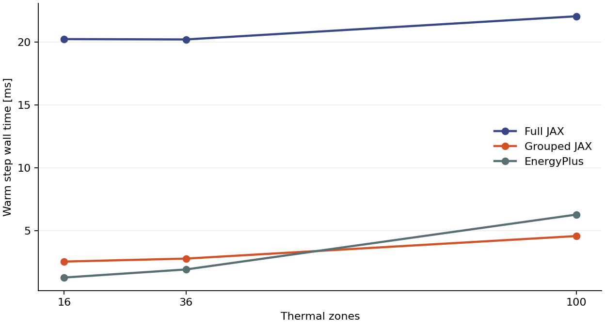
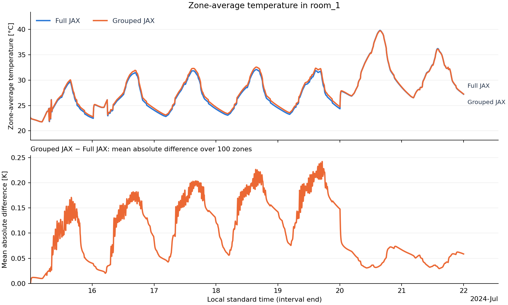

[English](REPORT.md)

# 전체·그룹 SBSim과 상세 EnergyPlus 비교

2024-07-15부터 7일간 USA_IL_Chicago-OHare.Intl.AP.725300_TMY3.epw의 같은 날씨를 사용했다. 구역은
5 × 4 m, 격자는 0.5 m, 외벽 창 폭은 2.0 m다. 시간 간격은 5분이며, 에피소드당 2,016스텝이다.

JAX 0.4.34에서 NVIDIA GeForce RTX 3080를 사용했다. 상세 EnergyPlus 입력 버전은 `24.2`이다.

SBSim 전체 노드와 그룹 노드는 같은 외피·공기·열질량 물성과 VAV 계통을 사용한다. 상세 EnergyPlus에는 별도의 외피·부하·공조
구현이 있으므로 엔진 간 온도 차이에는 이런 모델 차이도 들어간다.

실행에 사용한 논리 CPU는 `[0, 1, 2, 3, 4, 5, 6, 7, 8, 9, 10, 11, 12, 13, 14, 15]`이다.

부분별 그룹 풀이 설정은 timing `dense`, physics `cg`이다.

## 고정 설정온도 스텝 시간

주중 07–19시는 21–24 °C, 그 밖의 시간은 19–26 °C 설정을 적용했다. 첫 스텝을 제외한 평균에는 설정온도 적용, 시뮬레이션,
관측과 EnergyPlus 프로세스 통신이 포함된다.

| 존 수 | 엔진        | 초기화 초 | 리셋 초 | 첫 스텝 초 | 이후 ms/스텝 | 상태 수 |
| ----: | ----------- | --------: | ------: | ---------: | -----------: | ------: |
|    16 | Full JAX    |     1.719 |   0.001 |      0.020 |       20.233 |    2945 |
|    16 | Grouped JAX |     0.312 |   0.001 |      0.017 |        2.527 |     129 |
|    16 | EnergyPlus  |     4.625 |   2.278 |      0.005 |        1.257 |       — |
|    36 | Full JAX    |     2.149 |   0.002 |      0.038 |       20.206 |    6565 |
|    36 | Grouped JAX |     0.268 |   0.001 |      0.016 |        2.766 |     253 |
|    36 | EnergyPlus  |     2.832 |   3.564 |      0.003 |        1.901 |       — |
|   100 | Full JAX    |    10.171 |   0.002 |      0.036 |       22.049 |   18101 |
|   100 | Grouped JAX |     0.598 |   0.002 |      0.009 |        4.559 |     621 |
|   100 | EnergyPlus  |     2.902 |   9.808 |      0.007 |        6.265 |       — |

100존의 전체 JAX와 EnergyPlus 스텝 시간은 그룹 JAX의 각각 4.84배와 1.37배였다.

측정값 `timing.csv`

## 장파 선형화와 격자 그룹화에 따른 온도 차이

100존 전체 비선형 SBSim에서 적용한 디퓨저별 HVAC 열을 기록했다. 전체 선형 및 그룹 선형 SBSim에 같은 열을 재생해 장파
선형화와 격자 그룹화의 효과를 비교했다. 세 변형 모두 실내·외 복사와 내부 열질량을 사용한다.

| 비교                     | 평균 절대 오차 K | RMSE K | 95백분위 K | 최대 K |
| ------------------------ | ---------------: | -----: | ---------: | -----: |
| 전체 선형 대 전체 비선형 |           0.0001 | 0.0002 |     0.0006 | 0.0022 |
| 그룹 선형 대 전체 비선형 |           0.1022 | 0.1505 |     0.3500 | 0.5597 |
| 그룹 선형 대 전체 선형   |           0.1022 | 0.1505 |     0.3497 | 0.5586 |

| 열수지      | 풀이 | 상태 수 | LU·선형 풀이 횟수별 스텝 수              | 이후 ms/스텝 |
| ----------- | ---- | ------: | ---------------------------------------- | -----------: |
| Full JAX    | `cg` |  18,101 | 2회 풀이 × 478스텝, 3회 풀이 × 1,538스텝 |       21.412 |
| Full linear | `cg` |  18,101 | 1회 풀이 × 2,016스텝                     |       14.907 |
| Grouped JAX | `cg` |     621 | 1회 풀이 × 2,016스텝                     |        4.535 |

전체 비선형 기준 시간에는 HVAC 피드백과 열량 기록이, 두 선형 모델의 시간에는 고정 열량 재생과 존 온도 읽기가 들어간다.

위 패널은 시간평균 절대오차가 가장 큰 대표 존에서 Full JAX와 Grouped JAX의 존 평균온도 [°C]를 직접 겹쳐 보여준다. 이번
비교에는 Full linear 곡선을 추가하지 않는다. 온도는 각 모델이 계산한 존 평균이며 개별 유한체적 셀이 아니다. 아래 패널은 모든 존의
두 온도 곡선 차이를 절댓값으로 평균한 값 [K]이다. 백분위수 곡선은 표시하지 않는다.

5분 온도 시계열 `physics.csv`, 오차 통계 `physics_errors.csv`, 온도와 HVAC 열 `physics.npz`

환경과 집계값 `summary.json`
