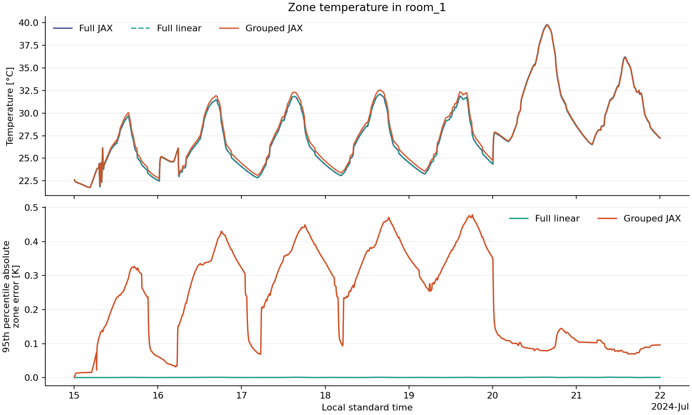

[한국어](REPORT_ko.md)

# Full and Grouped SBSim Compared with Detailed EnergyPlus

The same weather from USA_IL_Chicago-OHare.Intl.AP.725300_TMY3.epw was used for
7 days starting on 2024-07-15. Zones measure 5 × 4 m, the grid spacing is 0.5 m,
and the exterior-window width is 2.0 m. The time interval is 5 minutes, with
2,016 steps per episode.

JAX 0.4.34 ran on cpu. The detailed EnergyPlus input version is `24.2`.

The full-node and grouped-node SBSim models use the same envelope, air, and
thermal-mass properties and VAV system. Detailed EnergyPlus has separate
envelope, load, and HVAC implementations, so temperature differences between
engines also include these modeling differences.

The logical CPUs used for the run were `[8]`.

## Temperature Differences from Longwave Linearization and Grid Grouping

HVAC heat by diffuser was recorded from the 100-zone full nonlinear SBSim run.
The same heat was replayed in full linear and grouped linear SBSim to compare
the effects of longwave linearization and grid grouping. All three variants use
indoor and outdoor radiation and interior thermal mass.

| Comparison                        |  MAE K | RMSE K | 95th percentile K | Maximum K |
| --------------------------------- | -----: | -----: | ----------------: | --------: |
| Full linear vs. full nonlinear    | 0.0001 | 0.0002 |            0.0006 |    0.0022 |
| Grouped linear vs. full nonlinear | 0.1022 | 0.1505 |            0.3500 |    0.5597 |
| Grouped linear vs. full linear    | 0.1022 | 0.1505 |            0.3497 |    0.5586 |

| Heat balance | Solver      | States | Steps by LU/linear-solve count               | Subsequent ms/step |
| ------------ | ----------- | -----: | -------------------------------------------- | -----------------: |
| Full JAX     | `cg`        | 18,101 | 2 solves × 478 steps, 3 solves × 1,538 steps |             42.561 |
| Full linear  | `sparse_lu` | 18,101 | 1 solve × 2,016 steps                        |              8.672 |
| Grouped JAX  | `sparse_lu` |    621 | 1 solve × 2,016 steps                        |              0.607 |

The full nonlinear baseline timing includes HVAC feedback and heat recording;
timing for the two linear models includes fixed-heat replay and zone-temperature
reads.

Five-minute temperature time series: `physics.csv`; error statistics:
`physics_errors.csv`; temperatures and HVAC heat: `physics.npz`

Environment and aggregate values: `summary.json`
