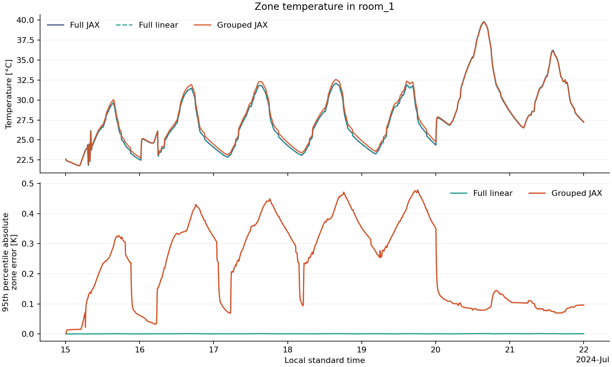

[English](REPORT.md)

# 전체·그룹 SBSim과 상세 EnergyPlus 비교

2024-07-15부터 7일간 USA_IL_Chicago-OHare.Intl.AP.725300_TMY3.epw의 같은 날씨를 사용했다. 구역은
5 × 4 m, 격자는 0.5 m, 외벽 창 폭은 2.0 m다. 시간 간격은 5분이며, 에피소드당 2,016스텝이다.

JAX 0.4.34에서 cpu를 사용했다. 상세 EnergyPlus 입력 버전은 `24.2`이다.

SBSim 전체 노드와 그룹 노드는 같은 외피·공기·열질량 물성과 VAV 계통을 사용한다. 상세 EnergyPlus에는 별도의 외피·부하·공조
구현이 있으므로 엔진 간 온도 차이에는 이런 모델 차이도 들어간다.

실행에 사용한 논리 CPU는 `[8]`이다.

## 장파 선형화와 격자 그룹화에 따른 온도 차이

100존 전체 비선형 SBSim에서 적용한 디퓨저별 HVAC 열을 기록했다. 전체 선형 및 그룹 선형 SBSim에 같은 열을 재생해 장파
선형화와 격자 그룹화의 효과를 비교했다. 세 변형 모두 실내·외 복사와 내부 열질량을 사용한다.

| 비교                     | 평균 절대 오차 K | RMSE K | 95백분위 K | 최대 K |
| ------------------------ | ---------------: | -----: | ---------: | -----: |
| 전체 선형 대 전체 비선형 |           0.0001 | 0.0002 |     0.0006 | 0.0022 |
| 그룹 선형 대 전체 비선형 |           0.1022 | 0.1505 |     0.3500 | 0.5597 |
| 그룹 선형 대 전체 선형   |           0.1022 | 0.1505 |     0.3497 | 0.5586 |

| 열수지      | 풀이        | 상태 수 | LU·선형 풀이 횟수별 스텝 수              | 이후 ms/스텝 |
| ----------- | ----------- | ------: | ---------------------------------------- | -----------: |
| Full JAX    | `cg`        |  18,101 | 2회 풀이 × 478스텝, 3회 풀이 × 1,538스텝 |       42.561 |
| Full linear | `sparse_lu` |  18,101 | 1회 풀이 × 2,016스텝                     |        8.672 |
| Grouped JAX | `sparse_lu` |     621 | 1회 풀이 × 2,016스텝                     |        0.607 |

전체 비선형 기준 시간에는 HVAC 피드백과 열량 기록이, 두 선형 모델의 시간에는 고정 열량 재생과 존 온도 읽기가 들어간다.

5분 온도 시계열 `physics.csv`, 오차 통계 `physics_errors.csv`, 온도와 HVAC 열 `physics.npz`

환경과 집계값 `summary.json`
