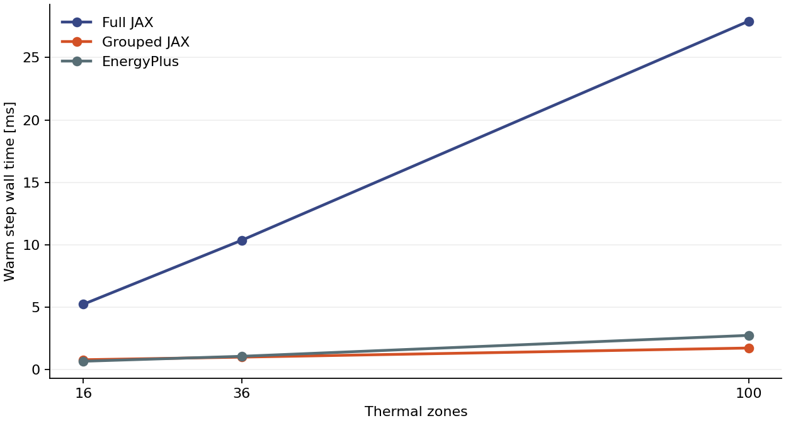
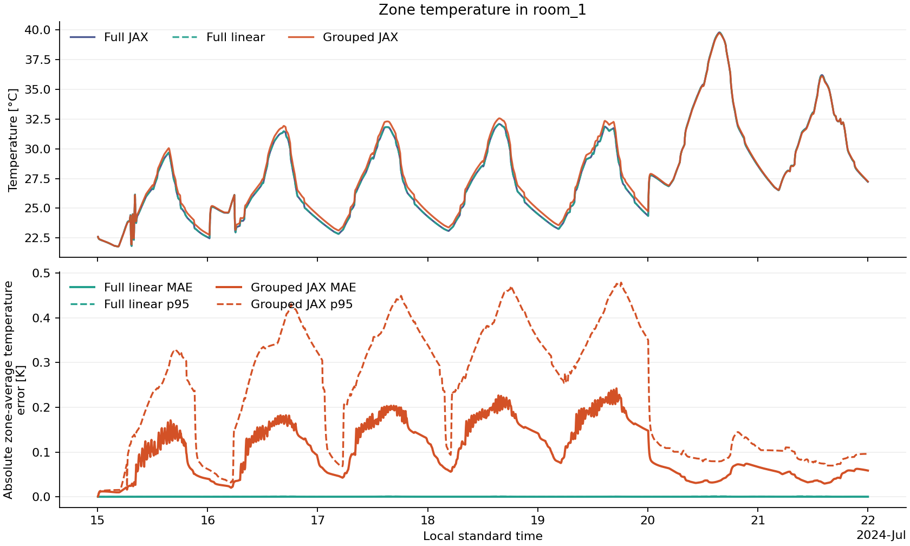
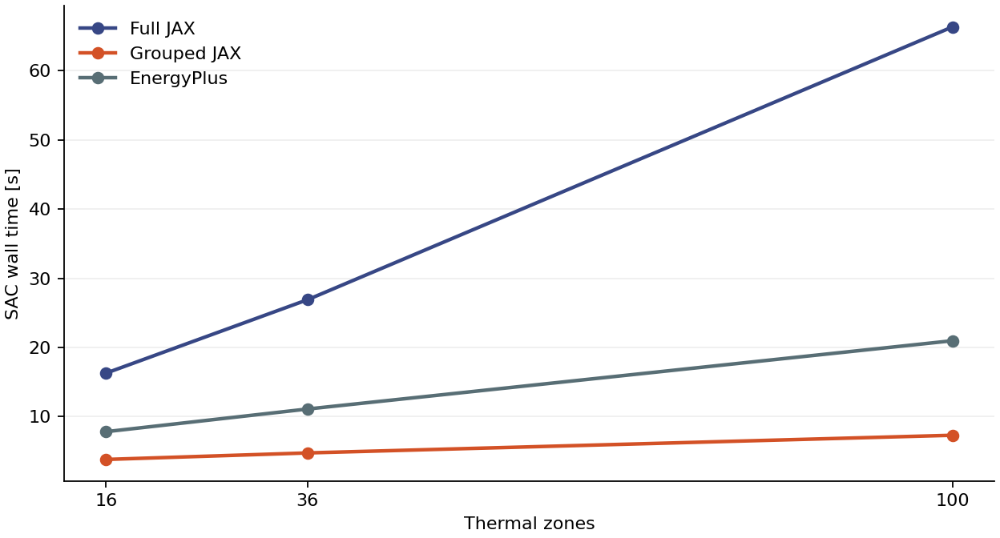

[한국어](REPORT_ko.md)

# Full and Grouped SBSim Compared with Detailed EnergyPlus

The same weather from USA_IL_Chicago-OHare.Intl.AP.725300_TMY3.epw was used for
7 days starting on 2024-07-15. Zones measure 5 × 4 m, the grid spacing is 0.5 m,
and the exterior-window width is 2.0 m. The time interval is 5 minutes, with
2,016 steps per episode.

JAX 0.4.34 ran on cpu. The detailed EnergyPlus input version is `24.2`.

The full-node and grouped-node SBSim models use the same envelope, air, and
thermal-mass properties and VAV system. Detailed EnergyPlus has separate
envelope, load, and HVAC implementations, so temperature differences between
engines also include these modeling differences.

The logical CPUs used for the run were `[8]`.

The grouped solver setting for each section was timing `dense`, physics
`sparse_lu`, sac `dense`.

## Step Time at Fixed Setpoints

A 21–24 °C setpoint range was applied on weekdays from 07:00–19:00 and 19–26 °C
at all other times. The average excluding the first step includes setpoint
application, simulation, observation, and EnergyPlus process communication.

| Zones | Engine      | Initialization s | Reset s | First step s | Subsequent ms/step | States |
| ----: | ----------- | ---------------: | ------: | -----------: | -----------------: | -----: |
|    16 | Full JAX    |            0.443 |   0.001 |        0.006 |              5.240 |   2945 |
|    16 | Grouped JAX |            0.147 |   0.001 |        0.002 |              0.797 |    129 |
|    16 | EnergyPlus  |            1.840 |   1.360 |        0.002 |              0.679 |      — |
|    36 | Full JAX    |            0.508 |   0.001 |        0.008 |             10.365 |   6565 |
|    36 | Grouped JAX |            0.215 |   0.001 |        0.002 |              1.008 |    253 |
|    36 | EnergyPlus  |            1.829 |   2.663 |        0.002 |              1.074 |      — |
|   100 | Full JAX    |            1.015 |   0.001 |        0.019 |             27.906 |  18101 |
|   100 | Grouped JAX |            0.442 |   0.001 |        0.003 |              1.736 |    621 |
|   100 | EnergyPlus  |            1.892 |   6.012 |        0.003 |              2.748 |      — |

At 100 zones, the full JAX and EnergyPlus step times were 16.07 and 1.58 times
the grouped JAX step time, respectively.

Measurements: `timing.csv`

## Temperature Differences from Longwave Linearization and Grid Grouping

HVAC heat by diffuser was recorded from the 100-zone full nonlinear SBSim run.
The same heat was replayed in full linear and grouped linear SBSim to compare
the effects of longwave linearization and grid grouping. All three variants use
indoor and outdoor radiation and interior thermal mass.

| Comparison                        |  MAE K | RMSE K | 95th percentile K | Maximum K |
| --------------------------------- | -----: | -----: | ----------------: | --------: |
| Full linear vs. full nonlinear    | 0.0001 | 0.0002 |            0.0006 |    0.0022 |
| Grouped linear vs. full nonlinear | 0.1022 | 0.1505 |            0.3500 |    0.5597 |
| Grouped linear vs. full linear    | 0.1022 | 0.1505 |            0.3497 |    0.5586 |

| Heat balance | Solver      | States | Steps by LU/linear-solve count               | Subsequent ms/step |
| ------------ | ----------- | -----: | -------------------------------------------- | -----------------: |
| Full JAX     | `cg`        | 18,101 | 2 solves × 478 steps, 3 solves × 1,538 steps |             29.252 |
| Full linear  | `sparse_lu` | 18,101 | 1 solve × 2,016 steps                        |              3.742 |
| Grouped JAX  | `sparse_lu` |    621 | 1 solve × 2,016 steps                        |              0.411 |

The full nonlinear baseline timing includes HVAC feedback and heat recording;
timing for the two linear models includes fixed-heat replay and zone-temperature
reads.

The top panel shows one representative zone, selected by its largest
time-average absolute error. Every temperature is a zone-average temperature
from the corresponding model. In the bottom panel, solid lines are the mean
absolute error over all zones at each time, and dashed lines are the 95th
percentile of those zone errors at the same time. The p95 can exceed the error
visible in the selected zone because it summarizes the upper tail across all
zones. Scalars in the table use all time × zone samples together, not
percentiles over the per-time p95 series.

Five-minute temperature time series: `physics.csv`; error statistics:
`physics_errors.csv`; temperatures and HVAC heat: `physics.npz`

## Actual SAC Training

JAX SAC was trained for one episode per environment with seed 0. 8 updates were
performed every 96 transitions, with batch size 256. Heating and cooling
setpoints were controlled independently in each zone. The reward was the
negative zone-average amount by which temperatures fell outside 21–24 °C.

| Zones | Engine      | Simulator device | Learner device | Transitions | Updates | Total s | Simulator ms/transition |
| ----: | ----------- | ---------------- | -------------- | ----------: | ------: | ------: | ----------------------: |
|    16 | Full JAX    | CPU              | CPU            |       2,016 |     168 |   16.30 |                   5.297 |
|    16 | Grouped JAX | CPU              | CPU            |       2,016 |     168 |    3.81 |                   0.853 |
|    16 | EnergyPlus  | CPU              | CPU            |       2,016 |     168 |    7.83 |                   0.908 |
|    36 | Full JAX    | CPU              | CPU            |       2,016 |     168 |   26.91 |                  10.479 |
|    36 | Grouped JAX | CPU              | CPU            |       2,016 |     168 |    4.76 |                   1.093 |
|    36 | EnergyPlus  | CPU              | CPU            |       2,016 |     168 |   11.10 |                   1.693 |
|   100 | Full JAX    | CPU              | CPU            |       2,016 |     168 |   66.33 |                  29.245 |
|   100 | Grouped JAX | CPU              | CPU            |       2,016 |     168 |    7.31 |                   1.761 |
|   100 | EnergyPlus  | CPU              | CPU            |       2,016 |     168 |   20.97 |                   4.467 |

SAC timing and training statistics: `sac.csv`

Environment and aggregate values: `summary.json`
