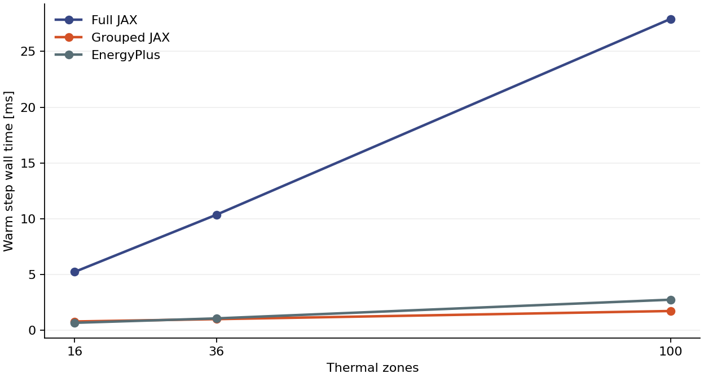
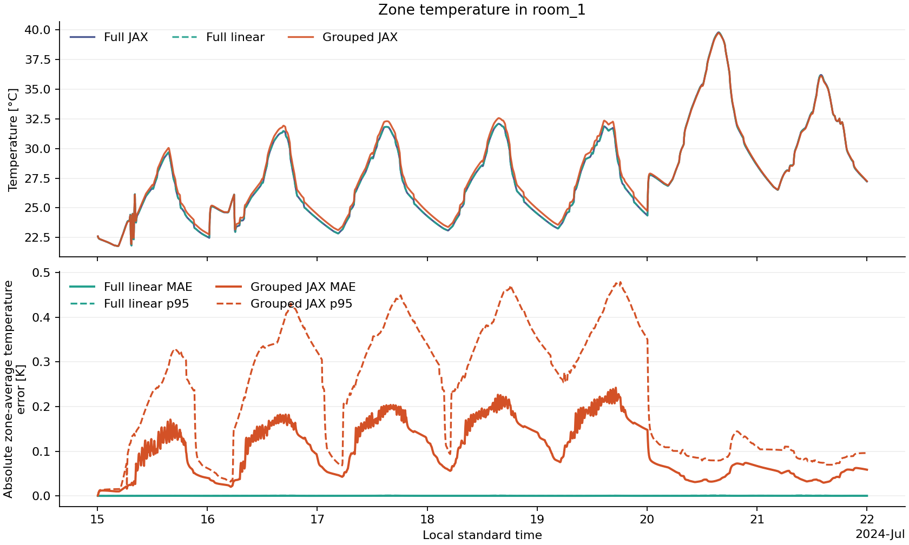
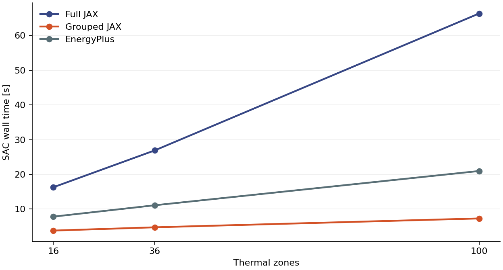

[English](REPORT.md)

# 전체·그룹 SBSim과 상세 EnergyPlus 비교

2024-07-15부터 7일간 USA_IL_Chicago-OHare.Intl.AP.725300_TMY3.epw의 같은 날씨를 사용했다. 구역은
5 × 4 m, 격자는 0.5 m, 외벽 창 폭은 2.0 m다. 시간 간격은 5분이며, 에피소드당 2,016스텝이다.

JAX 0.4.34에서 cpu를 사용했다. 상세 EnergyPlus 입력 버전은 `24.2`이다.

SBSim 전체 노드와 그룹 노드는 같은 외피·공기·열질량 물성과 VAV 계통을 사용한다. 상세 EnergyPlus에는 별도의 외피·부하·공조
구현이 있으므로 엔진 간 온도 차이에는 이런 모델 차이도 들어간다.

실행에 사용한 논리 CPU는 `[8]`이다.

부분별 그룹 풀이 설정은 timing `dense`, physics `sparse_lu`, sac `dense`이다.

## 고정 설정온도 스텝 시간

주중 07–19시는 21–24 °C, 그 밖의 시간은 19–26 °C 설정을 적용했다. 첫 스텝을 제외한 평균에는 설정온도 적용, 시뮬레이션,
관측과 EnergyPlus 프로세스 통신이 포함된다.

| 존 수 | 엔진        | 초기화 초 | 리셋 초 | 첫 스텝 초 | 이후 ms/스텝 | 상태 수 |
| ----: | ----------- | --------: | ------: | ---------: | -----------: | ------: |
|    16 | Full JAX    |     0.443 |   0.001 |      0.006 |        5.240 |    2945 |
|    16 | Grouped JAX |     0.147 |   0.001 |      0.002 |        0.797 |     129 |
|    16 | EnergyPlus  |     1.840 |   1.360 |      0.002 |        0.679 |       — |
|    36 | Full JAX    |     0.508 |   0.001 |      0.008 |       10.365 |    6565 |
|    36 | Grouped JAX |     0.215 |   0.001 |      0.002 |        1.008 |     253 |
|    36 | EnergyPlus  |     1.829 |   2.663 |      0.002 |        1.074 |       — |
|   100 | Full JAX    |     1.015 |   0.001 |      0.019 |       27.906 |   18101 |
|   100 | Grouped JAX |     0.442 |   0.001 |      0.003 |        1.736 |     621 |
|   100 | EnergyPlus  |     1.892 |   6.012 |      0.003 |        2.748 |       — |

100존의 전체 JAX와 EnergyPlus 스텝 시간은 그룹 JAX의 각각 16.07배와 1.58배였다.

측정값 `timing.csv`

## 장파 선형화와 격자 그룹화에 따른 온도 차이

100존 전체 비선형 SBSim에서 적용한 디퓨저별 HVAC 열을 기록했다. 전체 선형 및 그룹 선형 SBSim에 같은 열을 재생해 장파
선형화와 격자 그룹화의 효과를 비교했다. 세 변형 모두 실내·외 복사와 내부 열질량을 사용한다.

| 비교                     | 평균 절대 오차 K | RMSE K | 95백분위 K | 최대 K |
| ------------------------ | ---------------: | -----: | ---------: | -----: |
| 전체 선형 대 전체 비선형 |           0.0001 | 0.0002 |     0.0006 | 0.0022 |
| 그룹 선형 대 전체 비선형 |           0.1022 | 0.1505 |     0.3500 | 0.5597 |
| 그룹 선형 대 전체 선형   |           0.1022 | 0.1505 |     0.3497 | 0.5586 |

| 열수지      | 풀이        | 상태 수 | LU·선형 풀이 횟수별 스텝 수              | 이후 ms/스텝 |
| ----------- | ----------- | ------: | ---------------------------------------- | -----------: |
| Full JAX    | `cg`        |  18,101 | 2회 풀이 × 478스텝, 3회 풀이 × 1,538스텝 |       29.252 |
| Full linear | `sparse_lu` |  18,101 | 1회 풀이 × 2,016스텝                     |        3.742 |
| Grouped JAX | `sparse_lu` |     621 | 1회 풀이 × 2,016스텝                     |        0.411 |

전체 비선형 기준 시간에는 HVAC 피드백과 열량 기록이, 두 선형 모델의 시간에는 고정 열량 재생과 존 온도 읽기가 들어간다.

위 패널은 시간평균 절대오차가 가장 큰 대표 존 하나를 보여준다. 모든 온도 곡선은 개별 유한체적 셀이 아니라 각 모델이 계산한 존 평균온도다.
아래 패널의 실선은 각 시각 전체 존의 절대오차 평균 (MAE), 점선은 같은 시각 전체 존 절대오차의 95백분위(p95)다. p95는 모든
존의 오차 분포에서 꼬리를 보여주므로 위에서 선택한 존의 오차보다 커질 수 있다. 표의 스칼라 통계는 전체 time×zone 샘플을 한 번에
집계한 것이며, 시간별 p95 곡선의 백분위가 아니다.

5분 온도 시계열 `physics.csv`, 오차 통계 `physics_errors.csv`, 온도와 HVAC 열 `physics.npz`

## 실제 SAC 학습

환경마다 한 에피소드, 시드 0로 JAX SAC를 학습했다. 96개 전이마다 8회 업데이트하고 배치 크기는 256다. 각 존의 난방·냉방 설정을
독립 제어하고, 21–24 °C 범위를 벗어난 온도의 존 평균에 음의 부호를 붙여 보상으로 사용했다.

| 존 수 | 엔진        | 열수지 장치 | 학습 장치 |  전이 | 업데이트 | 전체 초 | 시뮬레이터 ms/전이 |
| ----: | ----------- | ----------- | --------- | ----: | -------: | ------: | -----------------: |
|    16 | Full JAX    | CPU         | CPU       | 2,016 |      168 |   16.30 |              5.297 |
|    16 | Grouped JAX | CPU         | CPU       | 2,016 |      168 |    3.81 |              0.853 |
|    16 | EnergyPlus  | CPU         | CPU       | 2,016 |      168 |    7.83 |              0.908 |
|    36 | Full JAX    | CPU         | CPU       | 2,016 |      168 |   26.91 |             10.479 |
|    36 | Grouped JAX | CPU         | CPU       | 2,016 |      168 |    4.76 |              1.093 |
|    36 | EnergyPlus  | CPU         | CPU       | 2,016 |      168 |   11.10 |              1.693 |
|   100 | Full JAX    | CPU         | CPU       | 2,016 |      168 |   66.33 |             29.245 |
|   100 | Grouped JAX | CPU         | CPU       | 2,016 |      168 |    7.31 |              1.761 |
|   100 | EnergyPlus  | CPU         | CPU       | 2,016 |      168 |   20.97 |              4.467 |

SAC 시간 및 학습 통계 `sac.csv`

환경과 집계값 `summary.json`
