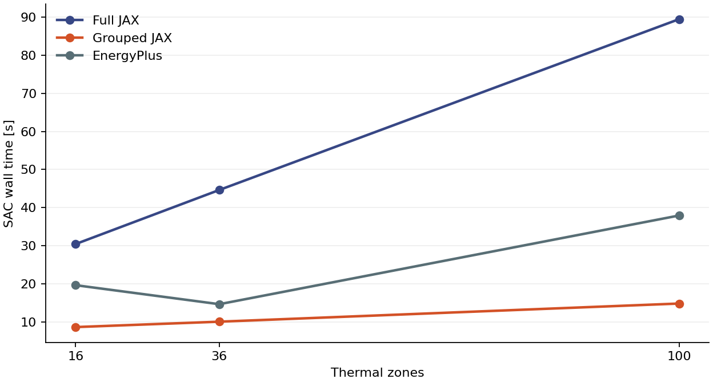

[한국어](REPORT_ko.md)

# Full and Grouped SBSim Compared with Detailed EnergyPlus

The same weather from USA_IL_Chicago-OHare.Intl.AP.725300_TMY3.epw was used for
7 days starting on 2024-07-15. Zones measure 5 × 4 m, the grid spacing is 0.5 m,
and the exterior-window width is 2.0 m. The time interval is 5 minutes, with
2,016 steps per episode.

JAX 0.4.34 ran on cpu. The detailed EnergyPlus input version is `24.2`.

The full-node and grouped-node SBSim models use the same envelope, air, and
thermal-mass properties and VAV system. Detailed EnergyPlus has separate
envelope, load, and HVAC implementations, so temperature differences between
engines also include these modeling differences.

The logical CPUs used for the run were `[6]`.

## Actual SAC Training

JAX SAC was trained for one episode per environment with seed 0. 8 updates were
performed every 96 transitions, with batch size 256. Heating and cooling
setpoints were controlled independently in each zone. The reward was the
negative zone-average amount by which temperatures fell outside 21–24 °C.

| Zones | Engine      | Simulator device | Learner device | Transitions | Updates | Total s | Simulator ms/transition |
| ----: | ----------- | ---------------- | -------------- | ----------: | ------: | ------: | ----------------------: |
|    16 | Full JAX    | CPU              | CPU            |       2,016 |     168 |   30.45 |                   9.626 |
|    16 | Grouped JAX | CPU              | CPU            |       2,016 |     168 |    8.66 |                   2.170 |
|    16 | EnergyPlus  | CPU              | CPU            |       2,016 |     168 |   19.65 |                   3.125 |
|    36 | Full JAX    | CPU              | CPU            |       2,016 |     168 |   44.64 |                  16.666 |
|    36 | Grouped JAX | CPU              | CPU            |       2,016 |     168 |   10.07 |                   2.644 |
|    36 | EnergyPlus  | CPU              | CPU            |       2,016 |     168 |   14.66 |                   2.275 |
|   100 | Full JAX    | CPU              | CPU            |       2,016 |     168 |   89.46 |                  39.390 |
|   100 | Grouped JAX | CPU              | CPU            |       2,016 |     168 |   14.84 |                   4.128 |
|   100 | EnergyPlus  | CPU              | CPU            |       2,016 |     168 |   37.94 |                   8.472 |

SAC timing and training statistics: `sac.csv`

Environment and aggregate values: `summary.json`
