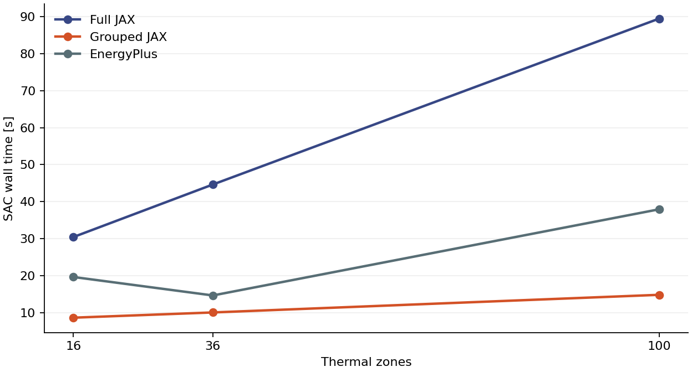

[English](REPORT.md)

# 전체·그룹 SBSim과 상세 EnergyPlus 비교

2024-07-15부터 7일간 USA_IL_Chicago-OHare.Intl.AP.725300_TMY3.epw의 같은 날씨를 사용했다. 구역은
5 × 4 m, 격자는 0.5 m, 외벽 창 폭은 2.0 m다. 시간 간격은 5분이며, 에피소드당 2,016스텝이다.

JAX 0.4.34에서 cpu를 사용했다. 상세 EnergyPlus 입력 버전은 `24.2`이다.

SBSim 전체 노드와 그룹 노드는 같은 외피·공기·열질량 물성과 VAV 계통을 사용한다. 상세 EnergyPlus에는 별도의 외피·부하·공조
구현이 있으므로 엔진 간 온도 차이에는 이런 모델 차이도 들어간다.

실행에 사용한 논리 CPU는 `[6]`이다.

## 실제 SAC 학습

환경마다 한 에피소드, 시드 0로 JAX SAC를 학습했다. 96개 전이마다 8회 업데이트하고 배치 크기는 256다. 각 존의 난방·냉방 설정을
독립 제어하고, 21–24 °C 범위를 벗어난 온도의 존 평균에 음의 부호를 붙여 보상으로 사용했다.

| 존 수 | 엔진        | 열수지 장치 | 학습 장치 |  전이 | 업데이트 | 전체 초 | 시뮬레이터 ms/전이 |
| ----: | ----------- | ----------- | --------- | ----: | -------: | ------: | -----------------: |
|    16 | Full JAX    | CPU         | CPU       | 2,016 |      168 |   30.45 |              9.626 |
|    16 | Grouped JAX | CPU         | CPU       | 2,016 |      168 |    8.66 |              2.170 |
|    16 | EnergyPlus  | CPU         | CPU       | 2,016 |      168 |   19.65 |              3.125 |
|    36 | Full JAX    | CPU         | CPU       | 2,016 |      168 |   44.64 |             16.666 |
|    36 | Grouped JAX | CPU         | CPU       | 2,016 |      168 |   10.07 |              2.644 |
|    36 | EnergyPlus  | CPU         | CPU       | 2,016 |      168 |   14.66 |              2.275 |
|   100 | Full JAX    | CPU         | CPU       | 2,016 |      168 |   89.46 |             39.390 |
|   100 | Grouped JAX | CPU         | CPU       | 2,016 |      168 |   14.84 |              4.128 |
|   100 | EnergyPlus  | CPU         | CPU       | 2,016 |      168 |   37.94 |              8.472 |

SAC 시간 및 학습 통계 `sac.csv`

환경과 집계값 `summary.json`
