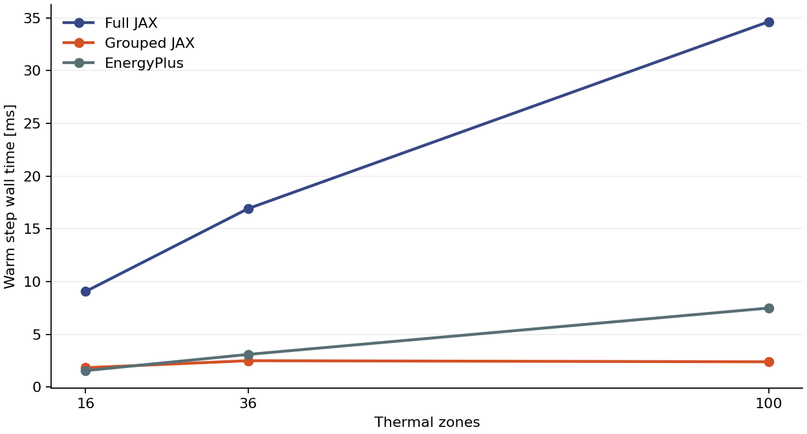

[한국어](REPORT_ko.md)

# Full and Grouped SBSim Compared with Detailed EnergyPlus

The same weather from USA_IL_Chicago-OHare.Intl.AP.725300_TMY3.epw was used for
7 days starting on 2024-07-15. Zones measure 5 × 4 m, the grid spacing is 0.5 m,
and the exterior-window width is 2.0 m. The time interval is 5 minutes, with
2,016 steps per episode.

JAX 0.4.34 ran on cpu. The detailed EnergyPlus input version is `24.2`.

The full-node and grouped-node SBSim models use the same envelope, air, and
thermal-mass properties and VAV system. Detailed EnergyPlus has separate
envelope, load, and HVAC implementations, so temperature differences between
engines also include these modeling differences.

The logical CPUs used for the run were `[4]`.

## Step Time at Fixed Setpoints

A 21–24 °C setpoint range was applied on weekdays from 07:00–19:00 and 19–26 °C
at all other times. The average excluding the first step includes setpoint
application, simulation, observation, and EnergyPlus process communication.

| Zones | Engine      | Initialization s | Reset s | First step s | Subsequent ms/step | States |
| ----: | ----------- | ---------------: | ------: | -----------: | -----------------: | -----: |
|    16 | Full JAX    |            0.762 |   0.002 |        0.008 |              9.060 |   2945 |
|    16 | Grouped JAX |            0.285 |   0.002 |        0.004 |              1.838 |    129 |
|    16 | EnergyPlus  |            3.725 |   2.317 |        0.003 |              1.564 |      — |
|    36 | Full JAX    |            0.969 |   0.002 |        0.015 |             16.919 |   6565 |
|    36 | Grouped JAX |            0.435 |   0.001 |        0.003 |              2.505 |    253 |
|    36 | EnergyPlus  |            3.832 |   5.079 |        0.005 |              3.101 |      — |
|   100 | Full JAX    |            1.645 |   0.003 |        0.037 |             34.624 |  18101 |
|   100 | Grouped JAX |            0.503 |   0.001 |        0.003 |              2.400 |    621 |
|   100 | EnergyPlus  |            2.591 |  19.924 |        0.010 |              7.493 |      — |

At 100 zones, the full JAX and EnergyPlus step times were 14.42 and 3.12 times
the grouped JAX step time, respectively.

Measurements: `timing.csv`

Environment and aggregate values: `summary.json`
