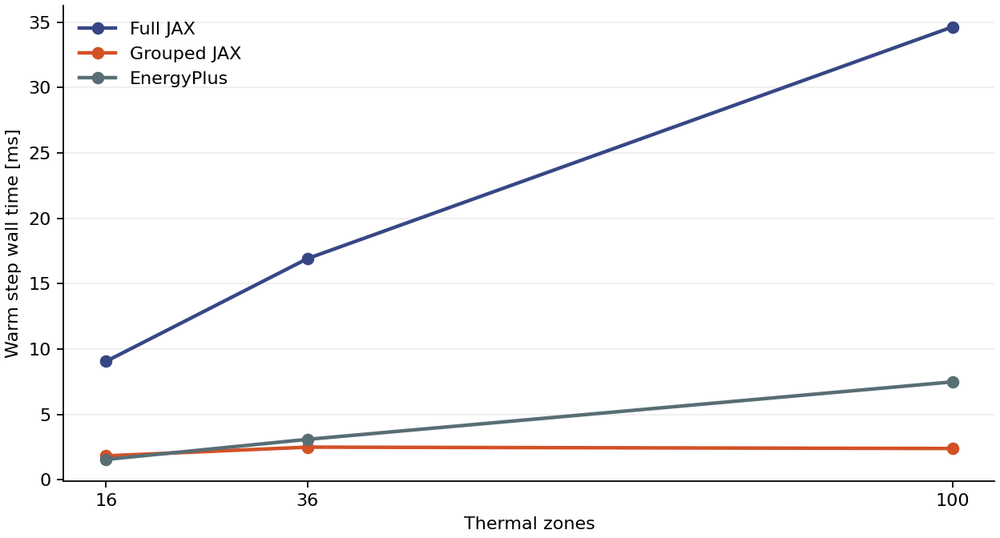

[English](REPORT.md)

# 전체·그룹 SBSim과 상세 EnergyPlus 비교

2024-07-15부터 7일간 USA_IL_Chicago-OHare.Intl.AP.725300_TMY3.epw의 같은 날씨를 사용했다. 구역은
5 × 4 m, 격자는 0.5 m, 외벽 창 폭은 2.0 m다. 시간 간격은 5분이며, 에피소드당 2,016스텝이다.

JAX 0.4.34에서 cpu를 사용했다. 상세 EnergyPlus 입력 버전은 `24.2`이다.

SBSim 전체 노드와 그룹 노드는 같은 외피·공기·열질량 물성과 VAV 계통을 사용한다. 상세 EnergyPlus에는 별도의 외피·부하·공조
구현이 있으므로 엔진 간 온도 차이에는 이런 모델 차이도 들어간다.

실행에 사용한 논리 CPU는 `[4]`이다.

## 고정 설정온도 스텝 시간

주중 07–19시는 21–24 °C, 그 밖의 시간은 19–26 °C 설정을 적용했다. 첫 스텝을 제외한 평균에는 설정온도 적용, 시뮬레이션,
관측과 EnergyPlus 프로세스 통신이 포함된다.

| 존 수 | 엔진        | 초기화 초 | 리셋 초 | 첫 스텝 초 | 이후 ms/스텝 | 상태 수 |
| ----: | ----------- | --------: | ------: | ---------: | -----------: | ------: |
|    16 | Full JAX    |     0.762 |   0.002 |      0.008 |        9.060 |    2945 |
|    16 | Grouped JAX |     0.285 |   0.002 |      0.004 |        1.838 |     129 |
|    16 | EnergyPlus  |     3.725 |   2.317 |      0.003 |        1.564 |       — |
|    36 | Full JAX    |     0.969 |   0.002 |      0.015 |       16.919 |    6565 |
|    36 | Grouped JAX |     0.435 |   0.001 |      0.003 |        2.505 |     253 |
|    36 | EnergyPlus  |     3.832 |   5.079 |      0.005 |        3.101 |       — |
|   100 | Full JAX    |     1.645 |   0.003 |      0.037 |       34.624 |   18101 |
|   100 | Grouped JAX |     0.503 |   0.001 |      0.003 |        2.400 |     621 |
|   100 | EnergyPlus  |     2.591 |  19.924 |      0.010 |        7.493 |       — |

100존의 전체 JAX와 EnergyPlus 스텝 시간은 그룹 JAX의 각각 14.42배와 3.12배였다.

측정값 `timing.csv`

환경과 집계값 `summary.json`
