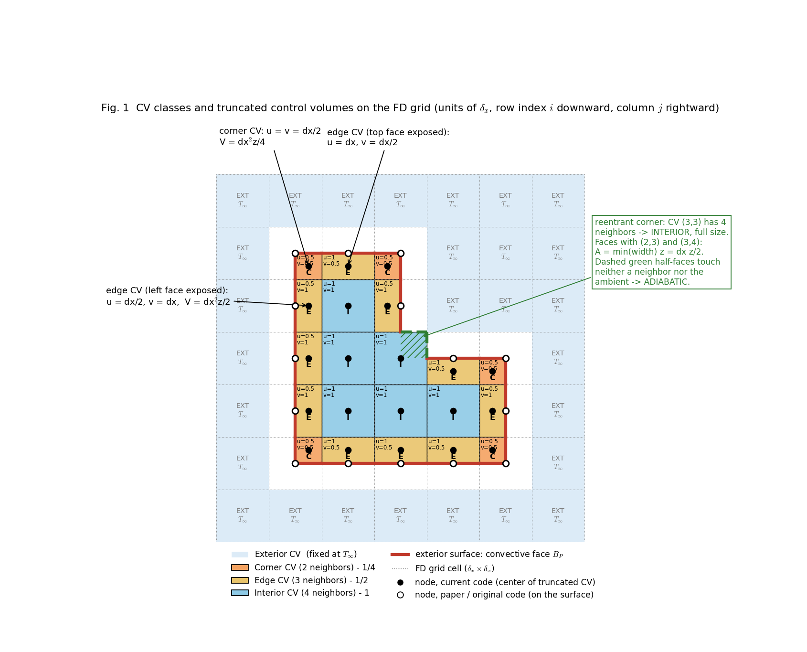
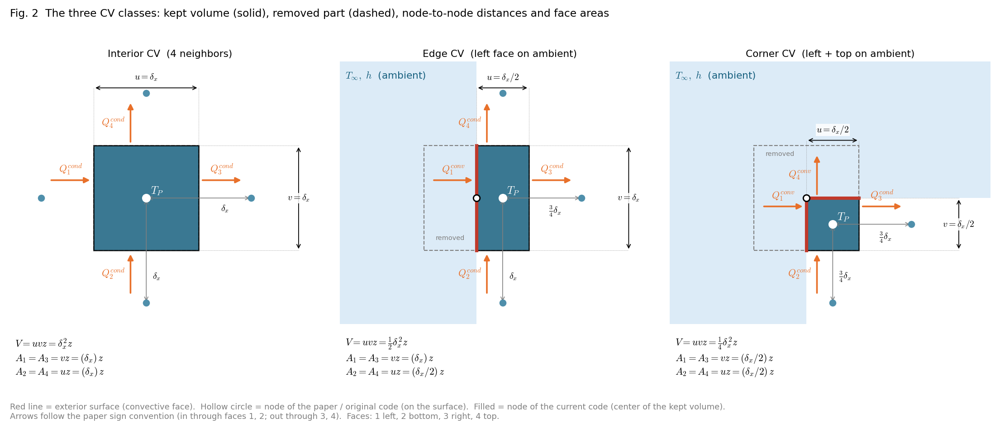
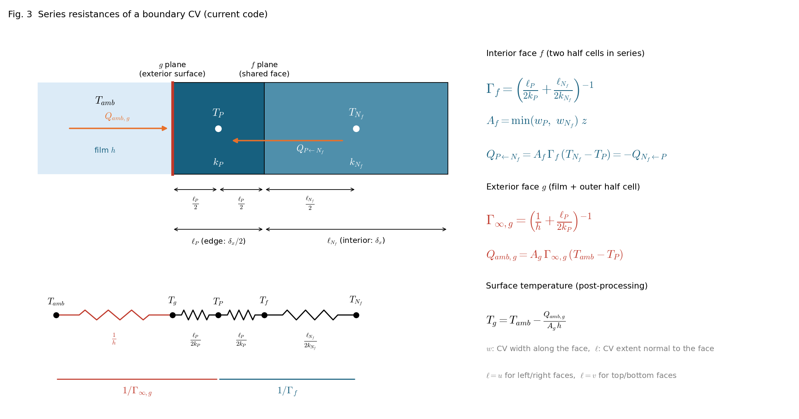
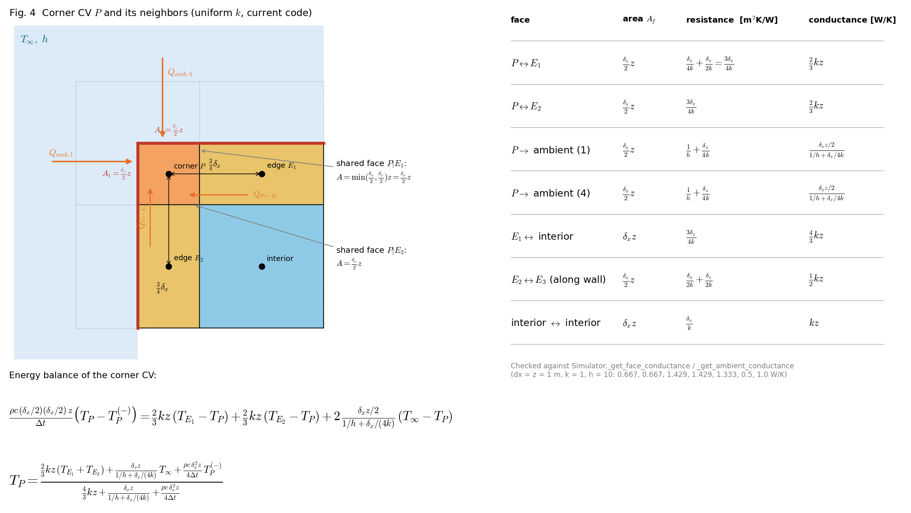
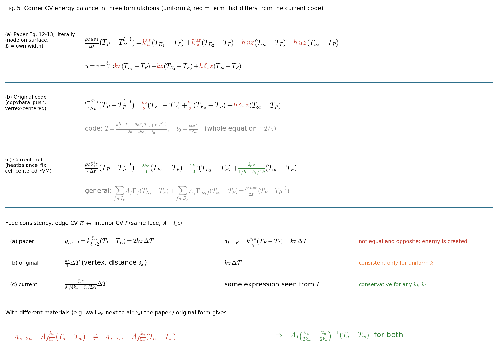
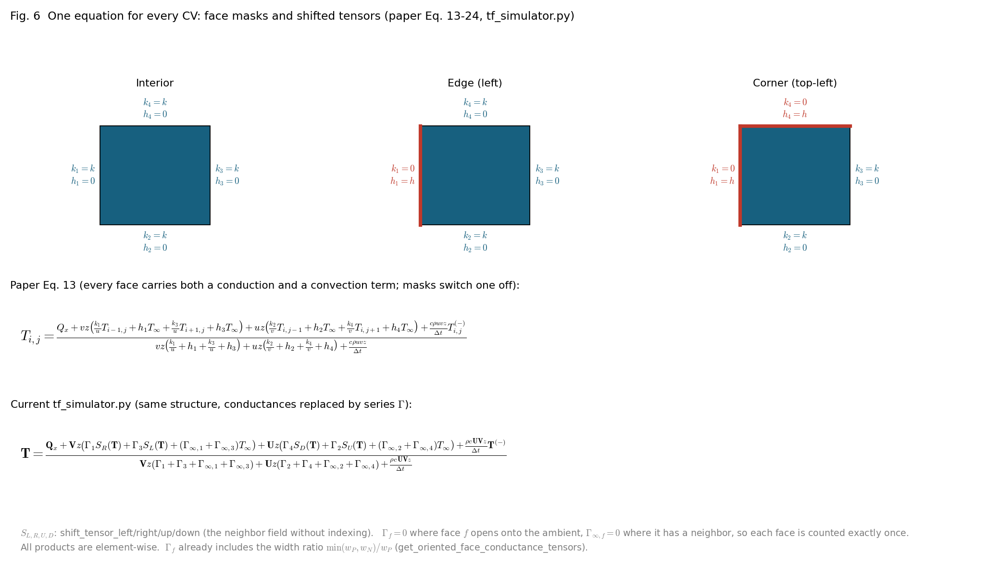

# 경계 CV(Edge/Corner)의 Control Volume 정의와 경계 열전달 계산

**대상**

- 논문: Goldfeder & Sipple (ICLR 2025), *Real-world data and calibrated simulation
    suite…*, Appendix D (pp. 32–38, Eq. 2–24, Fig. 10–12)
- 코드: `smart_control/simulator/simulator.py` (CV별 반복),
    `smart_control/simulator/tf_simulator.py` (격자 전체 텐서)
- 비교 기준: `copybara_push`의 원래 구현과 현재 `heatbalance_fix` 브랜치

**그림**: `reference/figures/boundary_cv/*.png`. 그림을 다시 만들려면
`.venv/bin/python reference/plot_boundary_cv_figures.py`를 실행합니다.

______________________________________________________________________

## 1. 기본 가정

- 바닥과 천장은 단열로 가정합니다. 그래서 각 층은 2D 문제가 되고, CV는 높이 $z$(층고)를 가진 기둥이 되며 옆 방향으로만 열을
    주고받습니다.
- 격자는 정사각형이고 간격은 $\delta_x$입니다. 평면도의 픽셀 하나가 CV 하나입니다. 각 CV는 하나의 온도 $T_{i,j}$를
    가집니다.
- 열전달은 세 가지만 다룹니다.
    - 전도: 이웃 CV와 주고받음
    - 대류: 외기와 주고받으며, 경계 CV에서만 발생
    - 열원 $Q_x$: 디퓨저
- 시간 적분은 implicit(backward Euler)이며, 수렴할 때까지 반복합니다.

$$
\underbrace{\frac{\rho c\,u v z}{\Delta t}\left(T_{i,j}-T_{i,j}^{(-)}\right)}_{\text{축열 } dU/dt}
= Q_x + Q_1 + Q_2 - Q_3 - Q_4 \qquad \text{(논문 Eq. 3, 11)}
$$

면 번호는 left = 1, bottom = 2, right = 3, top = 4입니다. 부호 규약은 면 1과 2로는 열이 들어오고, 면 3과
4로는 나가는 방향을 양으로 둡니다.

## 2. CV 분류와 잘린 Control Volume

| 종류              | 비-외부 이웃 수 | 외기 노출 면 $B_P$ | $u$          | $v$          | 부피                     |
| ----------------- | --------------- | ------------------ | ------------ | ------------ | ------------------------ |
| Exterior          | ≤ 1             | –                  | –            | –            | 계산 안 함, $T=T_\infty$ |
| Corner            | 2               | 2                  | $\delta_x/2$ | $\delta_x/2$ | $\tfrac14\delta_x^2 z$   |
| Edge (좌/우 노출) | 3               | 1                  | $\delta_x/2$ | $\delta_x$   | $\tfrac12\delta_x^2 z$   |
| Edge (상/하 노출) | 3               | 1                  | $\delta_x$   | $\delta_x/2$ | $\tfrac12\delta_x^2 z$   |
| Interior          | 4               | 0                  | $\delta_x$   | $\delta_x$   | $\delta_x^2 z$           |

코드 위치:

- 분류: `simulator.py:_get_cv_temp_estimate`, `tf_simulator.py:classify_cv`
- 길이: `simulator.py:_get_cv_dimensions`,
    `tf_simulator.py:get_cv_dimension_tensors`

`_get_cv_dimensions`는 두 축을 따로 검사합니다. 좌/우 중 한쪽이라도 이웃이 없으면 $u$를 반으로, 상/하 중 한쪽이라도
없으면 $v$를 반으로 줄입니다.

> 축 표기: 코드에서 $u$는 열(j) 방향 길이로, 좌/우 면에 수직입니다. $v$는 행(i) 방향 길이로, 상/하 면에 수직입니다. 논문
> 표기와는 전치되어 있지만 정사각형 격자에서는 결과가 같습니다.

**오목 모서리(reentrant corner)**: Fig. 1의 CV (3,3)은 이웃이 4개이므로 Interior로 분류되고 부피도
온전합니다. 위쪽 이웃 (2,3)과 오른쪽 이웃 (3,4)는 반폭 Edge입니다. 그래서 두 면의 공유 면적은
$A=\min(w_P,w_N)z=\tfrac{\delta_x}{2}z$가 됩니다. 나머지 반쪽 면(초록 점선)은 이웃과도 외기와도 연결되지
않으므로 **단열면으로 처리됩니다**. 이는 코드에서 확인했습니다:
`_get_face_conductance((3,3),(3,4)) = 0.5 W/K` (k = 1, δx = z = 1 m), 그리고 (3,3)의
ambient conductance는 없습니다.

## 3. 왜 Edge는 1/2, Corner는 1/4인가

논문 p.36의 설명은 이렇습니다. FD 온도는 CV 중심값입니다. 그런데 대류에는 벽 외표면 온도가 필요하고, 이 값은 미지수입니다. 그래서
경계 CV의 절점을 외표면 위에 둡니다(Fig. 2의 빈 원). 그러면 원래 CV의 바깥 절반은 건물 밖이 되어 잘려 나갑니다(점선).
Edge는 한 축이 잘려 1/2, Corner는 두 축이 잘려 1/4이 됩니다.

부피가 줄면 세 가지가 함께 바뀝니다.

1. **축열** $C_P=\rho c\,u v z/\Delta t$: Interior : Edge : Corner = 1 : ½ : ¼
2. **면적** $A_1=A_3=vz$, $A_2=A_4=uz$: 잘린 축을 따라 재는 면의 면적이 반으로 줄어듭니다.
3. **절점 간 거리**: 현재 코드는 절점을 잘린 CV의 중심(Fig. 2의 흰 점)에 둡니다. 따라서 Edge 절점은 외표면에서
    $\delta_x/4$ 안쪽에 있고, 안쪽 Interior 절점까지의 거리는 $\tfrac34\delta_x$입니다.

## 4. 경계 열전달: 직렬 저항 모델 (현재 코드)

모든 열 흐름을 conductance [W/K]로 통일합니다. $\ell_{P,f}$는 면 $f$에 수직인 CV 길이입니다. 좌/우 면이면
$u$, 상/하 면이면 $v$입니다.

**내부 공유면 $f$**: 두 반셀이 직렬로 연결됩니다 (`_get_face_conductance`,
`get_oriented_face_conductance_tensors`).

$$
\Gamma_f=\left(\frac{\ell_{P,f}}{2k_P}+\frac{\ell_{N_f,f}}{2k_{N_f}}\right)^{-1},
\qquad
A_f=\begin{cases}\min(v_P,v_{N_f})\,z & \text{좌/우 면}\\ \min(u_P,u_{N_f})\,z & \text{상/하 면}\end{cases}
$$

$$
Q_{P\leftarrow N_f}=A_f\Gamma_f\,(T_{N_f}-T_P)=-\,Q_{N_f\leftarrow P}
$$

**외기 면 $g\in B_P$**: 대류막과 바깥쪽 반셀이 직렬로 연결됩니다 (`_get_ambient_conductance`,
`get_oriented_ambient_conductance_tensors`).

$$
\Gamma_{\infty,g}=\left(\frac1h+\frac{\ell_{P,g}}{2k_P}\right)^{-1},
\qquad
Q_{amb,g}=A_g\Gamma_{\infty,g}\,(T_{amb}-T_P)
$$

**경계 CV 공통 해** (`_get_boundary_cv_temp_estimate`): Corner와 Edge는 같은 함수로 풉니다.

$$
T_P=\frac{\displaystyle\sum_{f\in I_P}A_f\Gamma_f\,T_{N_f}+\sum_{g\in B_P}A_g\Gamma_{\infty,g}\,T_\infty+\frac{\rho c\,uvz}{\Delta t}T_P^{(-)}}
{\displaystyle\sum_{f\in I_P}A_f\Gamma_f+\sum_{g\in B_P}A_g\Gamma_{\infty,g}+\frac{\rho c\,uvz}{\Delta t}}
$$

Corner와 Edge의 차이는 데이터에만 있습니다. $B_P$가 2개인지 1개인지, 그리고 $u$·$v$ 중 어느 쪽이 반으로 줄었는지입니다.
외표면 온도는 해를 구한 뒤 $T_g=T_{amb}-Q_{amb,g}/(A_g h)$로 복원할 수 있습니다.

## 5. Corner CV 상세 (균일 $k$)

| 면                          | $A_f$                  | 저항 [m²K/W]                                                      | conductance [W/K]                       |
| --------------------------- | ---------------------- | ----------------------------------------------------------------- | --------------------------------------- |
| Corner ↔ Edge (외피를 따라) | $\tfrac{\delta_x}{2}z$ | $\tfrac{\delta_x}{4k}+\tfrac{\delta_x}{2k}=\tfrac{3\delta_x}{4k}$ | $\tfrac23 kz$                           |
| Corner → 외기 (면당)        | $\tfrac{\delta_x}{2}z$ | $\tfrac1h+\tfrac{\delta_x}{4k}$                                   | $\dfrac{\delta_x z/2}{1/h+\delta_x/4k}$ |
| Edge → 안쪽 Interior        | $\delta_x z$           | $\tfrac{3\delta_x}{4k}$                                           | $\tfrac43 kz$                           |
| Edge ↔ Edge (외피를 따라)   | $\tfrac{\delta_x}{2}z$ | $\tfrac{\delta_x}{k}$                                             | $\tfrac12 kz$                           |
| Edge → 외기                 | $\delta_x z$           | $\tfrac1h+\tfrac{\delta_x}{4k}$                                   | $\dfrac{\delta_x z}{1/h+\delta_x/4k}$   |
| Interior ↔ Interior         | $\delta_x z$           | $\tfrac{\delta_x}{k}$                                             | $kz$                                    |

이 값들은 실제 `Simulator` 메서드를 호출해 확인했습니다. δx = z = 1 m, k = 1, h = 10일 때 결과는 0.667,
1.429(×2 = 2.857), 1.333, 0.5, 2.857, 1.0 W/K였습니다.

Corner CV의 에너지 균형은 다음과 같습니다.

$$
\frac{\rho c\,\delta_x^2 z}{4\Delta t}\left(T_P-T_P^{(-)}\right)
=\tfrac23 kz\,(T_{E_1}-T_P)+\tfrac23 kz\,(T_{E_2}-T_P)
+\frac{\delta_x z}{1/h+\delta_x/(4k)}\,(T_\infty-T_P)
$$

## 6. 세 가지 정식화 비교

| 항목 (Corner, ÷z)    | (a) 논문 Eq. 13 문자 그대로  | (b) 원래 코드 (vertex) | (c) 현재 코드 (cell-centered) |
| -------------------- | ---------------------------- | ---------------------- | ----------------------------- |
| 절점 위치            | 외표면                       | 외표면                 | 잘린 CV 중심                  |
| 이웃당 전도          | $k$ (2배 과대)               | $k/2$                  | $2k/3$                        |
| 외기 (노출면 2개 합) | $h\delta_x$                  | $h\delta_x$            | $\delta_x/(1/h+\delta_x/4k)$  |
| 축열                 | $\rho c\delta_x^2/4\Delta t$ | 같음                   | 같음                          |
| 면 양쪽 열량 일치    | ✗                            | 균일 $k$일 때만        | ○ (재료가 달라도)             |
| 벽체 반셀 저항       | ✗                            | ✗                      | ○                             |

- **(a)** 전도 길이 $L$로 자기 CV 폭을 씁니다(Eq. 7–8). 그래서 Edge→Interior는 $2kz$인데
    Interior→Edge는 $kz$가 되어, 같은 면을 두 CV가 다르게 봅니다. 결과적으로 에너지가 생겨납니다.

- **(b)** 원래 코드는 `copybara_push:simulator.py`에 다음과 같이 하드코딩되어 있었습니다.

    - Corner:
        $T=\dfrac{k\sum T_n+2h\delta_x T_\infty+t_0T^{(-)}}{2k+2h\delta_x+t_0}$,
        $t_0=\dfrac{\rho c\delta_x^2}{2\Delta t}$
    - Edge: 외피 방향 이웃에 가중치 0.5를 줍니다.

    이는 절점 간 거리를 $\delta_x$로 둔 vertex-centered FD와 같습니다. 하지만 $k_P$ 하나만 쓰므로, 벽과 공기처럼
    재료가 다른 면에서는 보존되지 않습니다.

- **(c)** 반셀 직렬 저항과 공유 면적 $\min(w_P,w_N)z$를 쓰므로, 재료가 달라도 면 양쪽에서 같은 열량을 계산합니다.

## 7. 하나의 식으로 텐서화 (논문 Eq. 13–24, `tf_simulator.py`)

논문의 아이디어는 모든 면에 전도 항과 대류 항을 함께 쓰고, 마스크로 하나를 끄는 것입니다. 면 너머가 건물이면 $k_f=k,\ h_f=0$,
외부이면 $k_f=0,\ h_f=h$로 둡니다. 그러면 CV 종류와 상관없이 같은 식이 됩니다.

$$
T_{i,j}=\frac{Q_x+vz\!\left(\frac{k_1}{u}T_{i-1,j}+h_1T_\infty+\frac{k_3}{u}T_{i+1,j}+h_3T_\infty\right)+uz\!\left(\frac{k_2}{v}T_{i,j-1}+h_2T_\infty+\frac{k_4}{v}T_{i,j+1}+h_4T_\infty\right)+\frac{c\rho uvz}{\Delta t}T_{i,j}^{(-)}}
{vz\!\left(\frac{k_1}{u}+h_1+\frac{k_3}{u}+h_3\right)+uz\!\left(\frac{k_2}{v}+h_2+\frac{k_4}{v}+h_4\right)+\frac{c\rho uvz}{\Delta t}}
$$

현재 `tf_simulator.py`도 같은 구조입니다. 다만 $k_f/\ell$ 대신 $\Gamma_f$를, $h_f$ 대신
$\Gamma_{\infty,f}$를 씁니다.

- $\Gamma_f$는 외기 면에서 0이고, $\Gamma_{\infty,f}$는 이웃이 있는 면에서 0입니다. 따라서 각 면은 정확히 한
    번만 계산됩니다.
- 이웃 온도는 인덱싱 대신 `shift_tensor_left/right/up/down`으로 온도장 전체를 밀어서 얻습니다.
- 분모는 `_get_denominator`에서 조립합니다:
    $\mathbf V z(\Gamma_1+\Gamma_3+\Gamma_{\infty,1}+\Gamma_{\infty,3})+\mathbf U z(\dots)+\rho c\mathbf{UV}z/\Delta t$
- `get_oriented_face_conductance_tensors`는 $\Gamma_f$에 $\min(w_P,w_N)/w_P$를 곱해
    둡니다. 그래서 자기 면적($\mathbf V z$ 또는 $\mathbf U z$)을 곱했을 때 공유 면적이 됩니다.

## 8. 논문 Appendix D의 표기 오류 및 불일치

- **Eq. 12**: $h_2$, $h_4$ 대류 항의 면적이 $vz$로 적혀 있습니다. 하단/상단 면이므로 $uz$가 맞습니다. Eq.
    13에서는 올바르게 $uz$로 묶여 있습니다.
- **Eq. 16/17과 Eq. 20/21의 방향이 반대입니다**: $k_2$는 $(i,j-1)$, $k_4$는 $(i,j+1)$에
    대응하는데, $h_2$는 $(i,j+1)$, $h_4$는 $(i,j-1)$이 Exterior일 때 켜집니다.
- **Eq. 22**: $u$가 "TOP/BOTTOM EDGE"에서 반으로 줄어든다고 되어 있습니다. 그러나 Fig. 12(왼쪽 Edge,
    $u=\delta_x/2$)와 맞지 않습니다. 코드는 이 때문에 축 규약을 따로 주석으로 명시합니다.
- **Eq. 7–8**: 전도 길이로 자기 CV 폭을 씁니다. 이 때문에 6절 (a)의 과대평가와 비보존 문제가 생깁니다.
